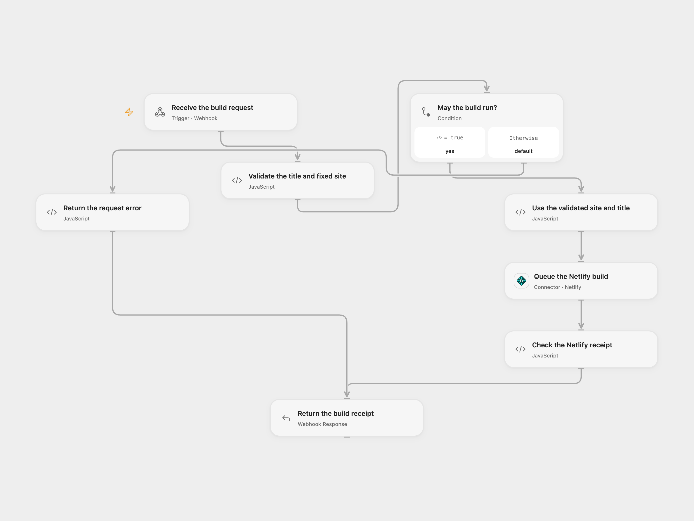

# Trigger a Netlify Build from a Webhook

Queue a build of a fixed Git-linked Netlify site and return its build and deploy IDs.

<!-- template-actions:start -->
 
<!-- template-actions:end -->

<picture>
  <source media="(prefers-color-scheme: dark)" srcset="preview-dark.png">
  
</picture>

## Setup

1. Use a Netlify site connected to a Git repository with builds enabled. Copy its Project ID from Netlify and enter it as the site ID in **Validate the title and fixed site** and select a Netlify connection that can queue builds for that site in **Queue the Netlify build**.
2. In **Receive the build request**, select **Header** authentication. Use `X-Netlify-Webhook-Key` as the header name and bind a secret variable as its value. Publish with **Enable Builds** off, verify a request without the header returns HTTP 401, then enable builds in **Validate the title and fixed site** and publish again.
3. Send a POST with the secret header, `Content-Type: application/json` and a body such as `{"data":{"title":"Publish spring catalog"}}`.

## Behavior

The workflow uses only the site selected during setup. It uses the supplied title and Netlify builds the latest commit on the site's production branch. The same request receives HTTP 202 and the Netlify build and deploy IDs after Netlify accepts the build. Check the site's deploy history for build progress and publication. [Netlify build API](https://open-api.netlify.com/#tag/build/operation/createSiteBuild)

The build title must contain 1–200 characters on one line. An invalid title returns HTTP 400. The workflow submits one build request per accepted webhook and does not retry. If the webhook times out or reports a provider error, check the site's build history before repeating the request.

In n8n

1. Enter the site ID in **Validate the title and fixed site**. Select a Netlify API credential in **Queue the Netlify build**. Its access token must be able to queue builds for the chosen site.
2. Set a **Header Auth** credential in **Receive the build request** with the name `X-Netlify-Webhook-Key` and a secret value. Test authentication with builds disabled. Set `enableBuilds` to `true` in **Validate the title and fixed site**, activate the workflow and send requests to its production webhook URL. The webhook returns HTTP 403 for a missing or incorrect key.

Inspiration &amp; credits

## Changes to the source

The source called Netlify's file-deploy endpoint with a title and no file content. This workflow queues a build of the existing Git-linked site using the same title and returns IDs after Netlify accepts it. The webhook now requires caller authentication. [Netlify file deploy API](https://docs.netlify.com/api-and-cli-guides/api-guides/get-started-with-api/#deploy-with-the-api)

Adapted from [Netlify deployment webhook](https://github.com/Zie619/n8n-workflows/blob/ae8cf6dc5b873cbb4f74587aa9180ed3a9f70682/workflows/Netlify/0104_Netlify_Webhook_Automate_Webhook.json) in [Zie619/n8n-workflows](https://github.com/Zie619/n8n-workflows). Attribution: Zie619 / n8n-workflows.

The collection’s [MIT notice](https://github.com/Zie619/n8n-workflows/blob/94007c1445d9258a7da116646b79473e7c7c3282/LICENSE) is pinned at a later revision. This is the collection notice at that revision; it does not establish a separate original template author's license. Our changes are listed above; see [repository licensing](../../README.md#licensing).

> MIT License
>
> Copyright (c) 2025 Zie619
>
> Permission is hereby granted, free of charge, to any person obtaining a copy
> of this software and associated documentation files (the "Software"), to deal
> in the Software without restriction, including without limitation the rights
> to use, copy, modify, merge, publish, distribute, sublicense, and/or sell
> copies of the Software, and to permit persons to whom the Software is
> furnished to do so, subject to the following conditions:
>
> The above copyright notice and this permission notice shall be included in all
> copies or substantial portions of the Software.
>
> THE SOFTWARE IS PROVIDED "AS IS", WITHOUT WARRANTY OF ANY KIND, EXPRESS OR
> IMPLIED, INCLUDING BUT NOT LIMITED TO THE WARRANTIES OF MERCHANTABILITY,
> FITNESS FOR A PARTICULAR PURPOSE AND NONINFRINGEMENT. IN NO EVENT SHALL THE
> AUTHORS OR COPYRIGHT HOLDERS BE LIABLE FOR ANY CLAIM, DAMAGES OR OTHER
> LIABILITY, WHETHER IN AN ACTION OF CONTRACT, TORT OR OTHERWISE, ARISING FROM,
> OUT OF OR IN CONNECTION WITH THE SOFTWARE OR THE USE OR OTHER DEALINGS IN THE
> SOFTWARE.

