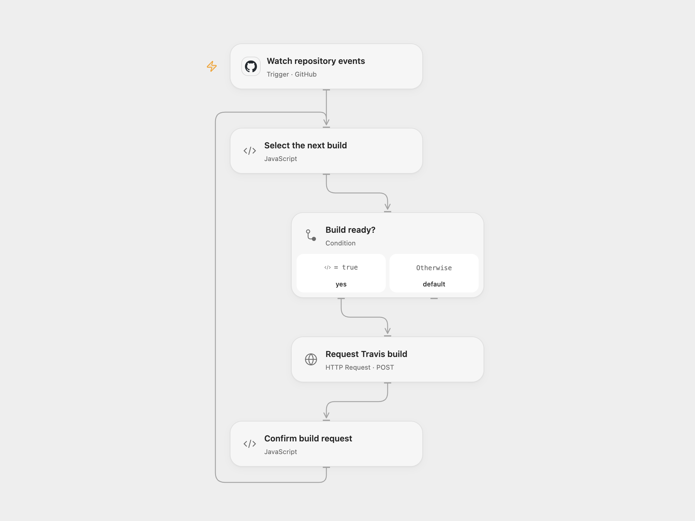

# Trigger Travis Builds from GitHub

Request a Travis CI build when a GitHub repository is pushed or a pull request opens.

<picture>
  <source media="(prefers-color-scheme: dark)" srcset="preview-dark.png">
  
</picture>

[Open Flow JSON](templates/trigger-travis-builds-from-github.openflow.json) · [n8n JSON](templates/trigger-travis-builds-from-github.n8n.json)

## Setup

Connect GitHub and set the repository owner and name in **Watch repository events**. Set the Travis branch in **Select the next build**; the same branch is used for both event types. Store the full value `token YOUR_TRAVIS_TOKEN` in Secret Variable `TRAVIS_AUTHORIZATION`. The Travis account needs permission to request builds for that repository. Enable persistent State and prevent overlapping runs.

In n8n configure the GitHub credential, repository and branch, and an HTTP Header Auth credential named `Authorization` with value `token YOUR_TRAVIS_TOKEN`, and create a Data Table with text columns delivery_id and status for the checkpoint nodes. Activate one format.

## Behavior

A push or an opened pull request requests a build for the repository named in the GitHub event. Other pull request actions are ignored. GitHub webhook redeliveries can occur; a pending or completed delivery is not automatically submitted twice. A successful request means Travis accepted it, not that the build succeeded.

If the request fails or its outcome is unknown, inspect Travis. In Open Flow set **acknowledgeId** to the pending delivery ID after inspection, then send another qualifying event; the acknowledged delivery is treated as handled and queued events continue. Clear the field afterward. In n8n mark the pending Data Table row done if handled, or remove it only when retry is safe. IDs accumulate until deliberately cleared.

Inspiration &amp; credits

## Changes to the source

- Configure the repository and branch and keep the Travis token in a Secret or credential.
- Record each pending delivery before requesting a build and avoid automatic replay after an uncertain write.

Adapted from [Build on GitHub push or pull request](https://github.com/Zie619/n8n-workflows/blob/ae8cf6dc5b873cbb4f74587aa9180ed3a9f70682/workflows/Travisci/0060_Travisci_GitHub_Automate_Triggered.json) in [Zie619/n8n-workflows](https://github.com/Zie619/n8n-workflows). The source export does not identify a separate template author or license.

The collection’s [MIT notice](https://github.com/Zie619/n8n-workflows/blob/94007c1445d9258a7da116646b79473e7c7c3282/LICENSE) is pinned at a later revision. This is the collection notice at that revision; it does not establish a separate original template author's license. Our changes are listed above; see [repository licensing](../../README.md#licensing).

> MIT License
>
> Copyright (c) 2025 Zie619
>
> Permission is hereby granted, free of charge, to any person obtaining a copy
> of this software and associated documentation files (the "Software"), to deal
> in the Software without restriction, including without limitation the rights
> to use, copy, modify, merge, publish, distribute, sublicense, and/or sell
> copies of the Software, and to permit persons to whom the Software is
> furnished to do so, subject to the following conditions:
>
> The above copyright notice and this permission notice shall be included in all
> copies or substantial portions of the Software.
>
> THE SOFTWARE IS PROVIDED "AS IS", WITHOUT WARRANTY OF ANY KIND, EXPRESS OR
> IMPLIED, INCLUDING BUT NOT LIMITED TO THE WARRANTIES OF MERCHANTABILITY,
> FITNESS FOR A PARTICULAR PURPOSE AND NONINFRINGEMENT. IN NO EVENT SHALL THE
> AUTHORS OR COPYRIGHT HOLDERS BE LIABLE FOR ANY CLAIM, DAMAGES OR OTHER
> LIABILITY, WHETHER IN AN ACTION OF CONTRACT, TORT OR OTHERWISE, ARISING FROM,
> OUT OF OR IN CONNECTION WITH THE SOFTWARE OR THE USE OR OTHER DEALINGS IN THE
> SOFTWARE.

