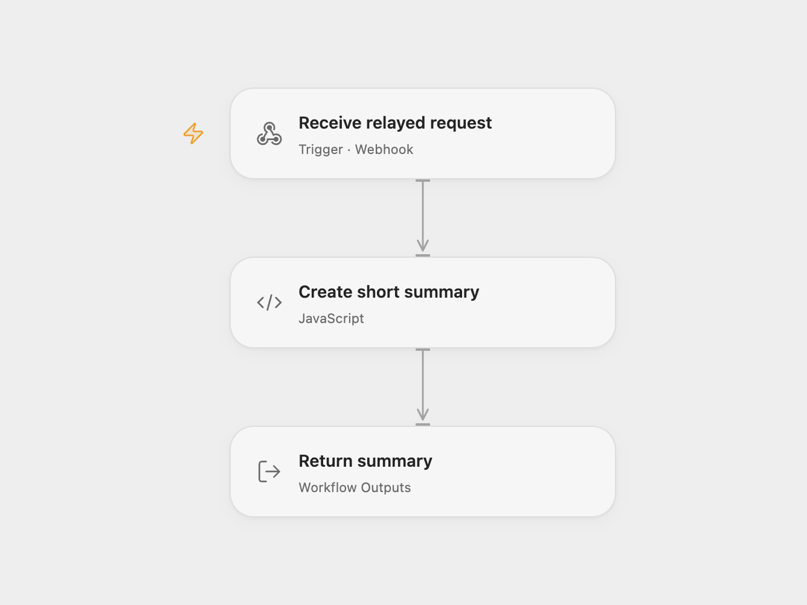

# Truncate a Text Summary via Webhook

Return a short text excerpt from a webhook request.

<picture>
  <source media="(prefers-color-scheme: dark)" srcset="preview-dark.png">
  
</picture>

[Open Flow JSON](templates/truncate-text-summary-webhook.openflow.json) · [n8n JSON](templates/truncate-text-summary-webhook.n8n.json)

## Setup and use

Import the supplied n8n workflow. For n8n mode enable **Webhook** and disable **Open Flow relay webhook**. For Open Flow mode disable **Webhook**, enable the relay, set the deployed Open Flow webhook URL in **Forward complete request**, and activate n8n. Send a JSON POST containing text to the selected n8n production webhook. Neither endpoint verifies callers; restrict access as needed.

## Behavior

Trim the text and return it as summary. Text longer than 240 characters is truncated to the first 240 characters followed by an ellipsis. Missing or empty text uses the source's example phrase. The n8n relay forwards the complete JSON body and waits for the Open Flow response. The Open Flow webhook waits up to 60 seconds.

The source also contains a disabled, disconnected OpenAI node. The default workflow uses the local truncation step and does not call an AI model.

Inspiration &amp; credits

## Changes to the source

- Add an n8n relay for complete arbitrary JSON requests and synchronous Open Flow responses.

Adapted from [Text summary webhook](https://github.com/Zie619/n8n-workflows/blob/94007c1445d9258a7da116646b79473e7c7c3282/workflows/Templates/9004_AI_Summarizer_Template_Webhook.json) in [Zie619/n8n-workflows](https://github.com/Zie619/n8n-workflows). The source export does not identify a separate template author or license.

The collection’s [MIT notice](https://github.com/Zie619/n8n-workflows/blob/94007c1445d9258a7da116646b79473e7c7c3282/LICENSE) is pinned at a later revision. This is the collection notice at that revision; it does not establish a separate original template author's license. Our changes are listed above; see [repository licensing](../../README.md#licensing).

> MIT License
>
> Copyright (c) 2025 Zie619
>
> Permission is hereby granted, free of charge, to any person obtaining a copy
> of this software and associated documentation files (the "Software"), to deal
> in the Software without restriction, including without limitation the rights
> to use, copy, modify, merge, publish, distribute, sublicense, and/or sell
> copies of the Software, and to permit persons to whom the Software is
> furnished to do so, subject to the following conditions:
>
> The above copyright notice and this permission notice shall be included in all
> copies or substantial portions of the Software.
>
> THE SOFTWARE IS PROVIDED "AS IS", WITHOUT WARRANTY OF ANY KIND, EXPRESS OR
> IMPLIED, INCLUDING BUT NOT LIMITED TO THE WARRANTIES OF MERCHANTABILITY,
> FITNESS FOR A PARTICULAR PURPOSE AND NONINFRINGEMENT. IN NO EVENT SHALL THE
> AUTHORS OR COPYRIGHT HOLDERS BE LIABLE FOR ANY CLAIM, DAMAGES OR OTHER
> LIABILITY, WHETHER IN AN ACTION OF CONTRACT, TORT OR OTHERWISE, ARISING FROM,
> OUT OF OR IN CONNECTION WITH THE SOFTWARE OR THE USE OR OTHER DEALINGS IN THE
> SOFTWARE.

