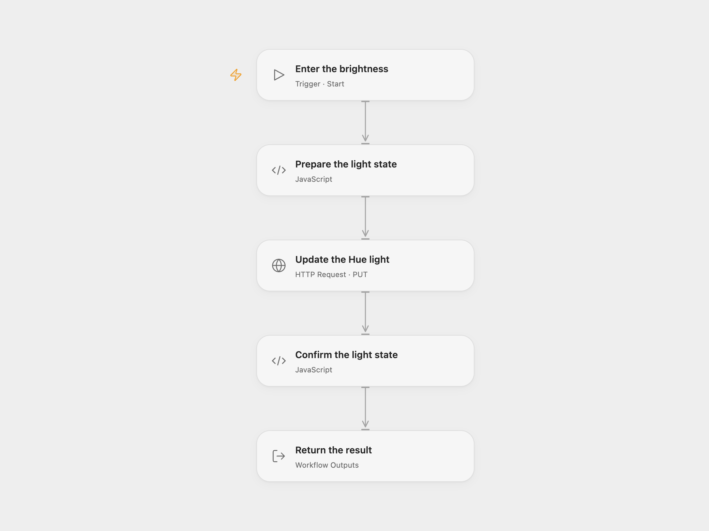

# Turn On a Philips Hue Light

Turn on a Philips Hue light and set its brightness.

<picture>
  <source media="(prefers-color-scheme: dark)" srcset="preview-dark.png">
  
</picture>

[Open Flow JSON](templates/turn-on-a-philips-hue-light.openflow.json) · [n8n JSON](templates/turn-on-a-philips-hue-light.n8n.json)

## Setup

Connect a Philips Hue account and authorize a Hue application for remote API access using the [Hue developer documentation](https://developers.meethue.com/develop/hue-api/remote-authentication-oauth/). Obtain an OAuth access token, an authorized Bridge application username and the light ID.

In Open Flow, create a secret Variable containing the full Hue remote V1 URL `https://api.meethue.com/route/api/BRIDGE_USERNAME/lights/LIGHT_ID/state`, replacing both placeholders, and bind it to **Update the Hue light** → **URL**. Bind the current OAuth access token as a separate secret Variable to that node's Bearer token. The token expires and must be refreshed before it expires. Start the workflow with an integer brightness from 1 to 254; the source uses 90.

In n8n, connect your Philips Hue OAuth2 credential and select the light in **Philips Hue**. The native node finds or registers its Bridge application username. Adjust the brightness there if needed.

## Behavior

Each run turns on the light and sets its brightness. Open Flow checks that the Bridge confirms both changes for the same light. Open Flow stops if the Bridge reports an error or does not confirm both changes; an uncertain HTTP request also stops without an automatic retry. The n8n node can return an empty result when the Bridge reports an error inside an HTTP 200 response, so inspect its output. The Hue account and Bridge must be connected and reachable through the Hue remote service.

Inspiration &amp; credits

## Changes to the source

- Replace the example light ID with configuration. Open Flow uses the Hue remote API with a manually supplied, expiring OAuth token and pre-authorized Bridge username; n8n retains its Philips Hue OAuth2 node and can register its username.

Adapted from [Turn on a light and set its brightness](https://github.com/Zie619/n8n-workflows/blob/ae8cf6dc5b873cbb4f74587aa9180ed3a9f70682/workflows/Manual/1053_Manual_Philipshue_Automation_Triggered.json) in [Zie619/n8n-workflows](https://github.com/Zie619/n8n-workflows). The source export does not identify a separate template author or license.

The collection’s [MIT notice](https://github.com/Zie619/n8n-workflows/blob/94007c1445d9258a7da116646b79473e7c7c3282/LICENSE) is pinned at a later revision. This is the collection notice at that revision; it does not establish a separate original template author's license. Our changes are listed above; see [repository licensing](../../README.md#licensing).

> MIT License
>
> Copyright (c) 2025 Zie619
>
> Permission is hereby granted, free of charge, to any person obtaining a copy
> of this software and associated documentation files (the "Software"), to deal
> in the Software without restriction, including without limitation the rights
> to use, copy, modify, merge, publish, distribute, sublicense, and/or sell
> copies of the Software, and to permit persons to whom the Software is
> furnished to do so, subject to the following conditions:
>
> The above copyright notice and this permission notice shall be included in all
> copies or substantial portions of the Software.
>
> THE SOFTWARE IS PROVIDED "AS IS", WITHOUT WARRANTY OF ANY KIND, EXPRESS OR
> IMPLIED, INCLUDING BUT NOT LIMITED TO THE WARRANTIES OF MERCHANTABILITY,
> FITNESS FOR A PARTICULAR PURPOSE AND NONINFRINGEMENT. IN NO EVENT SHALL THE
> AUTHORS OR COPYRIGHT HOLDERS BE LIABLE FOR ANY CLAIM, DAMAGES OR OTHER
> LIABILITY, WHETHER IN AN ACTION OF CONTRACT, TORT OR OTHERWISE, ARISING FROM,
> OUT OF OR IN CONNECTION WITH THE SOFTWARE OR THE USE OR OTHER DEALINGS IN THE
> SOFTWARE.

