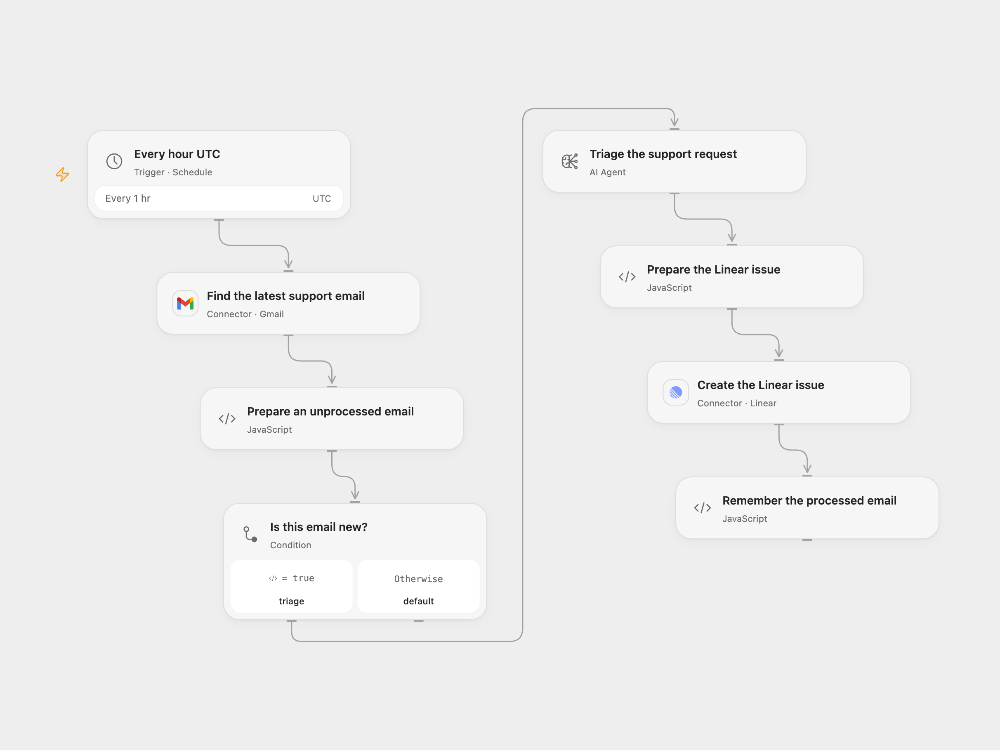

# Turn Support Gmail into Linear Issues

Triage the latest matching support email with AI and create a Linear issue.

<picture>
  <source media="(prefers-color-scheme: dark)" srcset="preview-dark.png">
  
</picture>

[Open Flow JSON](templates/turn-support-gmail-into-linear-issues.openflow.json) · [n8n JSON](templates/turn-support-gmail-into-linear-issues.n8n.json)

## Setup

Connect Gmail and set the support recipient in **Find the latest support email**. Connect Linear and set the team and state IDs in **Create the Linear issue**. Configure the model service and persistent workflow State. In n8n, use the same mailbox, recipient, Linear team and state, and a compatible model. Activate one format and avoid overlapping runs.

## Behavior

Every hour in UTC the workflow reads the single newest matching Gmail message. If it has not been processed, AI produces a factual issue summary, description, labels and priority, then creates a Linear issue. Labels are written as hashtags in the description. Source priorities 1–4 map directly; 5 maps to Linear Low (4). Open Flow uses a single-round Agent; n8n retains the source chain and expects an HTML message body for its Markdown conversion. Open Flow starts on the minute boundary; n8n uses a fixed second within the minute.

Only the latest message is checked each hour, so intermediate messages may be missed. Message IDs are remembered after a confirmed issue; State must fit host limits. A failed or uncertain Linear write may have created an issue. Check Linear before retrying; after an uncertain write the next run may create a duplicate. Keep email content, model access and execution history restricted. Review AI-generated issues for accuracy.

## Changes to the source

- Replace private mailbox and Linear IDs, validate the model output and map priority 5 to Linear Low.
- Remember an email only after a confirmed issue instead of marking it before the model and write. Open Flow passes plain text or HTML body to the Agent; n8n retains its HTML-to-Markdown node. Both use UTC instead of the source instance timezone.

Source and license

Adapted from [Automatically create Linear issues from Gmail support request messages](https://github.com/Zie619/n8n-workflows/blob/ae8cf6dc5b873cbb4f74587aa9180ed3a9f70682/workflows/Schedule/0912_Schedule_Removeduplicates_Create_Scheduled.json) in [Zie619/n8n-workflows](https://github.com/Zie619/n8n-workflows). The matching [n8n listing](https://n8n.io/workflows/3899-automatically-create-linear-issues-from-gmail-support-request-messages/) credits Jimleuk. No separate original template license was found.

The collection’s [MIT notice](https://github.com/Zie619/n8n-workflows/blob/94007c1445d9258a7da116646b79473e7c7c3282/LICENSE) is pinned at a later revision. This is the collection notice at that revision; it does not establish a separate original template author's license. Our changes are listed above; see [repository licensing](../../README.md#licensing).

> MIT License
>
> Copyright (c) 2025 Zie619
>
> Permission is hereby granted, free of charge, to any person obtaining a copy
> of this software and associated documentation files (the "Software"), to deal
> in the Software without restriction, including without limitation the rights
> to use, copy, modify, merge, publish, distribute, sublicense, and/or sell
> copies of the Software, and to permit persons to whom the Software is
> furnished to do so, subject to the following conditions:
>
> The above copyright notice and this permission notice shall be included in all
> copies or substantial portions of the Software.
>
> THE SOFTWARE IS PROVIDED "AS IS", WITHOUT WARRANTY OF ANY KIND, EXPRESS OR
> IMPLIED, INCLUDING BUT NOT LIMITED TO THE WARRANTIES OF MERCHANTABILITY,
> FITNESS FOR A PARTICULAR PURPOSE AND NONINFRINGEMENT. IN NO EVENT SHALL THE
> AUTHORS OR COPYRIGHT HOLDERS BE LIABLE FOR ANY CLAIM, DAMAGES OR OTHER
> LIABILITY, WHETHER IN AN ACTION OF CONTRACT, TORT OR OTHERWISE, ARISING FROM,
> OUT OF OR IN CONNECTION WITH THE SOFTWARE OR THE USE OR OTHER DEALINGS IN THE
> SOFTWARE.

