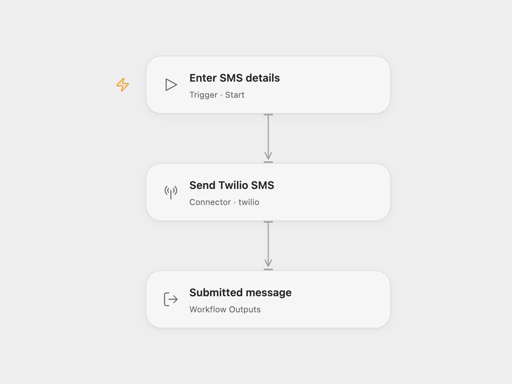

# Twilio SMS Sender

Submit one SMS to Twilio with a sender number, recipient number and message.

<picture>
  <source media="(prefers-color-scheme: dark)" srcset="preview-dark.png">
  
</picture>

[Open Flow JSON](templates/twilio-sms-sender.openflow.json) · [n8n JSON](templates/twilio-sms-sender.n8n.json)

## Setup

Select your Twilio account in **Send Twilio SMS**, using its Account SID and Auth Token. Run with **From**, **To** and **Body**. Use a Twilio sender that supports SMS and an allowed recipient, both in E.164 format. Trial accounts may require a verified recipient. In n8n, select Twilio credentials and set **From**, **To** and **Message** in **Twilio**.

Each run submits one text message. The workflow does not enable WhatsApp, add media or set a delivery callback. Open Flow returns the Action’s message SID, account SID, status, numbers and body; n8n returns Twilio’s full message record. An accepted or queued message is not proof of delivery to the phone.

Twilio messaging charges and account restrictions apply. Failed requests stop without an automatic retry. The workflow has no history or duplicate detection; check Twilio before repeating a request whose result is uncertain.

## Changes to the source

- Make the source’s default SMS/send operation explicit.
- Require the sender, recipient and message as Open Flow run inputs.
- Expose the submitted message details.

## Source and license

Adapted from [A workflow with the Twilio node](https://github.com/Zie619/n8n-workflows/blob/ae8cf6dc5b873cbb4f74587aa9180ed3a9f70682/workflows/Manual/0949_Manual_Twilio_Automate_Triggered.json) in [Zie619/n8n-workflows](https://github.com/Zie619/n8n-workflows). The source export does not identify a separate template author or license.

The collection’s [MIT notice](https://github.com/Zie619/n8n-workflows/blob/94007c1445d9258a7da116646b79473e7c7c3282/LICENSE) is pinned at a later revision. This is the collection notice at that revision; it does not establish a separate original template author's license. Our changes are listed above; see [repository licensing](../../README.md#licensing).

> MIT License
>
> Copyright (c) 2025 Zie619
>
> Permission is hereby granted, free of charge, to any person obtaining a copy
> of this software and associated documentation files (the "Software"), to deal
> in the Software without restriction, including without limitation the rights
> to use, copy, modify, merge, publish, distribute, sublicense, and/or sell
> copies of the Software, and to permit persons to whom the Software is
> furnished to do so, subject to the following conditions:
>
> The above copyright notice and this permission notice shall be included in all
> copies or substantial portions of the Software.
>
> THE SOFTWARE IS PROVIDED "AS IS", WITHOUT WARRANTY OF ANY KIND, EXPRESS OR
> IMPLIED, INCLUDING BUT NOT LIMITED TO THE WARRANTIES OF MERCHANTABILITY,
> FITNESS FOR A PARTICULAR PURPOSE AND NONINFRINGEMENT. IN NO EVENT SHALL THE
> AUTHORS OR COPYRIGHT HOLDERS BE LIABLE FOR ANY CLAIM, DAMAGES OR OTHER
> LIABILITY, WHETHER IN AN ACTION OF CONTRACT, TORT OR OTHERWISE, ARISING FROM,
> OUT OF OR IN CONNECTION WITH THE SOFTWARE OR THE USE OR OTHER DEALINGS IN THE
> SOFTWARE.
