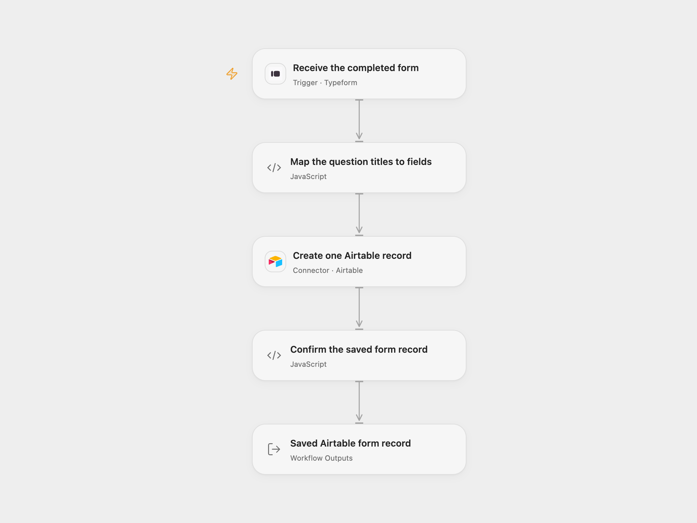

# Typeform Answers to Airtable

Save one Airtable record when someone completes the selected Typeform form.

<picture>
  <source media="(prefers-color-scheme: dark)" srcset="preview-dark.png">
  
</picture>

[Open Flow JSON](templates/typeform-answers-to-airtable.openflow.json) · [n8n JSON](templates/typeform-answers-to-airtable.n8n.json)

## Setup

In **Receive the completed form**, connect Typeform and replace **Form ID**. The account must be allowed to read that form and register its webhook. Enable the workflow after configuration.

In **Create one Airtable record**, connect an Airtable Personal Access Token and replace **Base ID** and **Table ID or Name**. The token needs `data.records:write` and access to that base. Create writable Airtable columns whose names match the Typeform question titles after the conversion described below. Their types must accept the actual answer values. The workflow does not create columns or coerce field types.

In n8n, select **Typeform API** credentials on the trigger and **Airtable Personal Access Token API** credentials on **Create one Airtable record**. Set the same form, base and table IDs. Keep the trigger’s raw response settings, Airtable **Append** operation and **Add All Fields** enabled, with type conversion disabled. This replaces the source’s legacy Airtable API-key setup with PAT authentication. Activate one format for this process.

## Behavior

Every completed submission creates one record. Only the supplied answers are mapped; submission metadata and hidden fields are not copied.

Question titles become Airtable field names. As in the source, `{{` in a title becomes `[` and `}}` becomes `]`. A single-choice answer uses its label; a multiple-choice answer uses its labels array. Text, numbers, booleans, dates, URLs and other supplied answer values retain their JSON values. For a file-upload answer, this records its URL value in a compatible Airtable field; it does not upload an attachment or fetch file bytes.

The source Airtable append helper removes a field named exactly `id`. This template preserves that rule. Rename that question if its answer must be stored. Question titles must be unique after conversion. Missing definitions, ambiguous duplicate titles, invalid answers or a submission with no remaining fields fail before any Airtable write. A later question-title or field-type change may require updating the Airtable table.

Airtable receives one record with type conversion disabled and returns the saved record. The result keeps the complete record, including its ID, fields and any extra response properties. Airtable may omit empty field values in its response. A rejected or uncertain creation fails the run. A record can already exist when its response is lost or invalid; check Airtable before repeating the submission or replaying the run. The workflow adds no retry or cross-run submission history.

Full answers and record receipts must fit the inspected Open Flow host’s 1 MiB per-Code input/result budget; oversized data fails without truncation. Open Flow identifies trigger deliveries by the Typeform response token. The n8n trigger adds no submission history. Manual replays or uncertain writes can create duplicate records in either format.

Inspiration &amp; credits

## Changes to the source

- Replace empty form/base/table settings and legacy Airtable authentication with explicit configuration and PAT credentials.
- Make the original simplified-answer, all-fields and no-typecast defaults explicit.
- Reject ambiguous or incomplete answer mappings before creating a record and verify the returned record.

Adapted from [Typeform answers appended to Airtable](https://github.com/Zie619/n8n-workflows/blob/ae8cf6dc5b873cbb4f74587aa9180ed3a9f70682/workflows/Typeform/1018_Typeform_Airtable_Automation_Triggered.json) in [Zie619/n8n-workflows](https://github.com/Zie619/n8n-workflows). The source export does not identify a separate template author or license.

The collection’s [MIT notice](https://github.com/Zie619/n8n-workflows/blob/94007c1445d9258a7da116646b79473e7c7c3282/LICENSE) is pinned at a later revision. This is the collection notice at that revision; it does not establish a separate original template author's license. Our changes are listed above; see [repository licensing](../../README.md#licensing).

> MIT License
>
> Copyright (c) 2025 Zie619
>
> Permission is hereby granted, free of charge, to any person obtaining a copy
> of this software and associated documentation files (the "Software"), to deal
> in the Software without restriction, including without limitation the rights
> to use, copy, modify, merge, publish, distribute, sublicense, and/or sell
> copies of the Software, and to permit persons to whom the Software is
> furnished to do so, subject to the following conditions:
>
> The above copyright notice and this permission notice shall be included in all
> copies or substantial portions of the Software.
>
> THE SOFTWARE IS PROVIDED "AS IS", WITHOUT WARRANTY OF ANY KIND, EXPRESS OR
> IMPLIED, INCLUDING BUT NOT LIMITED TO THE WARRANTIES OF MERCHANTABILITY,
> FITNESS FOR A PARTICULAR PURPOSE AND NONINFRINGEMENT. IN NO EVENT SHALL THE
> AUTHORS OR COPYRIGHT HOLDERS BE LIABLE FOR ANY CLAIM, DAMAGES OR OTHER
> LIABILITY, WHETHER IN AN ACTION OF CONTRACT, TORT OR OTHERWISE, ARISING FROM,
> OUT OF OR IN CONNECTION WITH THE SOFTWARE OR THE USE OR OTHER DEALINGS IN THE
> SOFTWARE.

