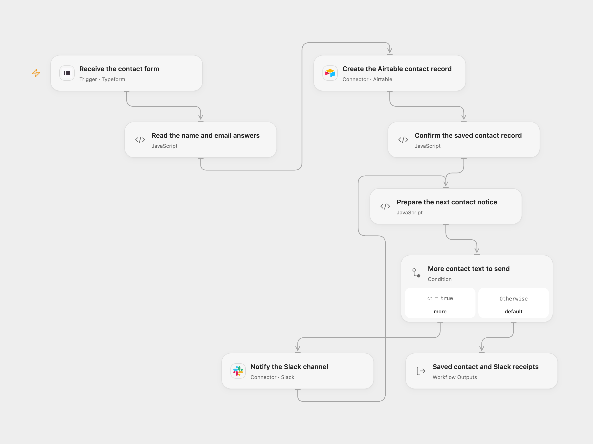

# Typeform Contacts to Airtable and Slack

Save a completed form’s name and email in Airtable, then announce the submission in Slack after Airtable confirms the saved record.

<picture>
  <source media="(prefers-color-scheme: dark)" srcset="preview-dark.png">
  
</picture>

[Open Flow JSON](templates/typeform-contacts-airtable-slack.openflow.json) · [n8n JSON](templates/typeform-contacts-airtable-slack.n8n.json)

## Setup

In Open Flow, connect Typeform in **Receive the contact form** and set its Form ID. The account needs access to the form and its webhook registration. In **Read the name and email answers**, keep the source’s two question titles or replace each selector with its exact title, field ID or ref. Use a text question for the name and an email question for the email address. Selectors must identify distinct fields with one answer each.

Connect Airtable in **Create the Airtable contact record**, then set the base and table IDs. The Personal Access Token needs `data.records:write` and access to that base. Create writable columns named exactly `Name` and `Email` with types that accept the answer strings. This workflow does not create columns or coerce their types. Connect Slack in **Notify the Slack channel** and set the channel ID in **Prepare the next contact notice**. The Slack app needs `chat:write` and access to that conversation; invite it to a private channel before activation.

In n8n, select **Typeform API** credentials on the trigger, **Airtable Personal Access Token API** credentials on its create node and **Slack API** credentials on its send node. Set the form/base/table/channel IDs. The two question selectors are at the end of **Read the name and email answers**. Keep raw Typeform response settings and Airtable Append with Add All Fields enabled and type conversion disabled. Activate one format for this process.

## Use

Complete the form with a name and email address. The workflow creates one Airtable record containing only `Name` and `Email`, as in the source’s Keep Only Set step. Other answers, hidden fields and submission metadata are not stored or posted. Both selected answers must be present, unambiguous and nonempty; the email must have an email-address format. Original whitespace and text are retained.

Slack is notified only after Airtable returns one valid saved record. The notification keeps the source wording: “New Submission”, followed by the name and email. It uses Slack’s default text formatting, including links and mentions. A long notification is divided into numbered messages of at most 4000 characters and posted in order without truncation. Join their content after the labels to reconstruct the complete notice.

Airtable failure, an uncertain creation or an invalid record receipt prevents Slack posting. A Slack failure stops later message parts. The Airtable record and earlier messages may already exist; check both destinations before replaying a failed run. No rollback, workflow retry or cross-run submission history is added. Open Flow identifies trigger deliveries by the Typeform response token. The n8n trigger adds no workflow-level delivery history. Manual replay or uncertain writes can produce duplicates.

The result keeps the complete Airtable record and all Slack receipts. Open Flow’s Slack Action exposes `ts` and `channelId`; n8n keeps the API response envelopes. A Slack receipt confirms the post identifier and channel rather than independently verifying its rendering. Full input, notification parts and accumulated receipts must fit the inspected Open Flow host’s 1 MiB per-Code input/result budget; oversized data fails without truncation.

Inspiration &amp; credits

## Changes to the source

- Restore the Typeform → selected contact fields → Airtable → Slack sequence and replace private form/channel settings with configuration placeholders.
- Preserve only the two contact fields and reject missing or ambiguous answers before creating a record.
- Replace deprecated Airtable API-key authentication with its supported PAT credential.
- Confirm the saved record before Slack, then verify each notification receipt and split long text sequentially.

Adapted from [Typeform contact submissions saved in Airtable and announced in Slack](https://github.com/Zie619/n8n-workflows/blob/ae8cf6dc5b873cbb4f74587aa9180ed3a9f70682/workflows/Slack/1191_Slack_Typeform_Automate_Triggered.json) in [Zie619/n8n-workflows](https://github.com/Zie619/n8n-workflows). The source export does not identify a separate template author or license.

The collection’s [MIT notice](https://github.com/Zie619/n8n-workflows/blob/94007c1445d9258a7da116646b79473e7c7c3282/LICENSE) is pinned at a later revision. This is the collection notice at that revision; it does not establish a separate original template author's license. Our changes are listed above; see [repository licensing](../../README.md#licensing).

> MIT License
>
> Copyright (c) 2025 Zie619
>
> Permission is hereby granted, free of charge, to any person obtaining a copy
> of this software and associated documentation files (the "Software"), to deal
> in the Software without restriction, including without limitation the rights
> to use, copy, modify, merge, publish, distribute, sublicense, and/or sell
> copies of the Software, and to permit persons to whom the Software is
> furnished to do so, subject to the following conditions:
>
> The above copyright notice and this permission notice shall be included in all
> copies or substantial portions of the Software.
>
> THE SOFTWARE IS PROVIDED "AS IS", WITHOUT WARRANTY OF ANY KIND, EXPRESS OR
> IMPLIED, INCLUDING BUT NOT LIMITED TO THE WARRANTIES OF MERCHANTABILITY,
> FITNESS FOR A PARTICULAR PURPOSE AND NONINFRINGEMENT. IN NO EVENT SHALL THE
> AUTHORS OR COPYRIGHT HOLDERS BE LIABLE FOR ANY CLAIM, DAMAGES OR OTHER
> LIABILITY, WHETHER IN AN ACTION OF CONTRACT, TORT OR OTHERWISE, ARISING FROM,
> OUT OF OR IN CONNECTION WITH THE SOFTWARE OR THE USE OR OTHER DEALINGS IN THE
> SOFTWARE.

