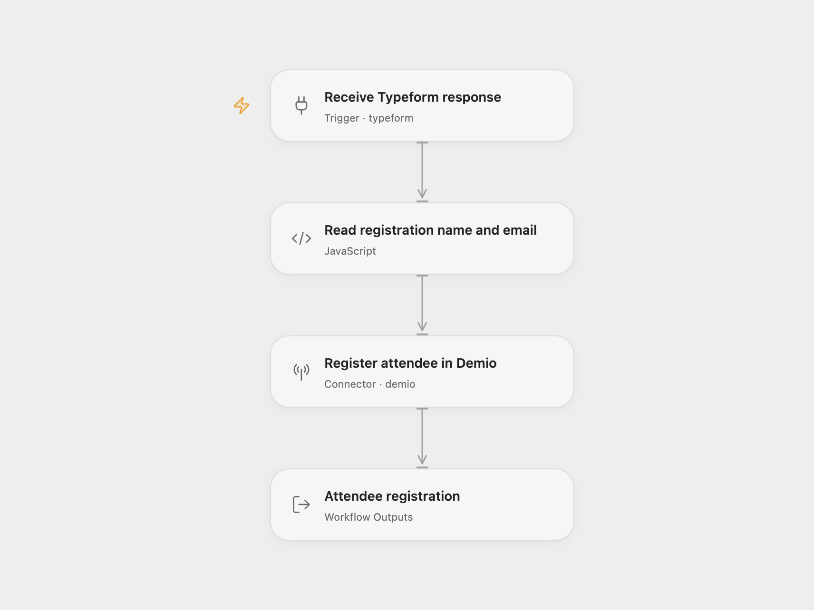

# Typeform to Demio Registration

Use a completed Typeform submission to register one attendee for a Demio event.

<picture>
  <source media="(prefers-color-scheme: dark)" srcset="preview-dark.png">
  
</picture>

[Open Flow JSON](templates/typeform-demio-registration.openflow.json) · [n8n JSON](templates/typeform-demio-registration.n8n.json)

## Setup

Connect Typeform in **Receive Typeform response** and replace the form ID. In **Read registration name and email**, set **Name Field** and **Email Field** to the corresponding question ID, reference, or exact title. The defaults match the source form’s titles:

- `Let's start with your name.`
- `What's your email address?`

Use a text question for the name and an email question for the email address. Each selector must match one question. The current Demio Action requires a first name of at least three characters.

Connect Demio in **Register attendee in Demio** and replace the placeholder Event ID `0` with your event’s numeric ID. No session ID is supplied, so Demio chooses the nearest active session. This template maps only name and email; use a destination event whose other registration fields are optional.

For n8n, configure **Typeform Trigger** and **Demio**, select the form and event, and edit the two selectors at the bottom of **Read registration name and email**. The trigger keeps the full response so the question definitions and typed answers remain available. Activate one format after setup.

Each completed submission makes one registration call. Missing, ambiguous, or invalid answers stop before Demio. The registration hash and join link are available in the workflow result; they are not sent back to the Typeform respondent by this workflow. Demio may send the event’s configured registration messages.

Duplicate submissions or event deliveries can make another registration call. The workflow keeps no delivery history and does not automatically retry failed calls. Check the Demio registration before retrying a run whose outcome is uncertain.

## Changes to the source

- Replace the original event and empty form with setup placeholders.
- Select typed answers by question ID, reference, or title and reject ambiguous matches.
- Validate the name and email before registering, and expose the complete registration result.

## Source and license

Adapted from [Typeform to Demio registration](https://github.com/Zie619/n8n-workflows/blob/ae8cf6dc5b873cbb4f74587aa9180ed3a9f70682/workflows/Typeform/1207_Typeform_Demio_Automate_Triggered.json) in [Zie619/n8n-workflows](https://github.com/Zie619/n8n-workflows). The source export does not identify a separate template author or license.

The collection’s [MIT notice](https://github.com/Zie619/n8n-workflows/blob/94007c1445d9258a7da116646b79473e7c7c3282/LICENSE) is pinned at a later revision. This is the collection notice at that revision; it does not establish a separate original template author's license. Our changes are listed above; see [repository licensing](../../README.md#licensing).

> MIT License
>
> Copyright (c) 2025 Zie619
>
> Permission is hereby granted, free of charge, to any person obtaining a copy
> of this software and associated documentation files (the "Software"), to deal
> in the Software without restriction, including without limitation the rights
> to use, copy, modify, merge, publish, distribute, sublicense, and/or sell
> copies of the Software, and to permit persons to whom the Software is
> furnished to do so, subject to the following conditions:
>
> The above copyright notice and this permission notice shall be included in all
> copies or substantial portions of the Software.
>
> THE SOFTWARE IS PROVIDED "AS IS", WITHOUT WARRANTY OF ANY KIND, EXPRESS OR
> IMPLIED, INCLUDING BUT NOT LIMITED TO THE WARRANTIES OF MERCHANTABILITY,
> FITNESS FOR A PARTICULAR PURPOSE AND NONINFRINGEMENT. IN NO EVENT SHALL THE
> AUTHORS OR COPYRIGHT HOLDERS BE LIABLE FOR ANY CLAIM, DAMAGES OR OTHER
> LIABILITY, WHETHER IN AN ACTION OF CONTRACT, TORT OR OTHERWISE, ARISING FROM,
> OUT OF OR IN CONNECTION WITH THE SOFTWARE OR THE USE OR OTHER DEALINGS IN THE
> SOFTWARE.
