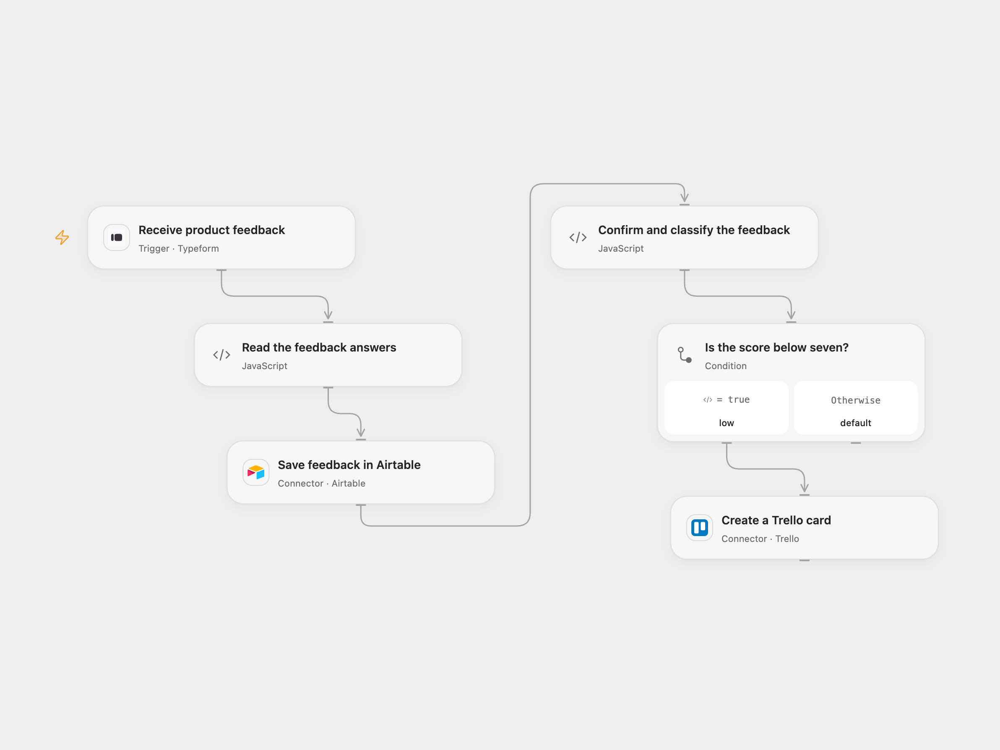

# Route Typeform Feedback to Airtable and Trello

Save Typeform product feedback in Airtable and create a Trello card for scores below seven.

<picture>
  <source media="(prefers-color-scheme: dark)" srcset="preview-dark.png">
  
</picture>

[Open Flow JSON](templates/typeform-feedback-to-airtable-and-trello.openflow.json) · [n8n JSON](templates/typeform-feedback-to-airtable-and-trello.n8n.json)

## Setup

Create a Typeform with these exact question titles and answer types: **What is your name?** (short text), **What is your email address?** (email), **What score would you like to give?** (number), and **Anything else you want to share?** (long text). Name and score must be answered; email and description may be left blank. Connect Typeform and configure the form ID. The connection must be able to register a webhook.

Create an Airtable table with fields **Name**, **Email**, **Score** (number), and **Description**. Connect Airtable and set its base and table. Connect Trello and set the destination list ID. In n8n, configure the same form, Airtable and Trello credentials and IDs. Activate one format.

## Behavior

Every completed response creates one Airtable record. When the numeric score is strictly below 7, the workflow then creates a Trello card named `[score] name`, with name, email, score and description in the card. A score of 7 or more creates no card. Missing or invalid required answers stop before Airtable.

Airtable must confirm a record with the submitted values before the Trello branch. If an Airtable write fails or has an uncertain outcome, no card is attempted. If the Trello write fails, the Airtable record remains; inspect both services before retrying. Repeated webhook deliveries can create duplicates.

## Changes to the source

- Replace the source's unconfigured form and base and its personal Trello list with configuration. Resolve answers by question identity from the full response, and validate the returned Airtable record before creating a card.

Source and license

Adapted from [Get product feedback and create ticket on Trello](https://github.com/Zie619/n8n-workflows/blob/ae8cf6dc5b873cbb4f74587aa9180ed3a9f70682/workflows/Noop/1091_Noop_Trello_Import_Triggered.json) in [Zie619/n8n-workflows](https://github.com/Zie619/n8n-workflows). The matching [n8n listing](https://n8n.io/workflows/791-get-product-feedback-and-create-ticket-on-trello/) credits Harshil Agrawal. The original template does not state a separate license.

The collection’s [MIT notice](https://github.com/Zie619/n8n-workflows/blob/94007c1445d9258a7da116646b79473e7c7c3282/LICENSE) is pinned at a later revision. This is the collection notice at that revision; it does not establish a separate original template author's license. Our changes are listed above; see [repository licensing](../../README.md#licensing).

> MIT License
>
> Copyright (c) 2025 Zie619
>
> Permission is hereby granted, free of charge, to any person obtaining a copy
> of this software and associated documentation files (the "Software"), to deal
> in the Software without restriction, including without limitation the rights
> to use, copy, modify, merge, publish, distribute, sublicense, and/or sell
> copies of the Software, and to permit persons to whom the Software is
> furnished to do so, subject to the following conditions:
>
> The above copyright notice and this permission notice shall be included in all
> copies or substantial portions of the Software.
>
> THE SOFTWARE IS PROVIDED "AS IS", WITHOUT WARRANTY OF ANY KIND, EXPRESS OR
> IMPLIED, INCLUDING BUT NOT LIMITED TO THE WARRANTIES OF MERCHANTABILITY,
> FITNESS FOR A PARTICULAR PURPOSE AND NONINFRINGEMENT. IN NO EVENT SHALL THE
> AUTHORS OR COPYRIGHT HOLDERS BE LIABLE FOR ANY CLAIM, DAMAGES OR OTHER
> LIABILITY, WHETHER IN AN ACTION OF CONTRACT, TORT OR OTHERWISE, ARISING FROM,
> OUT OF OR IN CONNECTION WITH THE SOFTWARE OR THE USE OR OTHER DEALINGS IN THE
> SOFTWARE.

