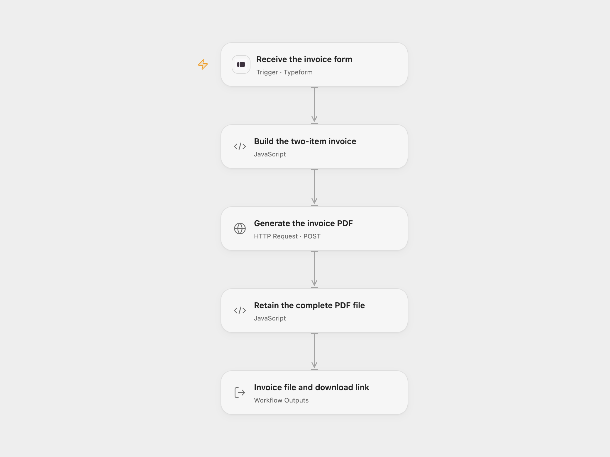

# Typeform Invoice PDF

Generate a two-item invoice PDF from one completed Typeform response. Keep the complete APITemplate.io response, the PDF bytes and its vendor download link.

<picture>
  <source media="(prefers-color-scheme: dark)" srcset="preview-dark.png">
  
</picture>

[Open Flow JSON](templates/typeform-invoice-pdf.openflow.json) · [n8n JSON](templates/typeform-invoice-pdf.n8n.json)

## Setup

Connect Typeform in **Receive the invoice form** and set the form ID. Configure six required questions in this answer order: billing name (text), email (email), first item name (text), first amount (number), second item name (text), second amount (number). The mapping uses these six answer positions, as the source does. Additional answers are ignored. Keep the six questions required so a skipped answer cannot shift the mapping.

Create a PDF template in APITemplate.io accepting `company`, `email`, `invoice_no`, `invoice_date`, `invoice_due_date`, `address`, `company_bill_to`, `website`, `document_id`, and an `items` array of `item_name`/`price` objects. In **Build the two-item invoice**, replace the PDF template ID and every issuer/document placeholder. Invoice identifiers and dates are configuration values; this template does not allocate unique invoice numbers or calculate dates. Each price retains the source’s `EUR ` prefix followed by the numeric answer. No taxes, totals or currency conversion are added.

In **Generate the invoice PDF**, select a secret Variable for **API key** containing your APITemplate.io API key. The request uses its v1 create endpoint and `X-API-KEY` authentication. In **Retain the complete PDF file**, set **Download Host** to the exact hostname used by your account’s returned `download_url` and allow that same hostname in the Code node’s HTTP capability. The initial host, `pub-cdn.apitemplate.io`, appears in the vendor’s v1 documentation. Only HTTPS without embedded credentials, a custom port or a fragment is accepted. The Open Flow create request and download do not follow redirects; the download receives no API key. The native n8n API helper follows vendor redirects.

In n8n, select **Typeform API** credentials on the trigger and **APITemplate.io API** credentials on its PDF node. Set the form ID on the trigger and the PDF template ID on **Generate and download the invoice PDF**. Set the issuer/document values in **Build the two-item invoice**. Keep the Typeform raw full-body settings and PDF download enabled with filename `invoice.pdf`. Activate one format for this process.

## Behavior

Each accepted response creates one PDF using all seven configured issuer/document fields, the billing name/email and exactly two item names/amounts. Text is passed as JSON values so quotes, backslashes and line breaks do not break the request. Missing or mistyped answers fail before creation. Zero and negative numeric answers remain unchanged.

Open Flow downloads the returned PDF once and persists its original bytes as a Run-owned Artifact named `invoice.pdf`, then returns **PDF**, the complete **Result** response and **Download URL**. Subsequent Code nodes in the same Run can use `context.artifact.open(pdf)` to read the bytes. The current platform has no Artifact download interface or endpoint; the Artifact reference itself is not a file link. Use the APITemplate.io **Download URL** to download the PDF. Its availability and lifetime follow the vendor’s storage/account settings; save a copy before the link expires. Artifact bytes share the Run’s retention. n8n retains its full generation response and native binary PDF output.

The inspected Open Flow Code fetch host accepts at most 1 MiB per download. The complete form/mapping and generation response must also fit the 1 MiB Code input/result budget. Oversized or empty downloads, a non-PDF body, a disallowed host, API/download failures or cancellation fail without returning a partial file. Download success confirms the received PDF bytes, not the rendered invoice’s content or legal correctness; check your PDF template before activation.

No workflow retry or rollback is added. A generation timeout, missing download URL or later download/storage failure may occur after a PDF was created. Check APITemplate.io before replaying. Both inspected create paths make one attempt for HTTP401 and surface the failure. Open Flow uses the Typeform response token as delivery identity; n8n adds no equivalent workflow history. Neither format guarantees exactly-once generation. A webhook acknowledgment confirms receipt, not completed generation.

## Changes to the source

- Restore the complete form → two-item invoice → generated PDF download and replace private form/template settings with configuration.
- Construct JSON safely while retaining all original invoice fields and the two EUR-prefixed amounts.
- Make raw Typeform/PAT authentication explicit and retain both the full generation response and PDF bytes.
- Bound and validate the Open Flow PDF download, with its vendor link preserved separately from the Run-owned file reference.

Source and license

Adapted from [Typeform invoice generation and PDF download](https://github.com/Zie619/n8n-workflows/blob/ae8cf6dc5b873cbb4f74587aa9180ed3a9f70682/workflows/Apitemplateio/1224_Apitemplateio_Typeform_Automation_Triggered.json) in [Zie619/n8n-workflows](https://github.com/Zie619/n8n-workflows). The source export does not identify a separate template author or license.

The collection’s [MIT notice](https://github.com/Zie619/n8n-workflows/blob/94007c1445d9258a7da116646b79473e7c7c3282/LICENSE) is pinned at a later revision. This is the collection notice at that revision; it does not establish a separate original template author's license. Our changes are listed above; see [repository licensing](../../README.md#licensing).

> MIT License
>
> Copyright (c) 2025 Zie619
>
> Permission is hereby granted, free of charge, to any person obtaining a copy
> of this software and associated documentation files (the "Software"), to deal
> in the Software without restriction, including without limitation the rights
> to use, copy, modify, merge, publish, distribute, sublicense, and/or sell
> copies of the Software, and to permit persons to whom the Software is
> furnished to do so, subject to the following conditions:
>
> The above copyright notice and this permission notice shall be included in all
> copies or substantial portions of the Software.
>
> THE SOFTWARE IS PROVIDED "AS IS", WITHOUT WARRANTY OF ANY KIND, EXPRESS OR
> IMPLIED, INCLUDING BUT NOT LIMITED TO THE WARRANTIES OF MERCHANTABILITY,
> FITNESS FOR A PARTICULAR PURPOSE AND NONINFRINGEMENT. IN NO EVENT SHALL THE
> AUTHORS OR COPYRIGHT HOLDERS BE LIABLE FOR ANY CLAIM, DAMAGES OR OTHER
> LIABILITY, WHETHER IN AN ACTION OF CONTRACT, TORT OR OTHERWISE, ARISING FROM,
> OUT OF OR IN CONNECTION WITH THE SOFTWARE OR THE USE OR OTHER DEALINGS IN THE
> SOFTWARE.

