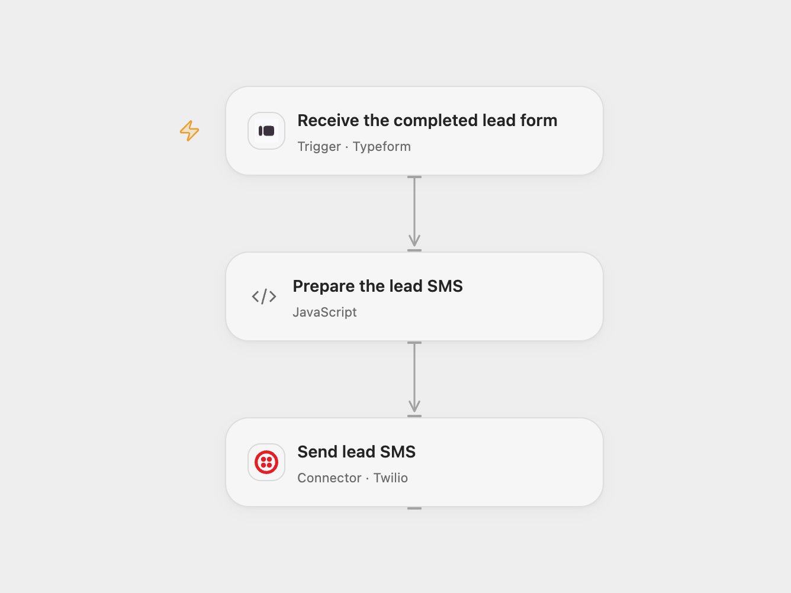

# Typeform Lead to Twilio SMS

Send a sales contact an SMS with the answers from a completed Typeform lead form.

<picture>
  <source media="(prefers-color-scheme: dark)" srcset="preview-dark.png">
  
</picture>

[Open Flow JSON](templates/typeform-lead-to-twilio-sms.openflow.json) · [n8n JSON](templates/typeform-lead-to-twilio-sms.n8n.json)

## Setup

Connect Typeform in **Receive the completed lead form** and set the form ID. The connection needs access to the form and permission to register its webhook. In **Send lead SMS**, connect Twilio and set an SMS-enabled sender number and the recipient number in E.164 format. In n8n set the same form, Twilio credentials and numbers. Enable one format only.

The mapping in **Prepare the lead SMS** uses the source form’s exact question titles for last name, first name, number of children, country, email and birth date. Adjust the titles in the code to match your form in both formats. Typeform field references in question titles appear in square brackets after conversion, so the country question’s field reference will normally need changing for your form. Each question must have one answer. A missing, duplicate or unsupported answer stops before sending.

## Behavior

Each completed form produces one SMS containing those six answers. The source title mentions WhatsApp, but its Twilio node has WhatsApp disabled and its numbers lack the WhatsApp prefix, so this template preserves its actual SMS setting. The template limits the message to 1,600 UTF-16 code units; longer results stop before sending. Unicode encoding can affect SMS segments and Twilio limits. The source’s organization-specific greeting is replaced with a generic lead heading.

Names, family information, email and birth date are sent to Twilio and the configured recipient. Use a form and recipient authorized to receive these details, and limit access to run history. A successful Twilio response means the message was accepted for processing, not necessarily delivered. The source enabled automatic retries; this template disables them to avoid repeating a send with an unknown outcome. Check Twilio before manually replaying an uncertain send. Typeform can redeliver events; Open Flow uses the response token for trigger deduplication, while n8n adds no separate submission history.

Inspiration &amp; credits

## Changes to the source

- Remove private form, phone numbers and organization-specific wording; use user configuration.
- Use raw completed responses and validate the six answer mappings before sending.
- Disable the source’s node retries in both formats and retain SMS as configured in the original Twilio node.

Adapted from [Send Typeforms leads via Whatsapp (Twilio)](https://github.com/Zie619/n8n-workflows/blob/ae8cf6dc5b873cbb4f74587aa9180ed3a9f70682/workflows/Twilio/0354_Twilio_Typeform_Send_Triggered.json) in [Zie619/n8n-workflows](https://github.com/Zie619/n8n-workflows). The source export does not identify a separate template author or license.

The collection’s [MIT notice](https://github.com/Zie619/n8n-workflows/blob/94007c1445d9258a7da116646b79473e7c7c3282/LICENSE) is pinned at a later revision. This is the collection notice at that revision; it does not establish a separate original template author's license. Our changes are listed above; see [repository licensing](../../README.md#licensing).

> MIT License
>
> Copyright (c) 2025 Zie619
>
> Permission is hereby granted, free of charge, to any person obtaining a copy
> of this software and associated documentation files (the "Software"), to deal
> in the Software without restriction, including without limitation the rights
> to use, copy, modify, merge, publish, distribute, sublicense, and/or sell
> copies of the Software, and to permit persons to whom the Software is
> furnished to do so, subject to the following conditions:
>
> The above copyright notice and this permission notice shall be included in all
> copies or substantial portions of the Software.
>
> THE SOFTWARE IS PROVIDED "AS IS", WITHOUT WARRANTY OF ANY KIND, EXPRESS OR
> IMPLIED, INCLUDING BUT NOT LIMITED TO THE WARRANTIES OF MERCHANTABILITY,
> FITNESS FOR A PARTICULAR PURPOSE AND NONINFRINGEMENT. IN NO EVENT SHALL THE
> AUTHORS OR COPYRIGHT HOLDERS BE LIABLE FOR ANY CLAIM, DAMAGES OR OTHER
> LIABILITY, WHETHER IN AN ACTION OF CONTRACT, TORT OR OTHERWISE, ARISING FROM,
> OUT OF OR IN CONNECTION WITH THE SOFTWARE OR THE USE OR OTHER DEALINGS IN THE
> SOFTWARE.

