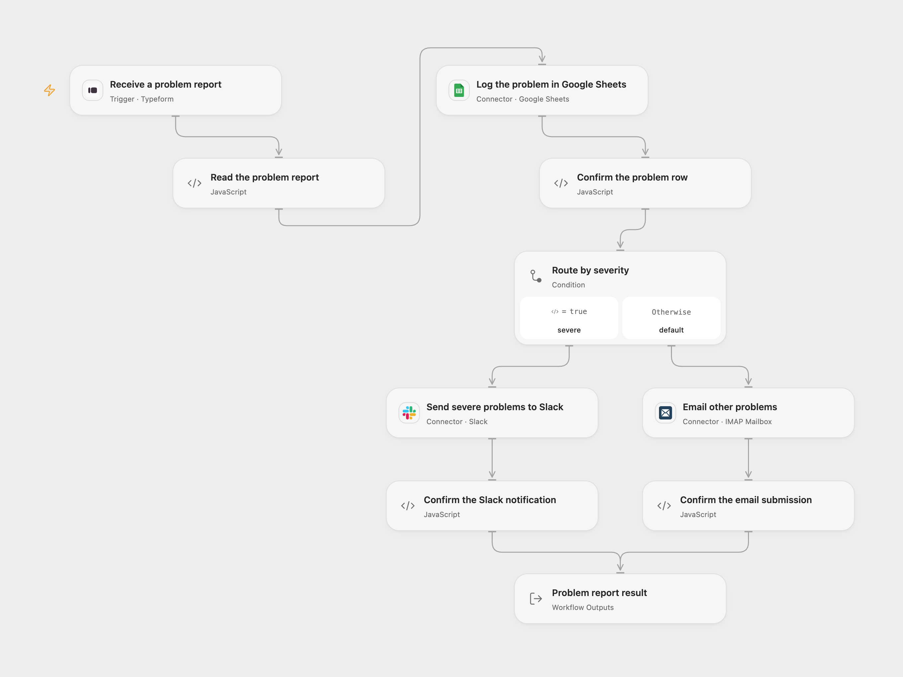

# Typeform Problem Report Routing

Record every completed Typeform problem report in Google Sheets. Reports with **Severity greater than 7** go to Slack; reports with **Severity 7 or below** go by email.

<picture>
  <source media="(prefers-color-scheme: dark)" srcset="preview-dark.png">
  
</picture>

[Open Flow JSON](templates/typeform-problem-report-routing.openflow.json) · [n8n JSON](templates/typeform-problem-report-routing.n8n.json)

## Setup

Create a Typeform with questions titled **Email**, **Name**, **Severity** and **Problem**. Use an email question, text questions for Name and Problem, and a number question for Severity. Connect Typeform in **Receive a problem report**, select the form ID, deploy with a public HTTPS callback and activate the signed subscription. Completed webhook bodies must fit within 64 KiB.

Create a **Problems** sheet with **Email**, **Name**, **Severity**, **Problem** in cells A1:D1, in that order. Connect an account with edit access in **Log the problem in Google Sheets** and configure the spreadsheet ID. Both formats write values as `RAW`, so user text is stored as text rather than evaluated as formulas. The source’s native Sheets node writes every cell as text, including Severity; this template keeps that sheet representation while using the numeric answer for routing.

Connect Slack in **Send severe problems to Slack** and set a channel ID where the account can post. In **Email other problems**, connect the sending mailbox and replace `support@example.com` with the actual recipient. The Open Flow mailbox connection requires a public IMAP server on port 993 and a public SMTP server using port 465 with TLS or a port supporting STARTTLS, plus the mailbox address and app password. Email is sent from that connected mailbox.

In n8n, configure Typeform, **Google API** Service Account, Slack and SMTP credentials on their nodes. In the Google API credential, configure the service account’s `client_email` and private key, and share the spreadsheet with that exact `client_email` address. Open Flow uses a connected Google user account with edit access to the same spreadsheet. Use the same form, spreadsheet, channel, recipient and SMTP mailbox. Set **From Email** to the connected sending mailbox address. Keep the Problems header order shown above. Activate one format for this process to avoid duplicate rows and notifications.

## Behavior

Each completed response must contain one unambiguous answer for every configured question, including a finite numeric Severity and nonblank Email, Name and Problem. The report is appended to the sheet before any notification. Severity greater than 7 sends one Slack message; every other numeric severity sends one email. Both messages include the submitted Email, Name, Severity and Problem. The source has no additional severity range requirement.

Missing or ambiguous answers stop before writing a row. A failed append stops before notification. Notification failures stop after the row has been written. No workflow retry is added. Check the sheet and destination before replaying a failed or uncertain run; replay can append another row or send another notification. SMTP acceptance confirms server submission, not inbox delivery.

Open Flow returns the selected **Route**, original **Report**, confirmed **Log**, and **Notification** receipt. Open Flow uses the Typeform response token as its trigger deduplication identity; native n8n does not add the same key. Neither format guarantees exactly-once writes or notifications.

Inspiration &amp; credits

## Changes to the source

- Resolve answers using their field IDs and question titles, with missing and duplicate checks.
- Preserve the original report for routing and message text instead of reading fields from a write receipt.
- Make the four sheet columns, RAW value mode and SMTP sender configuration explicit.
- Confirm the notification receipt and surface rejected email recipients.

Adapted from [Typeform problem report routing](https://github.com/Zie619/n8n-workflows/blob/ae8cf6dc5b873cbb4f74587aa9180ed3a9f70682/workflows/Googlesheets/0927_GoogleSheets_Slack_Send_Triggered.json) in [Zie619/n8n-workflows](https://github.com/Zie619/n8n-workflows). The source export does not identify a separate template author or license.

The collection’s [MIT notice](https://github.com/Zie619/n8n-workflows/blob/94007c1445d9258a7da116646b79473e7c7c3282/LICENSE) is pinned at a later revision. This is the collection notice at that revision; it does not establish a separate original template author's license. Our changes are listed above; see [repository licensing](../../README.md#licensing).

> MIT License
>
> Copyright (c) 2025 Zie619
>
> Permission is hereby granted, free of charge, to any person obtaining a copy
> of this software and associated documentation files (the "Software"), to deal
> in the Software without restriction, including without limitation the rights
> to use, copy, modify, merge, publish, distribute, sublicense, and/or sell
> copies of the Software, and to permit persons to whom the Software is
> furnished to do so, subject to the following conditions:
>
> The above copyright notice and this permission notice shall be included in all
> copies or substantial portions of the Software.
>
> THE SOFTWARE IS PROVIDED "AS IS", WITHOUT WARRANTY OF ANY KIND, EXPRESS OR
> IMPLIED, INCLUDING BUT NOT LIMITED TO THE WARRANTIES OF MERCHANTABILITY,
> FITNESS FOR A PARTICULAR PURPOSE AND NONINFRINGEMENT. IN NO EVENT SHALL THE
> AUTHORS OR COPYRIGHT HOLDERS BE LIABLE FOR ANY CLAIM, DAMAGES OR OTHER
> LIABILITY, WHETHER IN AN ACTION OF CONTRACT, TORT OR OTHERWISE, ARISING FROM,
> OUT OF OR IN CONNECTION WITH THE SOFTWARE OR THE USE OR OTHER DEALINGS IN THE
> SOFTWARE.

