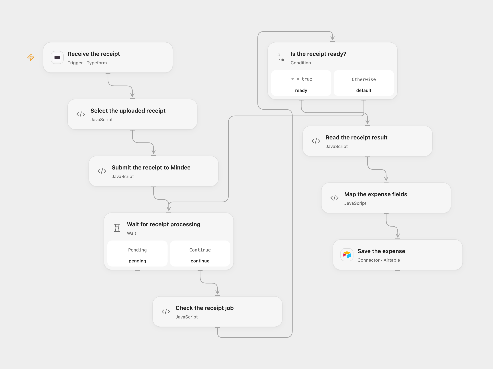

# Typeform Receipts to Airtable

Extract receipt details from Typeform uploads and save each expense in Airtable.

<picture>
  <source media="(prefers-color-scheme: dark)" srcset="preview-dark.png">
  
</picture>

[Open Flow JSON](templates/typeform-receipts-to-airtable.openflow.json) · [n8n JSON](templates/typeform-receipts-to-airtable.n8n.json)

## Setup

Create a Typeform with one File Upload question titled `Upload receipt` and allow shareable file links. Connect Typeform and select the form. Mindee must be able to fetch each HTTPS image URL directly without authentication or redirects. Login-only Typeform uploads cannot be used with this URL-based workflow.

In Mindee V2, create a Receipt model retaining `total_amount`, `supplier_name`, `date`, `time` and `purchase_category`. In Open Flow, set its model ID in **Submit the receipt to Mindee**, create a secret Variable named `MINDEE_API_KEY`, and bind it in all three Mindee Code nodes. Connect Airtable, set the base and table, and create compatible fields `Amount`, `Merchant`, `Date`, `Time`, `Receipt URL` and `Category`.

In n8n, set the form and connect Typeform. Configure a Header Auth credential with name `Authorization` and the Mindee V2 API key as its value on all three Mindee HTTP nodes. Set the Receipt model ID in **Submit the receipt to Mindee**, and connect Airtable with its Personal Access Token and matching base/table. Activate only one format.

## Behavior

Each completed form submits its receipt URL to the Mindee model, waits for processing, and saves the extracted amount, merchant, date, time, category and original receipt URL in one Airtable record. Missing model fields or a failed job stop before the Airtable write. Individual fields that Mindee could not recognize can be empty. Category values follow the current Mindee Receipt model and can differ from the legacy model. Both formats stop polling after 200 attempts at three-second intervals.

If Mindee cannot fetch the file, check the URL’s access and redirect behavior. An uncertain Mindee submission may already have created a job. An uncertain Airtable write may already have created a record; inspect both services before retrying. The workflow adds no automatic write retries or deduplication.

## Changes to the source

- Replace the legacy Mindee receipt node with the current asynchronous V2 Receipt model and configure a model ID. Mindee fetches the uploaded URL directly instead of passing downloaded bytes between nodes.
- Replace empty form/base credentials with setup instructions and Airtable PAT authentication.

Source and license

Adapted from [Expense Tracker App](https://github.com/Zie619/n8n-workflows/blob/ae8cf6dc5b873cbb4f74587aa9180ed3a9f70682/workflows/Http/1030_HTTP_Typeform_Monitor_Webhook.json) in [Zie619/n8n-workflows](https://github.com/Zie619/n8n-workflows). The source export does not identify a separate template author or license.

The collection’s [MIT notice](https://github.com/Zie619/n8n-workflows/blob/94007c1445d9258a7da116646b79473e7c7c3282/LICENSE) is pinned at a later revision. This is the collection notice at that revision; it does not establish a separate original template author's license. Our changes are listed above; see [repository licensing](../../README.md#licensing).

> MIT License
>
> Copyright (c) 2025 Zie619
>
> Permission is hereby granted, free of charge, to any person obtaining a copy
> of this software and associated documentation files (the "Software"), to deal
> in the Software without restriction, including without limitation the rights
> to use, copy, modify, merge, publish, distribute, sublicense, and/or sell
> copies of the Software, and to permit persons to whom the Software is
> furnished to do so, subject to the following conditions:
>
> The above copyright notice and this permission notice shall be included in all
> copies or substantial portions of the Software.
>
> THE SOFTWARE IS PROVIDED "AS IS", WITHOUT WARRANTY OF ANY KIND, EXPRESS OR
> IMPLIED, INCLUDING BUT NOT LIMITED TO THE WARRANTIES OF MERCHANTABILITY,
> FITNESS FOR A PARTICULAR PURPOSE AND NONINFRINGEMENT. IN NO EVENT SHALL THE
> AUTHORS OR COPYRIGHT HOLDERS BE LIABLE FOR ANY CLAIM, DAMAGES OR OTHER
> LIABILITY, WHETHER IN AN ACTION OF CONTRACT, TORT OR OTHERWISE, ARISING FROM,
> OUT OF OR IN CONNECTION WITH THE SOFTWARE OR THE USE OR OTHER DEALINGS IN THE
> SOFTWARE.

