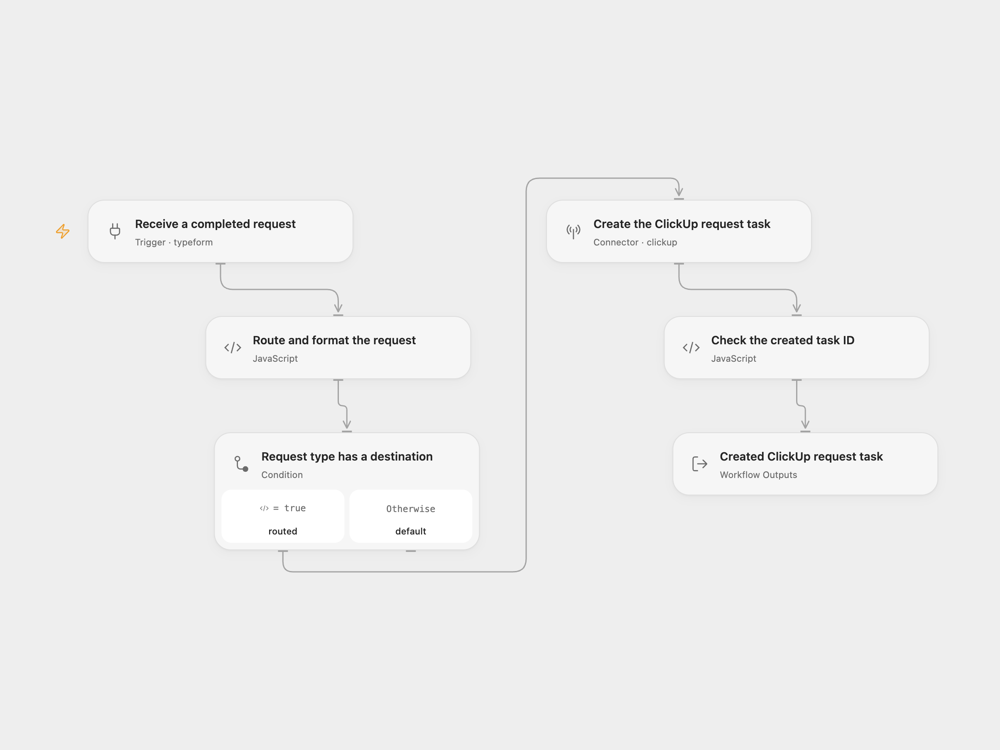

# Typeform Request to ClickUp

Create a ClickUp task for a completed Typeform request, selecting the list by its request type and including the details, requester and priority.

<picture>
  <source media="(prefers-color-scheme: dark)" srcset="preview-dark.png">
  
</picture>

[Open Flow JSON](templates/typeform-request-to-clickup.openflow.json) · [n8n JSON](templates/typeform-request-to-clickup.n8n.json)

## Setup

Prepare four ClickUp lists and a Typeform form using these exact question titles. Keep question titles unique.

| Question | Answer |
|---|---|
| What type of a request are you making? | Single choice: Document Request, Presentation Request, Update Request, or Workflow Request |
| Give this request a short title. | Required text |
| Describe in detail what you would like to see happen for this request. | Required text |
| Your full name | Required text |
| Your email address | Required email |
| How urgent is this request? | Optional number: 1 urgent, 2 high, 3 normal, 4 low; blank or 0 leaves no priority |

In Open Flow, connect Typeform in **Receive a completed request**, configure its `formId`, and connect a ClickUp **Personal API Token** in **Create the ClickUp request task**. In **Route and format the request**, replace each `listIds` placeholder with the matching list’s numeric ID as a string.

In n8n, select **Typeform API** credentials in the trigger and **ClickUp API** credentials in **Create the ClickUp request task**. Use a ClickUp Personal API Token. Set the trigger’s form ID and the four list IDs at the start of **Route and format the request**. Keep **Simplify Answers** and **Only Answers** disabled so the shared request parser can use the complete response. The native request uses the current `description` field and credentials manage the Authorization header.

Deploy a public HTTPS callback and activate one format to register a fresh signed Typeform webhook. Remove any older unsigned subscription for the same n8n callback before activation. Activating both formats registers two subscriptions and can create two tasks. The account needs access to the form, webhook management and all destination lists.

## Behavior

A completed response in one of the four categories creates one task in that category’s list. Its name is the short title. Its plain-text description contains the request details followed by the requester’s name and email. Numeric urgency becomes ClickUp priority; missing, blank or zero urgency leaves no priority. Other categories end without a task. Partial responses are ignored.

Missing fields, ambiguous question titles, invalid urgency or an unconfigured destination stop before writing. API, permission and malformed-result errors stop the run. A successful run returns the complete created task after checking its ID. The workflow does not search for duplicates, assign users, set dates or send a separate message. ClickUp’s own notifications follow its defaults.

Repeated delivery can create another task. No workflow retry or exactly-once guarantee is added. Check ClickUp before replaying a write with an unknown result. Webhook acknowledgment does not confirm the later task creation.

## Changes to the source

- Replace the private form, workspace and destination-list IDs with user configuration.
- Read the complete Typeform response and map answers through field definitions, preserving the four source categories.
- Use the current ClickUp `description` request field and a Personal API Token in both formats. The source selected OAuth2; reconnect with a Personal API Token for this template.
- Validate required answers, destination and priority before writing, then verify the returned task ID.

Source and license

Adapted from [User Request Management](https://github.com/Zie619/n8n-workflows/blob/ae8cf6dc5b873cbb4f74587aa9180ed3a9f70682/workflows/Typeform/0215_Typeform_Clickup_Automation_Triggered.json) in [Zie619/n8n-workflows](https://github.com/Zie619/n8n-workflows). The source export does not identify a separate template author or license.

The collection’s [MIT notice](https://github.com/Zie619/n8n-workflows/blob/94007c1445d9258a7da116646b79473e7c7c3282/LICENSE) is pinned at a later revision. This is the collection notice at that revision; it does not establish a separate original template author's license. Our changes are listed above; see [repository licensing](../../README.md#licensing).

> MIT License
>
> Copyright (c) 2025 Zie619
>
> Permission is hereby granted, free of charge, to any person obtaining a copy
> of this software and associated documentation files (the "Software"), to deal
> in the Software without restriction, including without limitation the rights
> to use, copy, modify, merge, publish, distribute, sublicense, and/or sell
> copies of the Software, and to permit persons to whom the Software is
> furnished to do so, subject to the following conditions:
>
> The above copyright notice and this permission notice shall be included in all
> copies or substantial portions of the Software.
>
> THE SOFTWARE IS PROVIDED "AS IS", WITHOUT WARRANTY OF ANY KIND, EXPRESS OR
> IMPLIED, INCLUDING BUT NOT LIMITED TO THE WARRANTIES OF MERCHANTABILITY,
> FITNESS FOR A PARTICULAR PURPOSE AND NONINFRINGEMENT. IN NO EVENT SHALL THE
> AUTHORS OR COPYRIGHT HOLDERS BE LIABLE FOR ANY CLAIM, DAMAGES OR OTHER
> LIABILITY, WHETHER IN AN ACTION OF CONTRACT, TORT OR OTHERWISE, ARISING FROM,
> OUT OF OR IN CONNECTION WITH THE SOFTWARE OR THE USE OR OTHER DEALINGS IN THE
> SOFTWARE.

