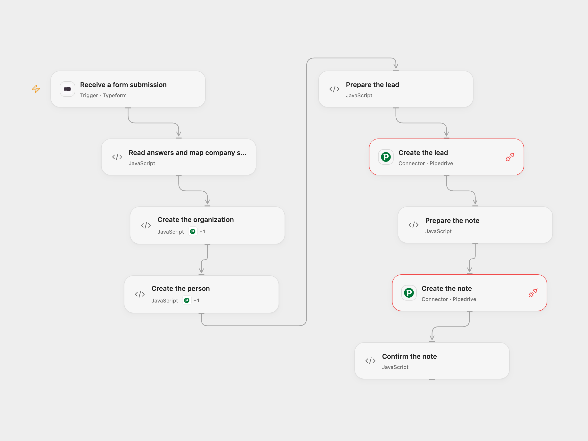

# Create Pipedrive Leads from Typeform

Create a Pipedrive organization, contact, lead and note for a completed Typeform.

<picture>
  <source media="(prefers-color-scheme: dark)" srcset="preview-dark.png">
  
</picture>

[Open Flow JSON](templates/typeform-submission-to-pipedrive-lead.openflow.json) · [n8n JSON](templates/typeform-submission-to-pipedrive-lead.n8n.json)

## Setup

Connect Typeform and Pipedrive and set your form ID. The form needs questions with these exact titles and types:

- `What *company* are you contacting us from?` — text
- `Let's start with your *first and last name.*` — text
- `What *email address* can we reach you at?` — email
- `Do you have any *specific questions* about embedding n8n at this stage?` — text
- `How many employees?` — single choice, with options `< 20`, `20 - 100`, `101 - 500`, `501 - 1000`, `1000+`

In Pipedrive create an organization single-option custom field and find its 40-character field key and the five option IDs. In Open Flow configure these in **Read answers and map company size**. The two creation Code nodes use the Pipedrive connection and each calls its named Action. For n8n set the same field key in **Create Organization** and in the code of **Read answers and map company size**, edit its five option IDs, connect credentials, and set the form ID. Activate one format.

## Behavior

Each completed response creates an organization with the mapped company size, then a person linked to it, a lead linked to both, and a note with the question and company size. Missing or invalid answers and incomplete option configuration stop before creating records. The form question and company size are escaped as text in the note.

A failed step stops subsequent steps; earlier creations remain. Repeated submissions or webhook deliveries create new records. An unknown write result may already have created a record, so inspect Pipedrive before replaying.

## Changes to the source

- Replace account-specific form and custom-field IDs with configuration; require complete answers and valid option IDs before writing.
- Use the complete Typeform response to associate answers with their questions and escape note text.

Source and license

Adapted from [Upload leads with custom fields from Typeform to Pipedrive](https://github.com/Zie619/n8n-workflows/blob/ae8cf6dc5b873cbb4f74587aa9180ed3a9f70682/workflows/Code/0239_Code_Typeform_Create_Triggered.json) in [Zie619/n8n-workflows](https://github.com/Zie619/n8n-workflows). The matching [n8n listing](https://n8n.io/workflows/1758-upload-leads-with-custom-fields-from-typeform-to-pipedrive/) credits n8n Team. No separate original template license was found.

The collection’s [MIT notice](https://github.com/Zie619/n8n-workflows/blob/94007c1445d9258a7da116646b79473e7c7c3282/LICENSE) is pinned at a later revision. This is the collection notice at that revision; it does not establish a separate original template author's license. Our changes are listed above; see [repository licensing](../../README.md#licensing).

> MIT License
>
> Copyright (c) 2025 Zie619
>
> Permission is hereby granted, free of charge, to any person obtaining a copy
> of this software and associated documentation files (the "Software"), to deal
> in the Software without restriction, including without limitation the rights
> to use, copy, modify, merge, publish, distribute, sublicense, and/or sell
> copies of the Software, and to permit persons to whom the Software is
> furnished to do so, subject to the following conditions:
>
> The above copyright notice and this permission notice shall be included in all
> copies or substantial portions of the Software.
>
> THE SOFTWARE IS PROVIDED "AS IS", WITHOUT WARRANTY OF ANY KIND, EXPRESS OR
> IMPLIED, INCLUDING BUT NOT LIMITED TO THE WARRANTIES OF MERCHANTABILITY,
> FITNESS FOR A PARTICULAR PURPOSE AND NONINFRINGEMENT. IN NO EVENT SHALL THE
> AUTHORS OR COPYRIGHT HOLDERS BE LIABLE FOR ANY CLAIM, DAMAGES OR OTHER
> LIABILITY, WHETHER IN AN ACTION OF CONTRACT, TORT OR OTHERWISE, ARISING FROM,
> OUT OF OR IN CONNECTION WITH THE SOFTWARE OR THE USE OR OTHER DEALINGS IN THE
> SOFTWARE.

