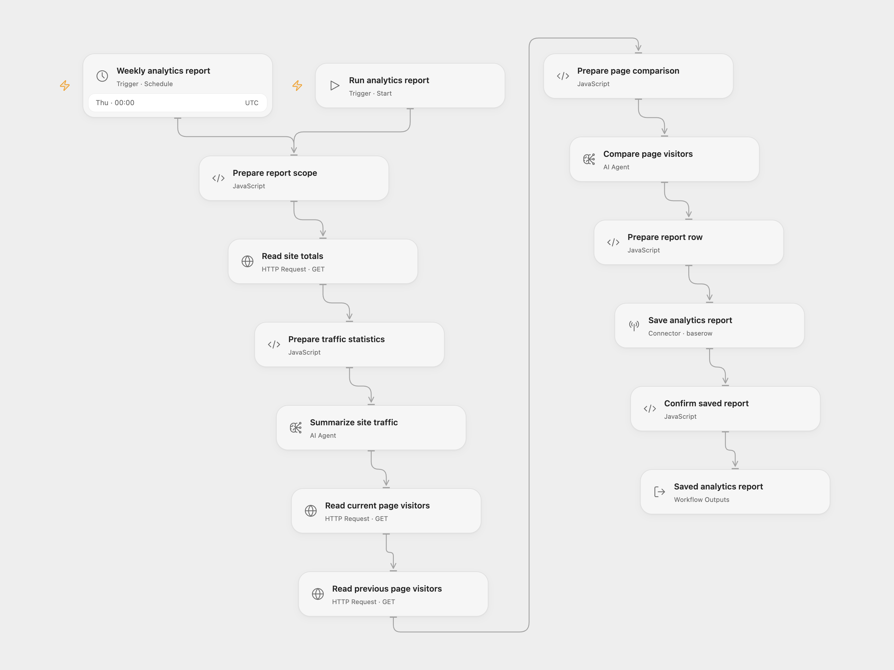

# Umami Weekly SEO Report

Review two rolling weeks of self-hosted Umami analytics. Generate a traffic summary and a page-visitor comparison with SEO suggestions, then save both in one Baserow row.

<picture>
  <source media="(prefers-color-scheme: dark)" srcset="preview-dark.png">
  
</picture>

[Open Flow JSON](templates/umami-weekly-seo-report.openflow.json) · [n8n JSON](templates/umami-weekly-seo-report.n8n.json)

## Setup

Use a self-hosted **Umami 3.4.1** instance. Its canonical HTTPS API base must be reachable from your execution server under that server’s outbound network rules. This template uses the self-hosted `/api` endpoints. It does not connect to Umami Cloud.

Create an API key in your Umami profile’s **Settings → API keys**. The key’s user must be able to view the selected website and its overview/comparison sections. Use an API key rather than a temporary login token; the workflow does not log in or refresh credentials. The audited self-hosted version checks the key and its user on requests, so revocation, user deletion or permission changes can stop a run.

Create a Baserow Cloud table with these field names:

| Field | Type |
| --- | --- |
| Date | Date |
| Summary | Long text |
| Top pages | Long text |
| Blog name | Text or long text |

### Open Flow

1. In **Prepare report scope**, replace the API base and website UUID, then set the site label and processing timezone. An API base can include a deployment prefix, for example `https://analytics.your-domain.com/umami/api`.
2. Create a secret Variable containing the self-hosted Umami API key, without the `Bearer ` prefix. Bind **Authentication Token** (`auth.token`) to this Variable on **Read site totals**, **Read current page visitors** and **Read previous page visitors**. The shared JSON contains no key or Variable binding.
3. On **Summarize site traffic** and **Compare page visitors**, replace `YOUR_GATEWAY_MODEL_ID` with a model available through your Open Flow deployment’s model gateway. Configure both nodes. An OpenRouter model ID is not automatically a valid gateway model ID.
4. On **Save analytics report**, connect Baserow Cloud using a database token with create-row permission and replace the example table ID with your table’s ID.
5. Check **Weekly analytics report** before enabling it. Its starting schedule is Thursday at 00:00 UTC. If you change timezone, update both the schedule and the processing timezone in **Prepare report scope**.

You can run **Run analytics report** manually after configuration.

### n8n

Import the n8n JSON and edit the settings object in **Prepare Report Scope**. Select Header Auth credentials on the three Umami read nodes: header name `Authorization`, value `Bearer <your self-hosted API key>`.

The two analysis HTTP nodes use OpenRouter. Select a separate Header Auth credential with `Authorization: Bearer <your OpenRouter key>` and replace `YOUR_OPENROUTER_MODEL_ID` in each JSON body with an available model. Check that model’s context limit before activation. The original model route is not assumed available.

In **Save Analytics Report**, select Baserow **Database Token** credentials with host `https://api.baserow.io`, then configure the table ID. Confirm the workflow timezone and schedule before activation.

## What a run does

The workflow captures one report time and uses one website for all three Umami reads. It reads the current rolling seven-day totals and their API comparison, generates a traffic summary, reads current and previous rolling seven-day page rankings, generates a second comparison with five requested SEO suggestions, then creates one Baserow row. A confirmed positive row ID is the completion boundary.

The two ranges cover seven elapsed 24-hour periods each. They are not calendar weeks. The API uses inclusive timestamp bounds, so the ranges meet at the same cutoff. The report date uses the configured processing timezone. Umami can also apply its own website-reset or retention boundaries.

The summary contains pageviews, unique visitors, visits, bounces and total visit duration in seconds. For page rankings, the audited Umami 3.4.1 `/metrics?type=path` implementation counts **unique visitors per path**. These counts are not pageview totals and cannot be added together to obtain site-wide unique visitors.

Each page query reads one ranked response, with Umami’s default maximum of 500 rows. There is no pagination. A missing path can be outside that ranking; it does not establish zero traffic. The workflow keeps every returned row, including nullable dimensions, and adds no further first-N truncation. Both sets of rankings must fit the selected comparison model’s context window.

Open Flow uses two AI Agent nodes with one model round each, text outputs, no external tools and no Code tool. n8n sends two ordinary OpenRouter completion requests with user prompts. The Agent runtime adds its own output and tool instructions; providers, model routing and generated wording can differ. Neither format sets an extra temperature or token budget. Review the generated tables and suggestions against the analytics before acting on them.

## Failure and repeat behavior

A failed HTTP or JSON request stops the workflow. Response data is checked before it is analyzed. Blank or missing analysis text is rejected before the next stage. Valid zero totals and empty rankings still produce the two requested analyses and one report row.

There is no automatic workflow retry or cross-run deduplication. Repeating a run reads fresh data, can incur two new model calls and creates another row. If Baserow accepted a write but its response was lost, the row may already exist; inspect the table before repeating the run.

Use canonical endpoints: redirects are errors. Open Flow allows 30 seconds and 4 MiB per Umami HTTP response; the n8n read timeout is also 30 seconds. A slow or oversized response stops the workflow.

## Changes to the source

- Read website statistics from `/stats` rather than the unrelated `/event-data/stats` endpoint.
- Target the audited self-hosted API version, its numeric totals/comparison shape and the current `path` metric dimension.
- Use one configured site, one captured time and one explicit timezone across both formats.
- Send literal JSON analytics to the analysis steps, replacing percent-encoded data and the summary prompt’s incorrect page-ranking labels.
- Keep both separate analyses and the single final Baserow row. Make model setup explicit and use AI Agent nodes in Open Flow.
- Preserve complete ranked responses without multiplying subsequent requests when a native HTTP response is an array.
- Use named Baserow fields and database-token authentication, remove private resource IDs, and confirm the returned row ID.

API references: [self-hosted authentication](https://docs.umami.is/docs/api/authentication), [website summary statistics](https://docs.umami.is/docs/api-reference/get-website-stats) and [ranked website metrics](https://docs.umami.is/docs/api-reference/get-website-metrics). The implementation was checked against [Umami 3.4.1](https://github.com/umami-software/umami/tree/559e3c607c23d2c72d9bd4f6481bda428255323c). Check compatibility before using a different server version.

Source and license

Adapted from [Summarize Umami data with AI (via Openrouter) and save it to Baserow](https://github.com/enescingoz/awesome-n8n-templates/blob/827110332c21cbe000ab13f6d292d5adb1f1f8db/AI_Research_RAG_and_Data_Analysis/Summarize%20Umami%20data%20with%20AI%20(via%20Openrouter)%20and%20save%20it%20to%20Baserow.json) in [enescingoz/awesome-n8n-templates](https://github.com/enescingoz/awesome-n8n-templates). The source credits [Keith Rumjahn’s case study](https://rumjahn.com/how-to-analyze-umami-data-using-n8n-and-a-i-to-improve-seo-and-uncover-hidden-insights-for-better-content-optimization/) on rumjahn.com. No separate template license is stated in the export.

Source collection notice: © 2024–2026 Enes Cingoz, [CC BY 4.0](https://github.com/enescingoz/awesome-n8n-templates/blob/827110332c21cbe000ab13f6d292d5adb1f1f8db/LICENSE). See [repository licensing](../../README.md#licensing) for the scope of OOMOL contributions and third-party material.

