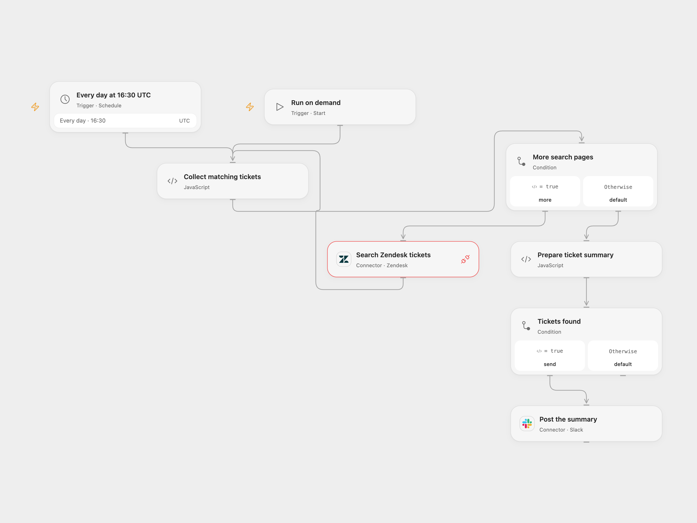

# Unassigned Zendesk Tickets to Slack

Summarize unassigned new and open Zendesk tickets in one Slack message.

<picture>
  <source media="(prefers-color-scheme: dark)" srcset="preview-dark.png">
  
</picture>

[Open Flow JSON](templates/unassigned-zendesk-tickets-to-slack.openflow.json) · [n8n JSON](templates/unassigned-zendesk-tickets-to-slack.n8n.json)

## Setup

Connect Zendesk to **Search Zendesk tickets**, with search permission and Provider API Request access. Connect Slack and set the channel ID in **Post the summary**. In n8n, configure Zendesk API token and Slack credentials, set your Zendesk subdomain in **Search Zendesk tickets**, and set the Slack channel. Run manually or enable the daily schedule. The source used the n8n instance timezone; both templates start at 16:30 UTC, so check the timezone before activation. Open Flow runs at the minute boundary; n8n Cron V1 chooses a second within that minute.

## Behavior

The workflow searches `type:ticket assignee:none status<pending`, collects all available pages, and posts one summary with ticket links, statuses and subjects. No matching tickets means no Slack message. Search indexing can lag, and offset pagination can change while tickets are being updated. Search errors, incomplete results or a result count above Zendesk’s 1,000-result limit stop before posting. Slack messages above 40,000 characters also stop before posting. Subjects have Slack control characters escaped and formatting characters replaced with full-width equivalents to avoid unintended markup. Only Zendesk-hosted ticket URLs are accepted.

A Slack failure stops the run; a message with an uncertain result may already be present, so check the channel before retrying.

## Changes to the source

- Replace the private channel and make the timezone explicit.
- Validate ticket links and escape message content before posting.
- Check every search page and the API result limit before posting; n8n uses its authenticated HTTP request to retain page metadata.

Source and license

Adapted from [Zendesk-to-slack](https://github.com/Zie619/n8n-workflows/blob/ae8cf6dc5b873cbb4f74587aa9180ed3a9f70682/workflows/Manual/0568_Manual_Zendesk_Automation_Scheduled.json) in [Zie619/n8n-workflows](https://github.com/Zie619/n8n-workflows). The source export does not identify a separate template author or license.

The collection’s [MIT notice](https://github.com/Zie619/n8n-workflows/blob/94007c1445d9258a7da116646b79473e7c7c3282/LICENSE) is pinned at a later revision. This is the collection notice at that revision; it does not establish a separate original template author's license. Our changes are listed above; see [repository licensing](../../README.md#licensing).

> MIT License
>
> Copyright (c) 2025 Zie619
>
> Permission is hereby granted, free of charge, to any person obtaining a copy
> of this software and associated documentation files (the "Software"), to deal
> in the Software without restriction, including without limitation the rights
> to use, copy, modify, merge, publish, distribute, sublicense, and/or sell
> copies of the Software, and to permit persons to whom the Software is
> furnished to do so, subject to the following conditions:
>
> The above copyright notice and this permission notice shall be included in all
> copies or substantial portions of the Software.
>
> THE SOFTWARE IS PROVIDED "AS IS", WITHOUT WARRANTY OF ANY KIND, EXPRESS OR
> IMPLIED, INCLUDING BUT NOT LIMITED TO THE WARRANTIES OF MERCHANTABILITY,
> FITNESS FOR A PARTICULAR PURPOSE AND NONINFRINGEMENT. IN NO EVENT SHALL THE
> AUTHORS OR COPYRIGHT HOLDERS BE LIABLE FOR ANY CLAIM, DAMAGES OR OTHER
> LIABILITY, WHETHER IN AN ACTION OF CONTRACT, TORT OR OTHERWISE, ARISING FROM,
> OUT OF OR IN CONNECTION WITH THE SOFTWARE OR THE USE OR OTHER DEALINGS IN THE
> SOFTWARE.

