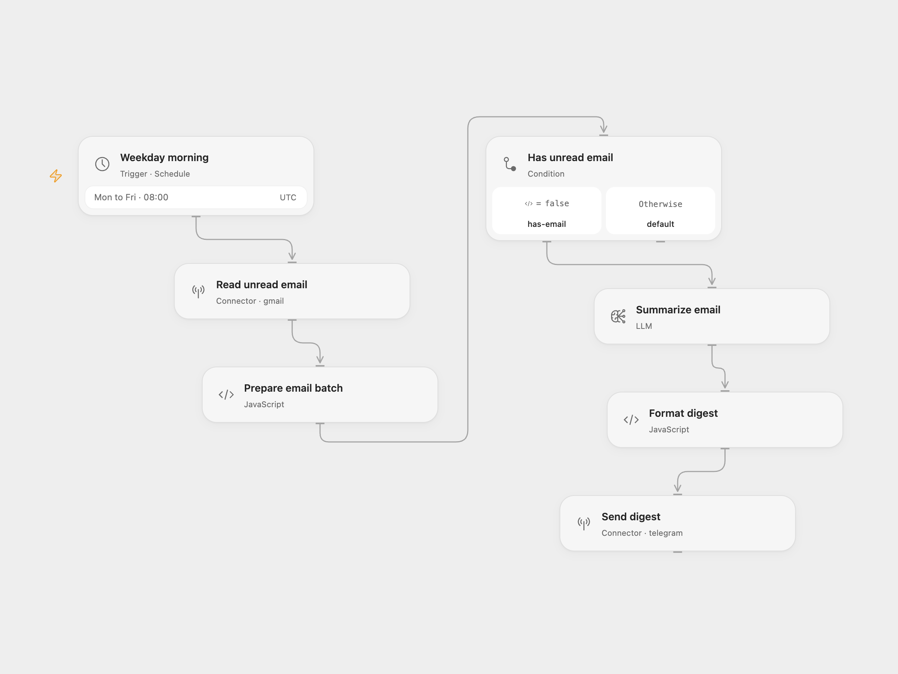

# Unread Email Digest

Every weekday at 08:00, read up to 25 unread Gmail messages, summarize them with AI, and send one prioritized morning digest to Telegram. The digest is written in Italian.

<picture>
  <source media="(prefers-color-scheme: dark)" srcset="preview-dark.png">
  
</picture>

[Open Flow JSON](templates/unread-email-digest.openflow.json) · [n8n JSON](templates/unread-email-digest.n8n.json)

## Setup

For Open Flow, import the JSON and configure:

| Node | Configuration |
| --- | --- |
| Weekday morning | Confirm the schedule and timezone. The template starts at `08:00 UTC`, Monday–Friday. |
| Read unread email | Connect the Gmail account to summarize. |
| Summarize email | Configure access to `gpt-4o-mini`, or select a model supported by your deployment. Edit the prompt to change the output language or priorities. |
| Format digest | Set `timezone` to match the schedule timezone for the date in the heading. |
| Send digest | Connect your Telegram bot and replace `@YOUR_TELEGRAM_CHANNEL` with your destination. |

For n8n, connect Gmail, OpenAI, and Telegram in their respective nodes, set the Telegram chat ID, and confirm the workflow timezone. The exported template uses `UTC`.

Run a manual test after configuration. Publish and enable the workflow to start automatic delivery.

## Behavior

The Gmail search is:

```text
is:unread newer_than:1d -category:promotions -category:social
```

The workflow sends the model each message's sender, subject, and first 200 characters of preview text. It makes one summary request for the whole batch. Empty results produce no model call or Telegram notification. Messages stay unread.

The prompt groups messages into urgent, important, and remaining items. Model output is delivered as plain text. It must fit within Telegram's 4,096-character message limit.

<details>
<summary>Inspiration &amp; credits</summary>

## Improvements to the source

- Set an explicit UTC schedule instead of depending on an unspecified instance timezone. The schedule and heading timezone are configurable.
- Deliver Telegram notifications as plain text so underscores, brackets, or other model-generated markup cannot cause Markdown parsing errors.

The source's weekday schedule, search query, 25-message limit, preview length, Italian priorities, and empty-result branch are retained.

Adapted from [Daily AI digest of unread emails to Telegram (Italian)](https://github.com/enescingoz/awesome-n8n-templates/blob/827110332c21cbe000ab13f6d292d5adb1f1f8db/Gmail_and_Email_Automation/Daily%20AI%20digest%20of%20unread%20emails%20to%20Telegram%20(Italian).json) in [enescingoz/awesome-n8n-templates](https://github.com/enescingoz/awesome-n8n-templates).

Source collection notice: © 2024–2026 Enes Cingoz, [CC BY 4.0](https://github.com/enescingoz/awesome-n8n-templates/blob/827110332c21cbe000ab13f6d292d5adb1f1f8db/LICENSE). The source export does not identify a separate template author or license. This adaptation includes the changes listed above; see [repository licensing](../../README.md#licensing) for the scope of OOMOL contributions and third-party material.

</details>
