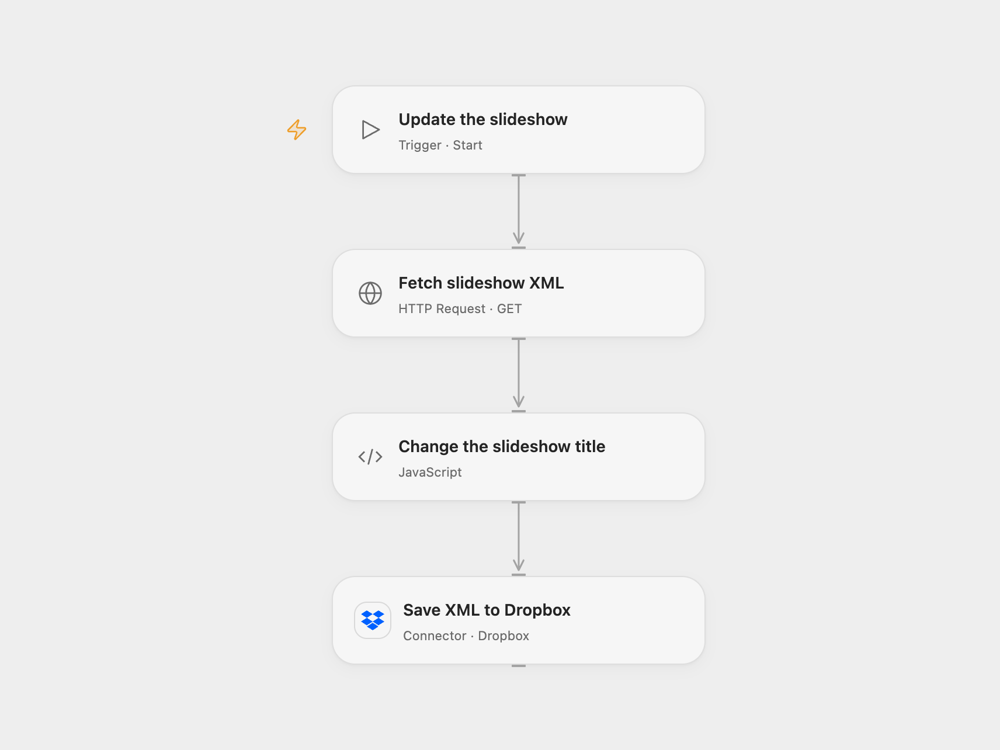

# Update an XML Slideshow in Dropbox

Fetch the sample XML slideshow, change its title and save the XML to Dropbox.

<picture>
  <source media="(prefers-color-scheme: dark)" srcset="preview-dark.png">
  
</picture>

[Open Flow JSON](templates/update-an-xml-slideshow-in-dropbox.openflow.json) · [n8n JSON](templates/update-an-xml-slideshow-in-dropbox.n8n.json)

## Setup and use

Connect Dropbox. Set the title in **Change the slideshow title** and the destination path in **Save XML to Dropbox**. In n8n, connect Dropbox and configure the title in **Change title** and the destination path. Run manually.

## Behavior

Fetch the sample slideshow from httpbin, replace the slideshow title and save the result as XML. Open Flow expects a slideshow root with one title attribute; it preserves the rest of the fetched document. The Dropbox add operation fails if the path already exists. An unknown upload outcome may have succeeded; inspect Dropbox before retrying.

Inspiration &amp; credits

## Changes to the source

- Add a manual trigger and fix the Dropbox content mapping. Keep XML attributes during n8n conversion so the slideshow title remains an attribute. Open Flow edits that attribute while preserving the rest of the source text.

Adapted from [Update a slideshow XML file](https://github.com/Zie619/n8n-workflows/blob/ae8cf6dc5b873cbb4f74587aa9180ed3a9f70682/workflows/Http/0153_HTTP_Dropbox_Update_Webhook.json) in [Zie619/n8n-workflows](https://github.com/Zie619/n8n-workflows). The source export does not identify a separate template author or license.

The collection’s [MIT notice](https://github.com/Zie619/n8n-workflows/blob/94007c1445d9258a7da116646b79473e7c7c3282/LICENSE) is pinned at a later revision. This is the collection notice at that revision; it does not establish a separate original template author's license. Our changes are listed above; see [repository licensing](../../README.md#licensing).

> MIT License
>
> Copyright (c) 2025 Zie619
>
> Permission is hereby granted, free of charge, to any person obtaining a copy
> of this software and associated documentation files (the "Software"), to deal
> in the Software without restriction, including without limitation the rights
> to use, copy, modify, merge, publish, distribute, sublicense, and/or sell
> copies of the Software, and to permit persons to whom the Software is
> furnished to do so, subject to the following conditions:
>
> The above copyright notice and this permission notice shall be included in all
> copies or substantial portions of the Software.
>
> THE SOFTWARE IS PROVIDED "AS IS", WITHOUT WARRANTY OF ANY KIND, EXPRESS OR
> IMPLIED, INCLUDING BUT NOT LIMITED TO THE WARRANTIES OF MERCHANTABILITY,
> FITNESS FOR A PARTICULAR PURPOSE AND NONINFRINGEMENT. IN NO EVENT SHALL THE
> AUTHORS OR COPYRIGHT HOLDERS BE LIABLE FOR ANY CLAIM, DAMAGES OR OTHER
> LIABILITY, WHETHER IN AN ACTION OF CONTRACT, TORT OR OTHERWISE, ARISING FROM,
> OUT OF OR IN CONNECTION WITH THE SOFTWARE OR THE USE OR OTHER DEALINGS IN THE
> SOFTWARE.

