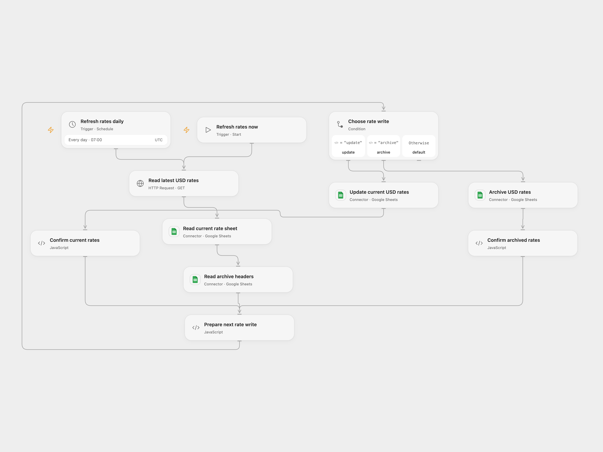

# Update and Archive USD Exchange Rates

Refresh a USD exchange rate row and append a historical snapshot in Google Sheets.

<!-- template-actions:start -->
 
<!-- template-actions:end -->

<picture>
  <source media="(prefers-color-scheme: dark)" srcset="preview-dark.png">
  
</picture>

## Setup

Set the secret deployment variable EXCHANGE_RATE_URL to the complete ExchangeRate-API Standard URL for USD, including your API key. Protect execution logs because the key is part of the URL. Connect Google Sheets and set the spreadsheet ID on all four Sheets nodes. Create sheets named Rates and Archives with matching column headers, including base_currency and time_last_update_utc, plus desired currency codes. Rates must contain exactly one USD row. Set a unique namespace in **Prepare next rate write** and enable persistent State. Create one row with item_key exchange-rates:YOUR_RATE_SHEET and status ready; use the same key in all checkpoint nodes. For an uncertain update, inspect the USD row and set status to archive_ready if confirmed or ready if absent. For an uncertain archive, inspect the matching timestamp and set status to done if confirmed or archive_ready if absent. Keep the snapshot and stamp unchanged during reconciliation.

## Behavior

Run manually or daily at 07:00 UTC. The current USD row is updated and a matching snapshot is appended to Archives. Each update timestamp is archived once. Avoid overlapping runs and concurrent edits to the current row. If a write is uncertain, inspect its destination, then enter the pending key and confirmed or absent in **Prepare next rate write**. Clear the recovery fields afterward. The preserved snapshot is used until both writes complete.

[ExchangeRate-API Standard requests](https://www.exchangerate-api.com/docs/standard-requests)

In n8n

In n8n configure the API key in **USD Query**, both sheet IDs, and one Data Table with text columns item_key, status, snapshot and stamp.

Inspiration &amp; credits

Map rates by sheet headers, preserve a snapshot across both writes, and stop for uncertain writes.

Adapted from [Update and archive exchange rates](https://github.com/Zie619/n8n-workflows/blob/ae8cf6dc5b873cbb4f74587aa9180ed3a9f70682/workflows/Code/0856_Code_Schedule_Update_Scheduled.json) in [Zie619/n8n-workflows](https://github.com/Zie619/n8n-workflows). Attribution: Samir Saci (named in source tutorial) / Zie619 (collection).

The collection’s [MIT notice](https://github.com/Zie619/n8n-workflows/blob/94007c1445d9258a7da116646b79473e7c7c3282/LICENSE) is pinned at a later revision. This is the collection notice at that revision; it does not establish a separate original template author's license. Our changes are listed above; see [repository licensing](../../README.md#licensing).

> MIT License
>
> Copyright (c) 2025 Zie619
>
> Permission is hereby granted, free of charge, to any person obtaining a copy
> of this software and associated documentation files (the "Software"), to deal
> in the Software without restriction, including without limitation the rights
> to use, copy, modify, merge, publish, distribute, sublicense, and/or sell
> copies of the Software, and to permit persons to whom the Software is
> furnished to do so, subject to the following conditions:
>
> The above copyright notice and this permission notice shall be included in all
> copies or substantial portions of the Software.
>
> THE SOFTWARE IS PROVIDED "AS IS", WITHOUT WARRANTY OF ANY KIND, EXPRESS OR
> IMPLIED, INCLUDING BUT NOT LIMITED TO THE WARRANTIES OF MERCHANTABILITY,
> FITNESS FOR A PARTICULAR PURPOSE AND NONINFRINGEMENT. IN NO EVENT SHALL THE
> AUTHORS OR COPYRIGHT HOLDERS BE LIABLE FOR ANY CLAIM, DAMAGES OR OTHER
> LIABILITY, WHETHER IN AN ACTION OF CONTRACT, TORT OR OTHERWISE, ARISING FROM,
> OUT OF OR IN CONNECTION WITH THE SOFTWARE OR THE USE OR OTHER DEALINGS IN THE
> SOFTWARE.

