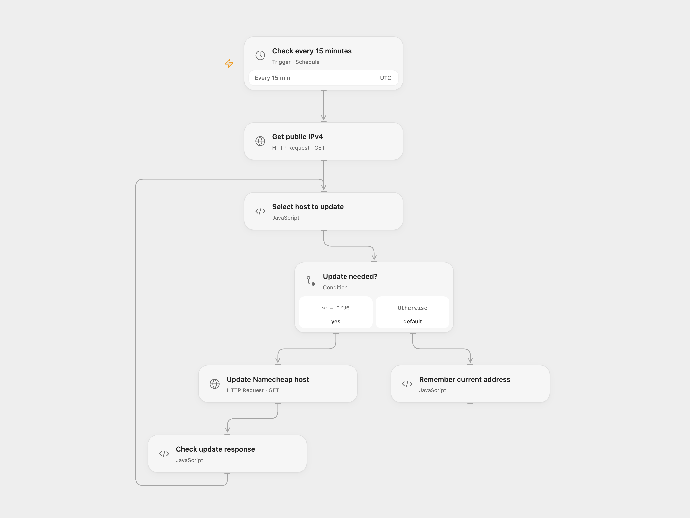

# Update Namecheap Dynamic DNS

Keep Namecheap dynamic DNS host records pointed at the current public IPv4 address.

<picture>
  <source media="(prefers-color-scheme: dark)" srcset="preview-dark.png">
  
</picture>

[Open Flow JSON](templates/update-namecheap-dynamic-dns.openflow.json) · [n8n JSON](templates/update-namecheap-dynamic-dns.n8n.json)

## Setup and use

Enable Dynamic DNS and create A+Dynamic DNS records for each host in Namecheap. Set your exact domain and host names in **Select host to update** and bind secret Variable NAMECHEAP_DDNS_PASSWORD to **Update Namecheap host**. Enable persistent State and avoid overlapping runs. In n8n set the domain and host list in the configuration nodes, and configure HTTP Query Auth with name password and the Dynamic DNS password as its value. Activate one format.

## Behavior

Every 15 minutes, the workflow checks the public IPv4 address using ipify. The first run updates every configured host; later runs update them when the address changes. An address is remembered only after all updates succeed. An interrupted or failed run may repeat an update on the next schedule. Namecheap receives the password in the HTTPS query as required by its API; protect access to network logs. IPv6 is not supported by Namecheap Dynamic DNS.

Inspiration &amp; credits

## Changes to the source

- Fix the host parameter, compare the latest address rather than all historical addresses, and save it after successful updates. Use a secret for the password.

Adapted from [NameCheap Dynamic DNS (DDNS)](https://github.com/Zie619/n8n-workflows/blob/ae8cf6dc5b873cbb4f74587aa9180ed3a9f70682/workflows/Http/0939_HTTP_Cron_Automation_Webhook.json) in [Zie619/n8n-workflows](https://github.com/Zie619/n8n-workflows). The source export does not identify a separate template author or license.

The collection’s [MIT notice](https://github.com/Zie619/n8n-workflows/blob/94007c1445d9258a7da116646b79473e7c7c3282/LICENSE) is pinned at a later revision. This is the collection notice at that revision; it does not establish a separate original template author's license. Our changes are listed above; see [repository licensing](../../README.md#licensing).

> MIT License
>
> Copyright (c) 2025 Zie619
>
> Permission is hereby granted, free of charge, to any person obtaining a copy
> of this software and associated documentation files (the "Software"), to deal
> in the Software without restriction, including without limitation the rights
> to use, copy, modify, merge, publish, distribute, sublicense, and/or sell
> copies of the Software, and to permit persons to whom the Software is
> furnished to do so, subject to the following conditions:
>
> The above copyright notice and this permission notice shall be included in all
> copies or substantial portions of the Software.
>
> THE SOFTWARE IS PROVIDED "AS IS", WITHOUT WARRANTY OF ANY KIND, EXPRESS OR
> IMPLIED, INCLUDING BUT NOT LIMITED TO THE WARRANTIES OF MERCHANTABILITY,
> FITNESS FOR A PARTICULAR PURPOSE AND NONINFRINGEMENT. IN NO EVENT SHALL THE
> AUTHORS OR COPYRIGHT HOLDERS BE LIABLE FOR ANY CLAIM, DAMAGES OR OTHER
> LIABILITY, WHETHER IN AN ACTION OF CONTRACT, TORT OR OTHERWISE, ARISING FROM,
> OUT OF OR IN CONNECTION WITH THE SOFTWARE OR THE USE OR OTHER DEALINGS IN THE
> SOFTWARE.

