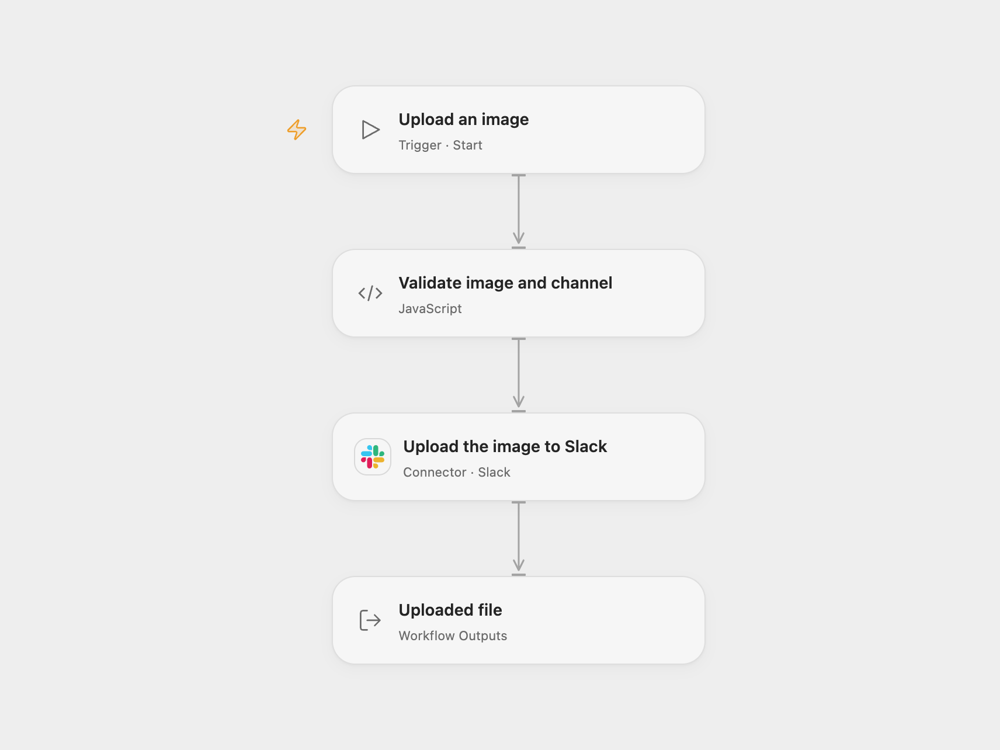

# Upload a Public Image to Slack

Download a public image and upload its bytes to a Slack channel with a comment.

<picture>
  <source media="(prefers-color-scheme: dark)" srcset="preview-dark.png">
  
</picture>

[Open Flow JSON](templates/upload-a-public-image-to-slack.openflow.json) · [n8n JSON](templates/upload-a-public-image-to-slack.n8n.json)

## Setup

Connect Slack with `files:write` and access to the target channel. In **Validate image and channel**, enter a public HTTPS PNG URL, the filename Slack should display, and the channel ID. The source image URL returned HTTP 404 when checked, so provide an available image. The example filename uses the source URL basename.

In n8n, set the image URL in **Download the file**, and set the channel ID and filename in **Post to Slack**. Connect Slack credentials. Run one format for each intended upload.

## Behavior

Run manually to download the file bytes and upload them to the configured channel with the comment “This is the file”. Open Flow returns the Slack file ID and upload result; n8n returns the native upload result. If upload completion fails or the result is uncertain, inspect the channel before retrying: the file may already have been uploaded.

Inspiration &amp; credits

## Changes to the source

- The original image URL is unavailable, so both formats require an accessible replacement and channel ID; the source channel was removed.
- Upgrade the n8n Slack node to version 2.2 for Slack’s current external upload protocol. Open Flow uses the Slack upload Action, which fetches the URL and uploads its response bytes.

Adapted from [Manual HTTP download and Slack file upload](https://github.com/Zie619/n8n-workflows/blob/ae8cf6dc5b873cbb4f74587aa9180ed3a9f70682/workflows/Manual/0191_Manual_Slack_Automation_Webhook.json) in [Zie619/n8n-workflows](https://github.com/Zie619/n8n-workflows). The source export does not identify a separate template author or license.

The collection’s [MIT notice](https://github.com/Zie619/n8n-workflows/blob/94007c1445d9258a7da116646b79473e7c7c3282/LICENSE) is pinned at a later revision. This is the collection notice at that revision; it does not establish a separate original template author's license. Our changes are listed above; see [repository licensing](../../README.md#licensing).

> MIT License
>
> Copyright (c) 2025 Zie619
>
> Permission is hereby granted, free of charge, to any person obtaining a copy
> of this software and associated documentation files (the "Software"), to deal
> in the Software without restriction, including without limitation the rights
> to use, copy, modify, merge, publish, distribute, sublicense, and/or sell
> copies of the Software, and to permit persons to whom the Software is
> furnished to do so, subject to the following conditions:
>
> The above copyright notice and this permission notice shall be included in all
> copies or substantial portions of the Software.
>
> THE SOFTWARE IS PROVIDED "AS IS", WITHOUT WARRANTY OF ANY KIND, EXPRESS OR
> IMPLIED, INCLUDING BUT NOT LIMITED TO THE WARRANTIES OF MERCHANTABILITY,
> FITNESS FOR A PARTICULAR PURPOSE AND NONINFRINGEMENT. IN NO EVENT SHALL THE
> AUTHORS OR COPYRIGHT HOLDERS BE LIABLE FOR ANY CLAIM, DAMAGES OR OTHER
> LIABILITY, WHETHER IN AN ACTION OF CONTRACT, TORT OR OTHERWISE, ARISING FROM,
> OUT OF OR IN CONNECTION WITH THE SOFTWARE OR THE USE OR OTHER DEALINGS IN THE
> SOFTWARE.

