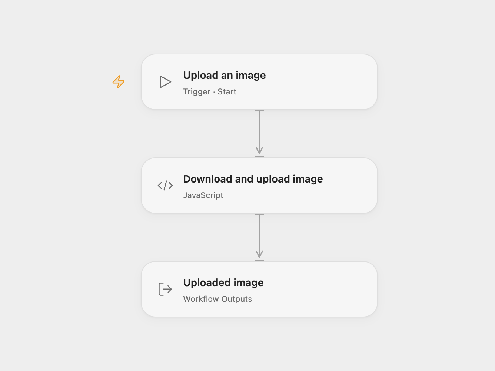

# Upload a Remote Image to SharePoint

Download a remote image and upload it to the root SharePoint site drive.

<picture>
  <source media="(prefers-color-scheme: dark)" srcset="preview-dark.png">
  
</picture>

[Open Flow JSON](templates/upload-a-remote-image-to-sharepoint.openflow.json) · [n8n JSON](templates/upload-a-remote-image-to-sharepoint.n8n.json)

## Setup and use

Obtain a Microsoft Graph access token with write access to the root site drive and store it in the secret Variable GRAPH_ACCESS_TOKEN. Configure the image URL, folder and filename in **Download and upload image**. If you change image hosts, update that node’s HTTP capability and host check. In n8n, set the image URL and destination and connect an HTTP Header Auth credential named Authorization with the value Bearer followed by a space and the Graph token. Run one format manually.

## Behavior

The workflow downloads the image and uploads its bytes to the specified path on the root site drive. The target folder must exist. An existing file at that path can be replaced. If the upload result is unknown, inspect the destination before retrying. The Open Flow Code HTTP response limit is 1 MiB. The example image is provided by Picsum and depends on its availability.

Inspiration &amp; credits

## Changes to the source

- Replace inline application credentials and token request with a separately obtained token. Open Flow returns the uploaded item's ID and name.

Adapted from [Upload photo to SharePoint](https://github.com/Zie619/n8n-workflows/blob/ae8cf6dc5b873cbb4f74587aa9180ed3a9f70682/workflows/Manual/0886_Manual_Stickynote_Import_Webhook.json) in [Zie619/n8n-workflows](https://github.com/Zie619/n8n-workflows). The source export does not identify a separate template author or license.

The collection’s [MIT notice](https://github.com/Zie619/n8n-workflows/blob/94007c1445d9258a7da116646b79473e7c7c3282/LICENSE) is pinned at a later revision. This is the collection notice at that revision; it does not establish a separate original template author's license. Our changes are listed above; see [repository licensing](../../README.md#licensing).

> MIT License
>
> Copyright (c) 2025 Zie619
>
> Permission is hereby granted, free of charge, to any person obtaining a copy
> of this software and associated documentation files (the "Software"), to deal
> in the Software without restriction, including without limitation the rights
> to use, copy, modify, merge, publish, distribute, sublicense, and/or sell
> copies of the Software, and to permit persons to whom the Software is
> furnished to do so, subject to the following conditions:
>
> The above copyright notice and this permission notice shall be included in all
> copies or substantial portions of the Software.
>
> THE SOFTWARE IS PROVIDED "AS IS", WITHOUT WARRANTY OF ANY KIND, EXPRESS OR
> IMPLIED, INCLUDING BUT NOT LIMITED TO THE WARRANTIES OF MERCHANTABILITY,
> FITNESS FOR A PARTICULAR PURPOSE AND NONINFRINGEMENT. IN NO EVENT SHALL THE
> AUTHORS OR COPYRIGHT HOLDERS BE LIABLE FOR ANY CLAIM, DAMAGES OR OTHER
> LIABILITY, WHETHER IN AN ACTION OF CONTRACT, TORT OR OTHERWISE, ARISING FROM,
> OUT OF OR IN CONNECTION WITH THE SOFTWARE OR THE USE OR OTHER DEALINGS IN THE
> SOFTWARE.

