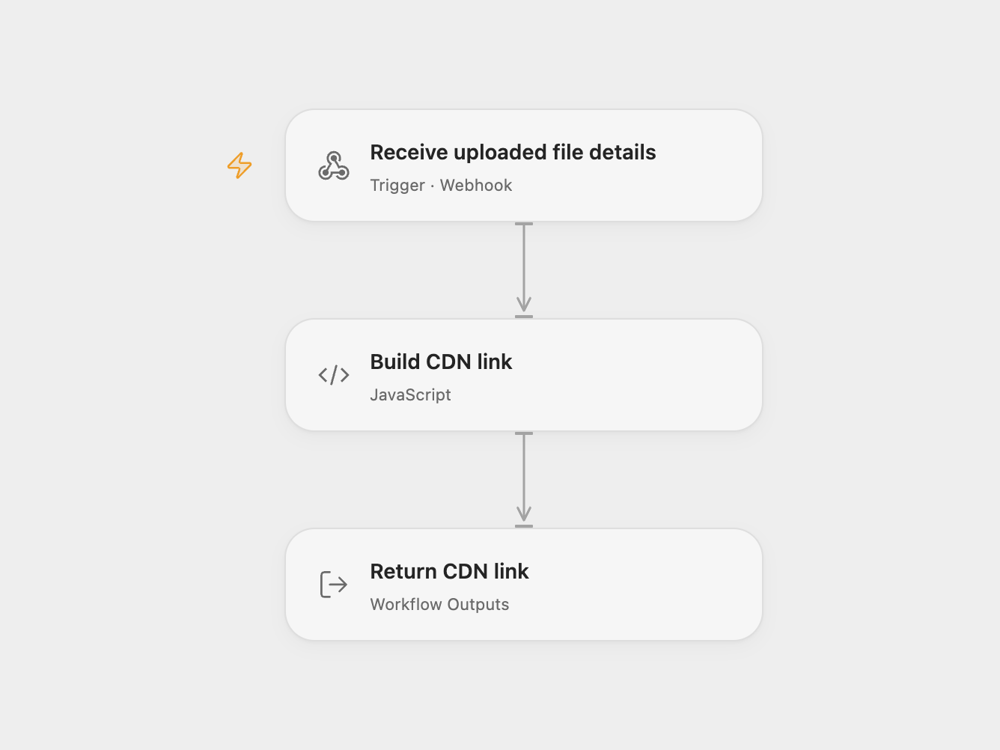

# Upload a Form File to Spaces

Upload a form file to DigitalOcean Spaces and return its CDN link.

<picture>
  <source media="(prefers-color-scheme: dark)" srcset="preview-dark.png">
  
</picture>

[Open Flow JSON](templates/upload-form-file-to-spaces.openflow.json) · [n8n JSON](templates/upload-form-file-to-spaces.n8n.json)

## Setup and use

Import the n8n workflow and configure its S3 credentials for your DigitalOcean Spaces endpoint and bucket. Enable the Spaces CDN. Set **Execution mode** to n8n or openflow. For Open Flow mode configure the relay URL, deploy the workflow and set your CDN base in **Build CDN link**. Publish the n8n form and choose one mode. Restrict access to the Open Flow endpoint, which does not authenticate callers.

## Behavior

n8n receives one file and uploads its bytes with the **public-read** ACL, then the selected branch shows its CDN URL on the form completion page. Public-read permits anyone with the link to read the object. Spaces CDN must be enabled; a prior cached object may take time to refresh. The Open Flow path receives the form's file metadata after n8n completes the upload. If an upload result is unknown, inspect the bucket before retrying; a later link or form failure does not undo the upload.

Inspiration &amp; credits

## Changes to the source

- Configure the form for one file, correct its binary field and filename mapping, replace sample identifiers and add an optional Open Flow link relay; n8n retains the form, binary upload and public-read ACL.

Adapted from [Upload a file to public Spaces](https://github.com/Zie619/n8n-workflows/blob/ae8cf6dc5b873cbb4f74587aa9180ed3a9f70682/workflows/Form/1371_Form_S3_Import_Triggered.json) in [Zie619/n8n-workflows](https://github.com/Zie619/n8n-workflows). The source export does not identify a separate template author or license.

The collection’s [MIT notice](https://github.com/Zie619/n8n-workflows/blob/94007c1445d9258a7da116646b79473e7c7c3282/LICENSE) is pinned at a later revision. This is the collection notice at that revision; it does not establish a separate original template author's license. Our changes are listed above; see [repository licensing](../../README.md#licensing).

> MIT License
>
> Copyright (c) 2025 Zie619
>
> Permission is hereby granted, free of charge, to any person obtaining a copy
> of this software and associated documentation files (the "Software"), to deal
> in the Software without restriction, including without limitation the rights
> to use, copy, modify, merge, publish, distribute, sublicense, and/or sell
> copies of the Software, and to permit persons to whom the Software is
> furnished to do so, subject to the following conditions:
>
> The above copyright notice and this permission notice shall be included in all
> copies or substantial portions of the Software.
>
> THE SOFTWARE IS PROVIDED "AS IS", WITHOUT WARRANTY OF ANY KIND, EXPRESS OR
> IMPLIED, INCLUDING BUT NOT LIMITED TO THE WARRANTIES OF MERCHANTABILITY,
> FITNESS FOR A PARTICULAR PURPOSE AND NONINFRINGEMENT. IN NO EVENT SHALL THE
> AUTHORS OR COPYRIGHT HOLDERS BE LIABLE FOR ANY CLAIM, DAMAGES OR OTHER
> LIABILITY, WHETHER IN AN ACTION OF CONTRACT, TORT OR OTHERWISE, ARISING FROM,
> OUT OF OR IN CONNECTION WITH THE SOFTWARE OR THE USE OR OTHER DEALINGS IN THE
> SOFTWARE.

