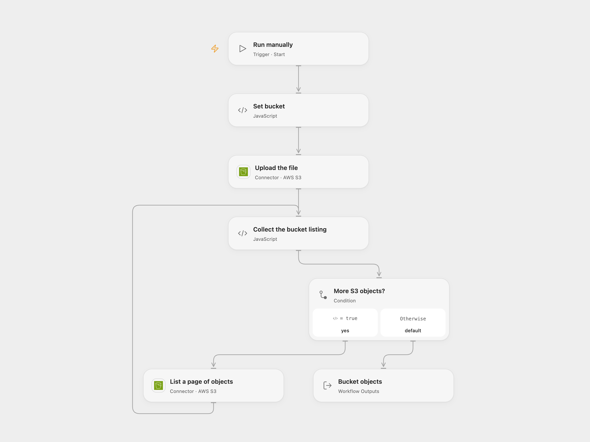

# Upload a URL and List S3 Objects

Upload a public file to an S3 bucket and list the bucket objects.

<picture>
  <source media="(prefers-color-scheme: dark)" srcset="preview-dark.png">
  
</picture>

[Open Flow JSON](templates/upload-url-and-list-s3-objects.openflow.json) · [n8n JSON](templates/upload-url-and-list-s3-objects.n8n.json)

## Setup and use

Connect AWS S3 with permission to upload the object and list the bucket. In Open Flow set the bucket in **Set bucket** and the object key and public file URL in **Upload the file**. In n8n set the URL in **HTTP Request**, the same bucket in both S3 nodes, and connect S3 credentials. The downloaded file's name is used as its S3 key.

## Behavior

A manual run uploads the file, then lists all pages of objects in the bucket. Open Flow returns the list as an array; n8n emits objects individually. The listing must fit the workflow's execution and output limits. If the upload result is unknown, inspect the object before retrying. A failed later listing does not undo the upload.

Inspiration &amp; credits

## Changes to the source

- Replace the sample bucket and image with configuration. Open Flow uses the S3 connector to fetch the public URL and an explicit object key.

Adapted from [Upload a file and list an S3 bucket](https://github.com/Zie619/n8n-workflows/blob/ae8cf6dc5b873cbb4f74587aa9180ed3a9f70682/workflows/Manual/1088_Manual_S3_Import_Webhook.json) in [Zie619/n8n-workflows](https://github.com/Zie619/n8n-workflows). The source export does not identify a separate template author or license.

The collection’s [MIT notice](https://github.com/Zie619/n8n-workflows/blob/94007c1445d9258a7da116646b79473e7c7c3282/LICENSE) is pinned at a later revision. This is the collection notice at that revision; it does not establish a separate original template author's license. Our changes are listed above; see [repository licensing](../../README.md#licensing).

> MIT License
>
> Copyright (c) 2025 Zie619
>
> Permission is hereby granted, free of charge, to any person obtaining a copy
> of this software and associated documentation files (the "Software"), to deal
> in the Software without restriction, including without limitation the rights
> to use, copy, modify, merge, publish, distribute, sublicense, and/or sell
> copies of the Software, and to permit persons to whom the Software is
> furnished to do so, subject to the following conditions:
>
> The above copyright notice and this permission notice shall be included in all
> copies or substantial portions of the Software.
>
> THE SOFTWARE IS PROVIDED "AS IS", WITHOUT WARRANTY OF ANY KIND, EXPRESS OR
> IMPLIED, INCLUDING BUT NOT LIMITED TO THE WARRANTIES OF MERCHANTABILITY,
> FITNESS FOR A PARTICULAR PURPOSE AND NONINFRINGEMENT. IN NO EVENT SHALL THE
> AUTHORS OR COPYRIGHT HOLDERS BE LIABLE FOR ANY CLAIM, DAMAGES OR OTHER
> LIABILITY, WHETHER IN AN ACTION OF CONTRACT, TORT OR OTHERWISE, ARISING FROM,
> OUT OF OR IN CONNECTION WITH THE SOFTWARE OR THE USE OR OTHER DEALINGS IN THE
> SOFTWARE.

