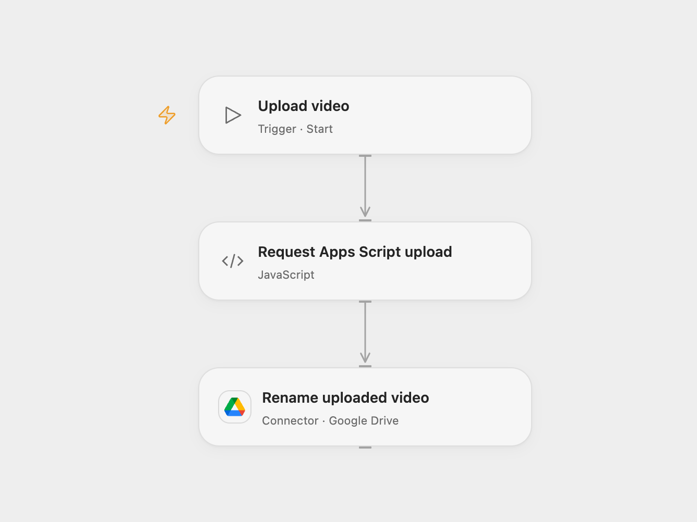

# Upload Video via Apps Script and Rename

Send a video URL to a Google Apps Script web app and rename the uploaded Drive file.

<picture>
  <source media="(prefers-color-scheme: dark)" srcset="preview-dark.png">
  
</picture>

[Open Flow JSON](templates/upload-video-via-apps-script-and-rename.openflow.json) · [n8n JSON](templates/upload-video-via-apps-script-and-rename.n8n.json)

## Setup and use

Deploy your own Google Apps Script web app that accepts POST JSON with videoUrl and secret, uploads the video to Drive, and returns JSON with driveUrl as a Google Drive file link. The source does not include the script. Set its deployment URL and the video URL in **Request Apps Script upload**, bind the secret Variable APPS_SCRIPT_SECRET to the shared secret, and connect Google Drive. Set the desired filename in **Rename uploaded video**. The Code node allows the standard Apps Script hosts; update its HTTP capability if your deployment uses another host.

In n8n set the web app URL, video URL and shared secret in **Send URL to GDrive Script and Upload**, then connect Google Drive. The n8n request body contains the shared secret, so restrict access to workflow configuration and execution history. Run one format manually.

## Behavior

The script performs the upload and returns the file link. Each Open Flow Code HTTP request has a 30-second limit to receive its complete response. Real upload durations have not been measured and a video upload may exceed this limit. The workflow extracts the file ID from that link and renames the file. If the upload or rename result is uncertain, inspect Drive before rerunning because a file may already exist or be renamed.

Inspiration &amp; credits

## Changes to the source

- Replace the example URLs and shared secret with placeholders and use a Secret Variable in Open Flow.

Adapted from [Upload video to Drive via Apps Script](https://github.com/Zie619/n8n-workflows/blob/ae8cf6dc5b873cbb4f74587aa9180ed3a9f70682/workflows/Manual/1999_Manual_HTTP_Import_Webhook.json) in [Zie619/n8n-workflows](https://github.com/Zie619/n8n-workflows). The source export does not identify a separate template author or license.

The collection’s [MIT notice](https://github.com/Zie619/n8n-workflows/blob/94007c1445d9258a7da116646b79473e7c7c3282/LICENSE) is pinned at a later revision. This is the collection notice at that revision; it does not establish a separate original template author's license. Our changes are listed above; see [repository licensing](../../README.md#licensing).

> MIT License
>
> Copyright (c) 2025 Zie619
>
> Permission is hereby granted, free of charge, to any person obtaining a copy
> of this software and associated documentation files (the "Software"), to deal
> in the Software without restriction, including without limitation the rights
> to use, copy, modify, merge, publish, distribute, sublicense, and/or sell
> copies of the Software, and to permit persons to whom the Software is
> furnished to do so, subject to the following conditions:
>
> The above copyright notice and this permission notice shall be included in all
> copies or substantial portions of the Software.
>
> THE SOFTWARE IS PROVIDED "AS IS", WITHOUT WARRANTY OF ANY KIND, EXPRESS OR
> IMPLIED, INCLUDING BUT NOT LIMITED TO THE WARRANTIES OF MERCHANTABILITY,
> FITNESS FOR A PARTICULAR PURPOSE AND NONINFRINGEMENT. IN NO EVENT SHALL THE
> AUTHORS OR COPYRIGHT HOLDERS BE LIABLE FOR ANY CLAIM, DAMAGES OR OTHER
> LIABILITY, WHETHER IN AN ACTION OF CONTRACT, TORT OR OTHERWISE, ARISING FROM,
> OUT OF OR IN CONNECTION WITH THE SOFTWARE OR THE USE OR OTHER DEALINGS IN THE
> SOFTWARE.

