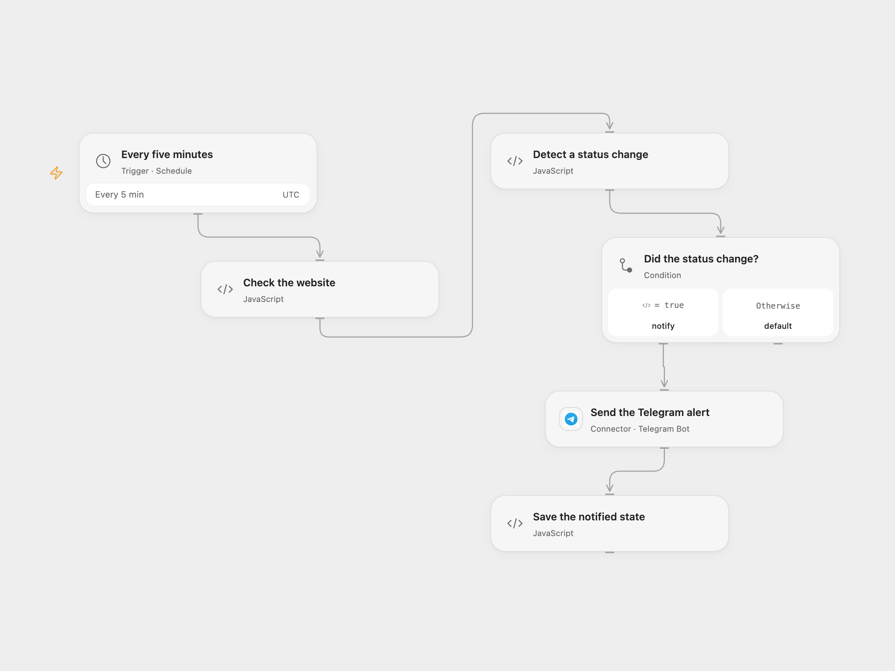

# Uptime Transition Alert to Telegram

Check a website every five minutes and send a Telegram alert when its HTTP status changes between up and down.

<picture>
  <source media="(prefers-color-scheme: dark)" srcset="preview-dark.png">
  
</picture>

[Open Flow JSON](templates/uptime-transition-alert-to-telegram.openflow.json) · [n8n JSON](templates/uptime-transition-alert-to-telegram.n8n.json)

## Setup

Connect Telegram and set the chat ID in **Send the Telegram alert**. In Open Flow, set the target URL in **Check the website** and add the target hostname and every possible redirect hostname to that Code node’s HTTP capability allowlist (up to 20 host patterns). In n8n, set the URL in **Chiama il sito**, connect Telegram and set the chat ID. Run one format with persistent workflow state and avoid overlapping executions.

## Behavior

Every five minutes, the workflow GETs the website, following up to 21 redirects within a ten-second total request budget. HTTP 5xx is down; other HTTP statuses are up. The first up check is silent. A transition to down sends a red alert; a subsequent transition back up sends a green alert. Repeated results send nothing. A network error or timeout stops the run without changing state or sending a status alert.

Both formats save a changed state after Telegram confirms the alert. A failed or uncertain send leaves the old state, so the next check tries the transition again. An uncertain send may have arrived and the retry can duplicate it; inspect the chat before manually retrying. Persistent state is scoped to the workflow, so use a separate workflow for each website. In Open Flow an unlisted redirect hostname or an HTTP response larger than 1 MiB stops the run without changing state.

## Changes to the source

- Replace the example URL and environment-variable chat ID with workflow configuration. Open Flow requires the HTTP host allowlist.
- Configure the n8n HTTP node to return the final status for non-2xx responses; the original flat option did not apply and the response did not include statusCode. Disable n8n’s automatic Telegram footer and save the changed state after a successful alert, so failed sends can be retried on the next check.

Source and license

Adapted from [Uptime Ping Alert — sai che un sito è giù prima dei tuoi utenti](https://github.com/enescingoz/awesome-n8n-templates/blob/827110332c21cbe000ab13f6d292d5adb1f1f8db/devops/uptime-ping-alert.json) in [enescingoz/awesome-n8n-templates](https://github.com/enescingoz/awesome-n8n-templates).

Source collection notice: © 2024–2026 Enes Cingoz, [CC BY 4.0](https://github.com/enescingoz/awesome-n8n-templates/blob/827110332c21cbe000ab13f6d292d5adb1f1f8db/LICENSE). The source export does not identify a separate template author or license. See [repository licensing](../../README.md#licensing) for the scope of OOMOL contributions and third-party material.

