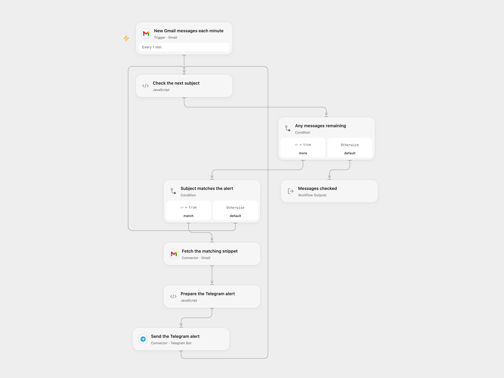

# Urgent Gmail Subjects to Telegram

Send a Telegram alert when a new Gmail subject contains `Urgent` or equals `Server Down`.

<picture>
  <source media="(prefers-color-scheme: dark)" srcset="preview-dark.png">
  
</picture>

[Open Flow JSON](templates/urgent-gmail-subject-to-telegram.openflow.json) · [n8n JSON](templates/urgent-gmail-subject-to-telegram.n8n.json)

## Setup

Connect the same Gmail mailbox in **New Gmail messages each minute** and **Fetch the matching snippet**. Connect your Telegram bot in **Send the Telegram alert**, and set the destination chat ID in **Prepare the Telegram alert**. The bot must be able to post in that chat.

In n8n, select Gmail and Telegram credentials and set the chat ID in **Send Telegram Message**. Activate only one format to avoid duplicate alerts.

## Behavior

Each minute, new incoming mail is checked. A subject matches if it contains `Urgent` anywhere or exactly equals `Server Down`; both checks are case-sensitive. `urgent` and `Server Down today` do not match. Each matching message sends one preformatted alert with the original sender, subject and Gmail snippet. Both formats escape the fields as literal text and disable link previews. The snippet is a preview, not the full email body.

The poll starts at the current mailbox position and does not import old mail. Both formats exclude drafts, spam, trash and outgoing-only messages. n8n also excludes scheduled messages; Open Flow does not add that filter. Open Flow uses Gmail history checkpoints; n8n uses a time cursor and bounded backlog queue. Poll pages contain at most 50 messages. Neither format guarantees exactly-once delivery or automatic replay after a workflow failure.

A failed read or send stops the page; earlier alerts may already have been sent. Check Telegram before replaying an uncertain send. The workflow does not split messages over Telegram’s 4096-character limit. Full fetched Gmail responses and Code inputs must fit execution limits. Restrict access to the mailbox, Telegram chat and run history.

## Changes to the source

- Add the missing Telegram chat setup and remove personal credential identifiers.
- Upgrade the n8n trigger to version 1.4 with a 50-message budget to retain a backlog and exclude outgoing-only mail, matching the incoming-mail purpose.
- Keep the exact case-sensitive subject rules and original sender, subject and snippet alert.
- Escape the alert as literal HTML instead of treating incoming email content as Markdown.

Source and license

Adapted from [Forward Filtered Gmail Notifications to Telegram Chat](https://github.com/Zie619/n8n-workflows/blob/ae8cf6dc5b873cbb4f74587aa9180ed3a9f70682/workflows/Telegram/1347_Telegram_Gmail_Automation_Triggered.json) in [Zie619/n8n-workflows](https://github.com/Zie619/n8n-workflows). The source export does not identify a separate template author or license.

The collection’s [MIT notice](https://github.com/Zie619/n8n-workflows/blob/94007c1445d9258a7da116646b79473e7c7c3282/LICENSE) is pinned at a later revision. This is the collection notice at that revision; it does not establish a separate original template author's license. Our changes are listed above; see [repository licensing](../../README.md#licensing).

> MIT License
>
> Copyright (c) 2025 Zie619
>
> Permission is hereby granted, free of charge, to any person obtaining a copy
> of this software and associated documentation files (the "Software"), to deal
> in the Software without restriction, including without limitation the rights
> to use, copy, modify, merge, publish, distribute, sublicense, and/or sell
> copies of the Software, and to permit persons to whom the Software is
> furnished to do so, subject to the following conditions:
>
> The above copyright notice and this permission notice shall be included in all
> copies or substantial portions of the Software.
>
> THE SOFTWARE IS PROVIDED "AS IS", WITHOUT WARRANTY OF ANY KIND, EXPRESS OR
> IMPLIED, INCLUDING BUT NOT LIMITED TO THE WARRANTIES OF MERCHANTABILITY,
> FITNESS FOR A PARTICULAR PURPOSE AND NONINFRINGEMENT. IN NO EVENT SHALL THE
> AUTHORS OR COPYRIGHT HOLDERS BE LIABLE FOR ANY CLAIM, DAMAGES OR OTHER
> LIABILITY, WHETHER IN AN ACTION OF CONTRACT, TORT OR OTHERWISE, ARISING FROM,
> OUT OF OR IN CONNECTION WITH THE SOFTWARE OR THE USE OR OTHER DEALINGS IN THE
> SOFTWARE.

