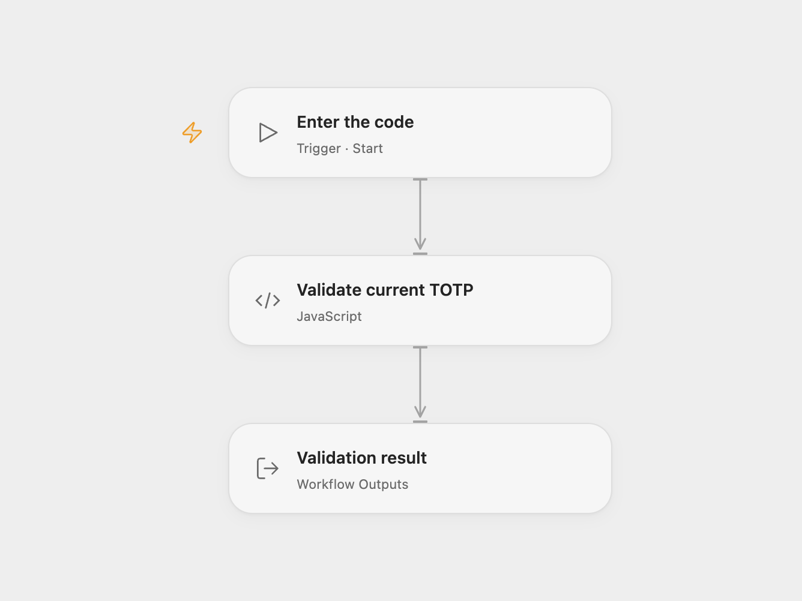

# Validate a TOTP Code

Demonstrate validating a six-digit TOTP code against a Base32 secret.

<picture>
  <source media="(prefers-color-scheme: dark)" srcset="preview-dark.png">
  
</picture>

[Open Flow JSON](templates/validate-a-totp-code.openflow.json) · [n8n JSON](templates/validate-a-totp-code.n8n.json)

## Setup and use

For Open Flow, bind a test Base32 secret to the secret Variable **TOTP_SECRET**, then run with the six-digit code as a string. In n8n, set the example secret and code in **EXAMPLE FIELDS** and run manually. Use test values when exploring the workflow.

## Behavior

The workflow calculates TOTP using HMAC-SHA1, six digits and 30-second steps. It compares only the current step and returns `1` for a match or `0` for a non-match. A malformed Base32 secret stops the run. n8n routes the result through its true/false IF node; Open Flow returns `status` for a later condition.

This is a validation example. Production authentication also needs appropriate protection against repeated attempts and replay, secure secret handling and a clock policy. n8n stores the example fields in workflow data, so do not put production secrets there.

Inspiration &amp; credits

## Changes to the source

- Replace the source's example secret and code with configuration. Open Flow uses a secret Variable and returns the status.

Adapted from [TOTP validation without creating a credential](https://github.com/Zie619/n8n-workflows/blob/ae8cf6dc5b873cbb4f74587aa9180ed3a9f70682/workflows/Manual/0558_Manual_Stickynote_Automation_Triggered.json) in [Zie619/n8n-workflows](https://github.com/Zie619/n8n-workflows). The source export does not identify a separate template author or license.

The collection’s [MIT notice](https://github.com/Zie619/n8n-workflows/blob/94007c1445d9258a7da116646b79473e7c7c3282/LICENSE) is pinned at a later revision. This is the collection notice at that revision; it does not establish a separate original template author's license. Our changes are listed above; see [repository licensing](../../README.md#licensing).

> MIT License
>
> Copyright (c) 2025 Zie619
>
> Permission is hereby granted, free of charge, to any person obtaining a copy
> of this software and associated documentation files (the "Software"), to deal
> in the Software without restriction, including without limitation the rights
> to use, copy, modify, merge, publish, distribute, sublicense, and/or sell
> copies of the Software, and to permit persons to whom the Software is
> furnished to do so, subject to the following conditions:
>
> The above copyright notice and this permission notice shall be included in all
> copies or substantial portions of the Software.
>
> THE SOFTWARE IS PROVIDED "AS IS", WITHOUT WARRANTY OF ANY KIND, EXPRESS OR
> IMPLIED, INCLUDING BUT NOT LIMITED TO THE WARRANTIES OF MERCHANTABILITY,
> FITNESS FOR A PARTICULAR PURPOSE AND NONINFRINGEMENT. IN NO EVENT SHALL THE
> AUTHORS OR COPYRIGHT HOLDERS BE LIABLE FOR ANY CLAIM, DAMAGES OR OTHER
> LIABILITY, WHETHER IN AN ACTION OF CONTRACT, TORT OR OTHERWISE, ARISING FROM,
> OUT OF OR IN CONNECTION WITH THE SOFTWARE OR THE USE OR OTHER DEALINGS IN THE
> SOFTWARE.

