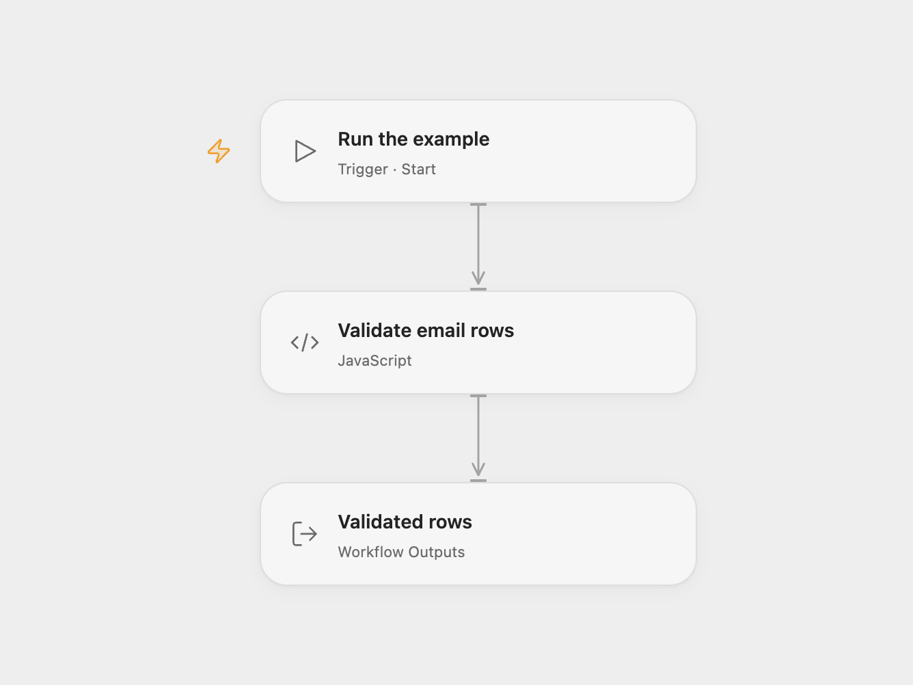

# Validate Emails and Extract Domains

Validate example email addresses and extract their domains.

<picture>
  <source media="(prefers-color-scheme: dark)" srcset="preview-dark.png">
  
</picture>

[Open Flow JSON](templates/validate-emails-and-extract-domains.openflow.json) · [n8n JSON](templates/validate-emails-and-extract-domains.n8n.json)

## Setup and use

Run manually with ten example rows. Edit the rows in **Validate email rows** in Open Flow. In n8n, the Debug Helper generates example emails; replace it with your own data source.

## Behavior

Each row keeps its original fields and gains `Valid EmailIs email ` as the string `true` or `false`, plus `Extract Domain`. Invalid email addresses receive an empty domain. Open Flow uses validator.js, whose email rules are stricter than n8n's string helper for some inputs. n8n retains the source helpers and its invalid-domain behavior may differ. Validation checks syntax and does not establish that a mailbox exists.

Inspiration &amp; credits

## Changes to the source

- Use validator.js in Open Flow and remove the source's pinned example data. Its license notice is included in the Code node.

Adapted from [Email validation and domain extraction](https://github.com/Zie619/n8n-workflows/blob/ae8cf6dc5b873cbb4f74587aa9180ed3a9f70682/workflows/Manual/0489_Manual_Debughelper_Create_Triggered.json) in [Zie619/n8n-workflows](https://github.com/Zie619/n8n-workflows). The source export does not identify a separate template author or license.

The collection’s [MIT notice](https://github.com/Zie619/n8n-workflows/blob/94007c1445d9258a7da116646b79473e7c7c3282/LICENSE) is pinned at a later revision. This is the collection notice at that revision; it does not establish a separate original template author's license. Our changes are listed above; see [repository licensing](../../README.md#licensing).

> MIT License
>
> Copyright (c) 2025 Zie619
>
> Permission is hereby granted, free of charge, to any person obtaining a copy
> of this software and associated documentation files (the "Software"), to deal
> in the Software without restriction, including without limitation the rights
> to use, copy, modify, merge, publish, distribute, sublicense, and/or sell
> copies of the Software, and to permit persons to whom the Software is
> furnished to do so, subject to the following conditions:
>
> The above copyright notice and this permission notice shall be included in all
> copies or substantial portions of the Software.
>
> THE SOFTWARE IS PROVIDED "AS IS", WITHOUT WARRANTY OF ANY KIND, EXPRESS OR
> IMPLIED, INCLUDING BUT NOT LIMITED TO THE WARRANTIES OF MERCHANTABILITY,
> FITNESS FOR A PARTICULAR PURPOSE AND NONINFRINGEMENT. IN NO EVENT SHALL THE
> AUTHORS OR COPYRIGHT HOLDERS BE LIABLE FOR ANY CLAIM, DAMAGES OR OTHER
> LIABILITY, WHETHER IN AN ACTION OF CONTRACT, TORT OR OTHERWISE, ARISING FROM,
> OUT OF OR IN CONNECTION WITH THE SOFTWARE OR THE USE OR OTHER DEALINGS IN THE
> SOFTWARE.

