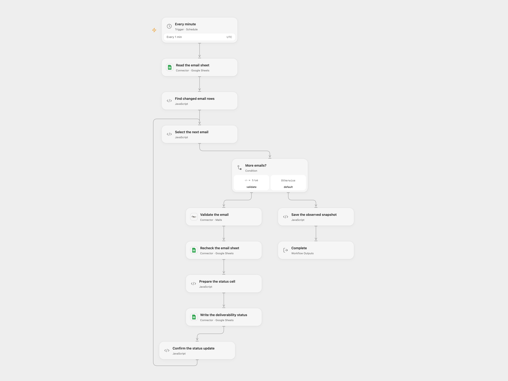

# Validate Sheet Email Deliverability

Validate changed email addresses and write deliverability results to their Google Sheets rows.

<picture>
  <source media="(prefers-color-scheme: dark)" srcset="preview-dark.png">
  
</picture>

[Open Flow JSON](templates/validate-sheet-email-deliverability.openflow.json) · [n8n JSON](templates/validate-sheet-email-deliverability.n8n.json)

## Setup

Connect Google Sheets and Mails. Set the same spreadsheet ID and the worksheet range in both sheet-read nodes and the spreadsheet ID in the write node. Set the worksheet name in **Prepare the status cell**. The first row needs unique **Email** and **Status** headers. In n8n set the same spreadsheet ID in the read, recheck and write HTTP nodes, the worksheet range in both read nodes, and the worksheet name in **Prepare the status cell**. Set a Google Sheets OAuth2 credential on those three nodes and a Header Auth credential with header name **x-mails-api-key** and your Mails key on **Validate the email**. Enable one format, preserve workflow State, and prevent concurrent runs or edits while a run is in progress.

## Behavior

The first successful poll records the current rows. Each later poll checks changed or newly added rows with an email and blank Status. The workflow validates each distinct selected email once per poll, re-reads the sheet, verifies the email and blank status still occupy the same row, and writes only that Status cell. Mails returns deliverable, undeliverable, risky or unknown; unknown is not a successful deliverability claim.

Open Flow starts on the minute boundary; n8n runs at a fixed second within that minute. Open Flow saves the observed snapshot after all selected rows finish. On a later poll it can retry rows whose Status is still blank after a failed or uncertain update. n8n records the observed snapshot during the run and may skip failed or remaining rows on a later poll. Inspect the sheet and provider before manually retrying an uncertain write. Keep rows stable during each run and ensure the full table and snapshot fit platform state and execution limits.

Inspiration &amp; credits

## Changes to the source

- Replace Effibotics with Mails, whose deliverability categories may differ, and write its result to Status. The original service response contract was unavailable during migration.
- Poll and compare the complete sheet to handle both new and changed rows. Replace the source's example sheet and embedded credential with your own connections. Remove the source validation node’s automatic retry and error continuation; stop on validation errors before updating the sheet.

Adapted from [Verifying email deliverability using Google Sheets and Effibotics API](https://github.com/Zie619/n8n-workflows/blob/ae8cf6dc5b873cbb4f74587aa9180ed3a9f70682/workflows/Http/0470_HTTP_GoogleSheets_Update_Webhook.json) in [Zie619/n8n-workflows](https://github.com/Zie619/n8n-workflows). The matching [n8n listing](https://n8n.io/workflows/2191-verifying-email-deliverability-using-google-sheets-and-effibotics-api/) credits Zacharia Kimotho. No separate original template license is stated.

The collection’s [MIT notice](https://github.com/Zie619/n8n-workflows/blob/94007c1445d9258a7da116646b79473e7c7c3282/LICENSE) is pinned at a later revision. This is the collection notice at that revision; it does not establish a separate original template author's license. Our changes are listed above; see [repository licensing](../../README.md#licensing).

> MIT License
>
> Copyright (c) 2025 Zie619
>
> Permission is hereby granted, free of charge, to any person obtaining a copy
> of this software and associated documentation files (the "Software"), to deal
> in the Software without restriction, including without limitation the rights
> to use, copy, modify, merge, publish, distribute, sublicense, and/or sell
> copies of the Software, and to permit persons to whom the Software is
> furnished to do so, subject to the following conditions:
>
> The above copyright notice and this permission notice shall be included in all
> copies or substantial portions of the Software.
>
> THE SOFTWARE IS PROVIDED "AS IS", WITHOUT WARRANTY OF ANY KIND, EXPRESS OR
> IMPLIED, INCLUDING BUT NOT LIMITED TO THE WARRANTIES OF MERCHANTABILITY,
> FITNESS FOR A PARTICULAR PURPOSE AND NONINFRINGEMENT. IN NO EVENT SHALL THE
> AUTHORS OR COPYRIGHT HOLDERS BE LIABLE FOR ANY CLAIM, DAMAGES OR OTHER
> LIABILITY, WHETHER IN AN ACTION OF CONTRACT, TORT OR OTHERWISE, ARISING FROM,
> OUT OF OR IN CONNECTION WITH THE SOFTWARE OR THE USE OR OTHER DEALINGS IN THE
> SOFTWARE.

