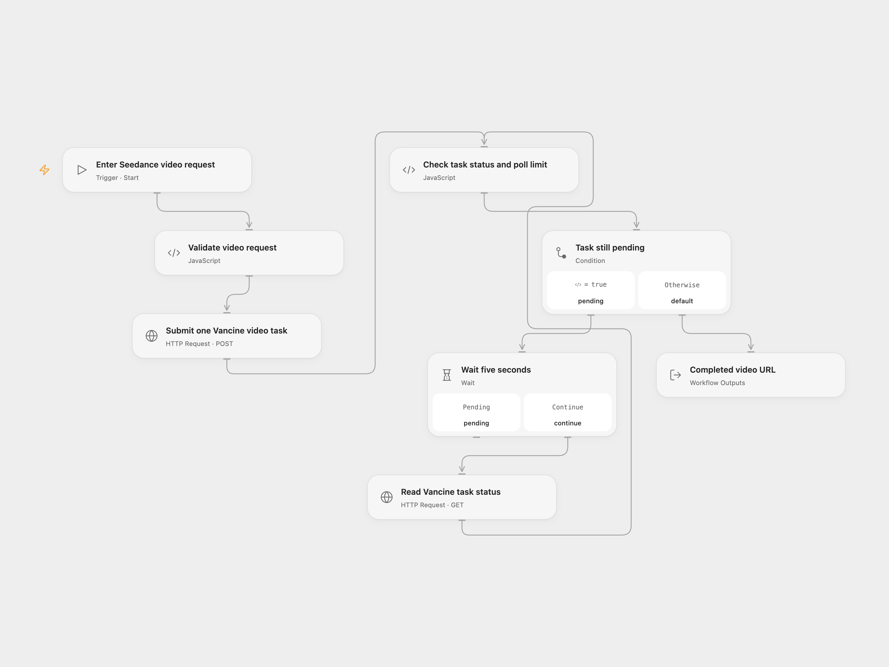

# Vancine Seedance Video

Generate a Seedance video from a text prompt through Vancine and return its URL after the task completes.

<picture>
  <source media="(prefers-color-scheme: dark)" srcset="preview-dark.png">
  
</picture>

[Open Flow JSON](templates/vancine-seedance-video.openflow.json) · [n8n JSON](templates/vancine-seedance-video.n8n.json)

## Setup

In Open Flow, create a secret Variable containing only your Vancine API key. Bind **Authentication Token** (`auth.token`) to that same Variable in **Submit one Vancine video task** and **Read Vancine task status**. Each sends `Authorization: Bearer <key>`. Select the Variable after importing; the shared JSON contains no key or binding.

Run with a currently supported Vancine **Model**, **Prompt** and **Size**, such as `1280x720` where supported by that model. The source used `Doubao-Seedance-1.5-pro`; the current first-party starter uses `Doubao-Seedance-2.5`. This template requires your model choice instead of assuming either ID is available to your account. The API host is fixed to `https://vancine.com`.

In n8n, edit **Configure Video Request** and choose the same supported model, prompt and size. Create one HTTP Header Auth credential with name `Authorization` and value `Bearer YOUR_VANCINE_API_KEY`, and select it on both HTTP Request nodes.

## Run

Each run submits exactly one video task. It waits five seconds before the first status request and between subsequent requests, for at most 120 polls by default. Change the Open Flow Wait duration and the `maxPolls` input in **Check task status and poll limit**, or the corresponding n8n settings, to adjust those limits. The total run time includes request latency as well as waits. Your runtime must support the full duration.

The workflow reads the current `data.status`, `data.result_url` and `data.fail_reason` fields first, with the source’s older response shapes retained as fallbacks. Completion requires a result URL. A failed task, malformed response, HTTP error or exhausted polling limit stops the run. The result contains the task ID, reported status, URL and poll count. It does not download the video or verify its quality.

No submission or status request is automatically retried. A lost submission response may leave a task running; check Vancine before starting another run. Polling timeout and workflow cancellation stop local polling and do not cancel the remote generation. Open Flow allows 30 seconds per HTTP execution and enforces Code input/result budgets, including 1 MiB for each in the inspected host. Each poll is an independent HTTP execution; the workflow does not put all polls inside one Code invocation.

## Changes to the source

- Require a supported model as configuration in both formats.
- Prefer the current task envelope, validate task association and require a completion URL.
- Keep one submission and a bounded, visible Wait/status feedback loop, with explicit HTTP timeouts.

Source and license

Adapted from [Generate Seedance videos with Vancine API and bounded polling](https://github.com/enescingoz/awesome-n8n-templates/blob/827110332c21cbe000ab13f6d292d5adb1f1f8db/Other_Integrations_and_Use_Cases/Generate%20Seedance%20videos%20with%20Vancine%20API%20and%20bounded%20polling.json) in [enescingoz/awesome-n8n-templates](https://github.com/enescingoz/awesome-n8n-templates).

Source collection notice: © 2024–2026 Enes Cingoz, [CC BY 4.0](https://github.com/enescingoz/awesome-n8n-templates/blob/827110332c21cbe000ab13f6d292d5adb1f1f8db/LICENSE). The source export does not identify a separate template author or license. See [repository licensing](../../README.md#licensing) for the scope of OOMOL contributions and third-party material.

