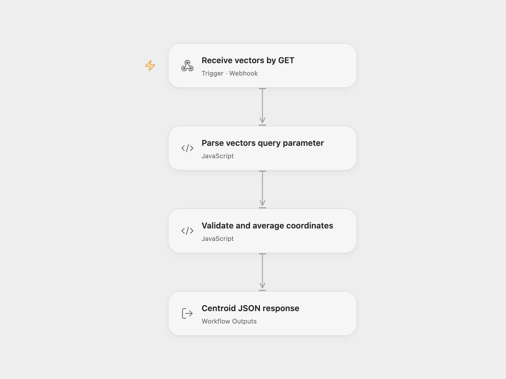

# Vector Centroid API

Calculate the coordinate-wise mean of a nonempty set of numeric vectors through a GET endpoint.

<picture>
  <source media="(prefers-color-scheme: dark)" srcset="preview-dark.png">
  
</picture>

[Open Flow JSON](templates/vector-centroid-api.openflow.json) · [n8n JSON](templates/vector-centroid-api.n8n.json)

## Use

Enable either format and copy its webhook URL. Send the `vectors` query parameter as URL-encoded JSON:

```sh
curl --get --data-urlencode 'vectors=[[2,3,4],[4,5,6],[6,7,8]]' 'YOUR_WEBHOOK_URL'
```

The response is:

```json
{"centroid":[4,5,6]}
```

Each vector must be an array, all vectors must have the same number of coordinates, and every coordinate must be a finite JSON number. Numeric strings are rejected. A set of zero-dimensional vectors, such as `[[],[]]`, returns `{"centroid":[]}`. Arithmetic uses JavaScript floating-point numbers.

Missing or malformed input returns an `error` object, for example:

```json
{"error":"Vectors have inconsistent dimensions."}
```

Both successful calculations and validation errors use HTTP 200 with a JSON body, matching the source’s response pattern. Inspect the body for `error`. The workflow makes no external service calls and stores no vector history.

## Changes to the source

- Parse the JSON query parameter explicitly and make GET/JSON response settings explicit.
- Validate vector rows and finite numeric coordinates before computing.
- Scale each coordinate before averaging and use compensated summation to handle large values and equal subnormal values.
- Replace the source’s deployed example URL with a setup placeholder.

## Source and license

Adapted from [Calculate the Centroid of a Set of Vectors](https://github.com/Zie619/n8n-workflows/blob/ae8cf6dc5b873cbb4f74587aa9180ed3a9f70682/workflows/Code/1862_Code_Respondtowebhook_Automation_Webhook.json) in [Zie619/n8n-workflows](https://github.com/Zie619/n8n-workflows). The source export does not identify a separate template author or license.

The collection’s [MIT notice](https://github.com/Zie619/n8n-workflows/blob/94007c1445d9258a7da116646b79473e7c7c3282/LICENSE) is pinned at a later revision. This is the collection notice at that revision; it does not establish a separate original template author's license. Our changes are listed above; see [repository licensing](../../README.md#licensing).

> MIT License
>
> Copyright (c) 2025 Zie619
>
> Permission is hereby granted, free of charge, to any person obtaining a copy
> of this software and associated documentation files (the "Software"), to deal
> in the Software without restriction, including without limitation the rights
> to use, copy, modify, merge, publish, distribute, sublicense, and/or sell
> copies of the Software, and to permit persons to whom the Software is
> furnished to do so, subject to the following conditions:
>
> The above copyright notice and this permission notice shall be included in all
> copies or substantial portions of the Software.
>
> THE SOFTWARE IS PROVIDED "AS IS", WITHOUT WARRANTY OF ANY KIND, EXPRESS OR
> IMPLIED, INCLUDING BUT NOT LIMITED TO THE WARRANTIES OF MERCHANTABILITY,
> FITNESS FOR A PARTICULAR PURPOSE AND NONINFRINGEMENT. IN NO EVENT SHALL THE
> AUTHORS OR COPYRIGHT HOLDERS BE LIABLE FOR ANY CLAIM, DAMAGES OR OTHER
> LIABILITY, WHETHER IN AN ACTION OF CONTRACT, TORT OR OTHERWISE, ARISING FROM,
> OUT OF OR IN CONNECTION WITH THE SOFTWARE OR THE USE OR OTHER DEALINGS IN THE
> SOFTWARE.
