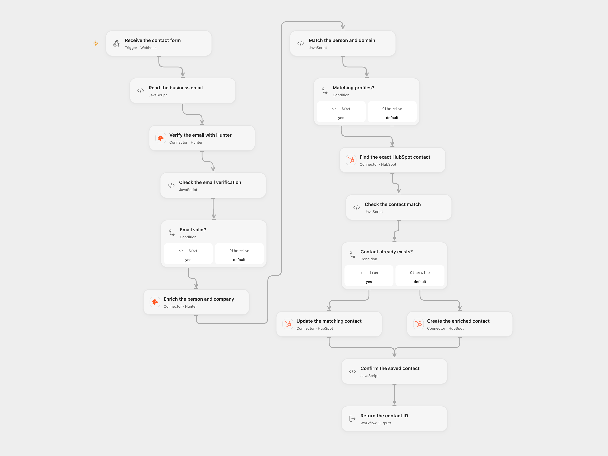

# Verify and Enrich Form Leads in HubSpot

Collect business email addresses and save matching professional and company details to HubSpot after Hunter verifies the email.

<!-- template-actions:start -->
 
<!-- template-actions:end -->

<picture>
  <source media="(prefers-color-scheme: dark)" srcset="preview-dark.png">
  
</picture>

## Setup

1. In HubSpot, create a **Contact** property labeled **Hunter company size**, with internal name `hunter_company_size` and type **Single-line text**. It stores an employee count or the size range that Hunter reports. [Create a HubSpot property](https://knowledge.hubspot.com/properties/create-and-edit-properties)
2. Use the same Hunter connection in **Verify the email with Hunter** and **Enrich the person and company**. Enable verification and enrichment credits. Use the same HubSpot connection in **Find the exact HubSpot contact**, **Create the enriched contact**, and **Update the matching contact**.
3. Publish the workflow and share the form URL from **Receive the contact form**.

## Behavior

The form acknowledges submission immediately. Hunter must return a valid status for the submitted business email before enrichment starts. The profile must match that email, and both the employment and company domains must match its domain. Missing or mismatched profiles leave HubSpot untouched. Provider errors appear in the execution record.

The workflow saves available names, job title, company, and company size. It omits unavailable fields so existing values are preserved. A matching email updates the existing contact, and a new email creates one. HubSpot must confirm the contact ID and email before the run reports success. If a write is interrupted, check that email in HubSpot before retrying.

In n8n

Create the **Hunter company size** HubSpot contact property with the same name and type above. Use a **Header Auth** credential named `X-API-Key` in **Verify the email with Hunter** and **Enrich the person and company**. In **Find the exact HubSpot contact**, **Create the enriched contact**, and **Update the matching contact**, use the same **Header Auth** credential named `Authorization` with value `Bearer YOUR_HUBSPOT_TOKEN` and contact read and write scopes. Activate the workflow and share the **Receive the contact form** production URL.

Inspiration &amp; credits

Adapted from [Verify emails and enrich new form leads and save them to HubSpot](https://github.com/Zie619/n8n-workflows/blob/ae8cf6dc5b873cbb4f74587aa9180ed3a9f70682/workflows/Hunter/0420_Hunter_Form_Create_Triggered.json) in [Zie619/n8n-workflows](https://github.com/Zie619/n8n-workflows). Attribution: Niklas Hatje (original workflow) and Zie619 (collection). See the [original n8n listing](https://n8n.io/workflows/2116-verify-emails-and-enrich-new-form-leads-and-save-them-to-hubspot/).

The collection’s [MIT notice](https://github.com/Zie619/n8n-workflows/blob/94007c1445d9258a7da116646b79473e7c7c3282/LICENSE) is pinned at a later revision. This is the collection notice at that revision; it does not establish a separate original template author's license. Our changes are listed above; see [repository licensing](../../README.md#licensing).

> MIT License
>
> Copyright (c) 2025 Zie619
>
> Permission is hereby granted, free of charge, to any person obtaining a copy
> of this software and associated documentation files (the "Software"), to deal
> in the Software without restriction, including without limitation the rights
> to use, copy, modify, merge, publish, distribute, sublicense, and/or sell
> copies of the Software, and to permit persons to whom the Software is
> furnished to do so, subject to the following conditions:
>
> The above copyright notice and this permission notice shall be included in all
> copies or substantial portions of the Software.
>
> THE SOFTWARE IS PROVIDED "AS IS", WITHOUT WARRANTY OF ANY KIND, EXPRESS OR
> IMPLIED, INCLUDING BUT NOT LIMITED TO THE WARRANTIES OF MERCHANTABILITY,
> FITNESS FOR A PARTICULAR PURPOSE AND NONINFRINGEMENT. IN NO EVENT SHALL THE
> AUTHORS OR COPYRIGHT HOLDERS BE LIABLE FOR ANY CLAIM, DAMAGES OR OTHER
> LIABILITY, WHETHER IN AN ACTION OF CONTRACT, TORT OR OTHERWISE, ARISING FROM,
> OUT OF OR IN CONNECTION WITH THE SOFTWARE OR THE USE OR OTHER DEALINGS IN THE
> SOFTWARE.

