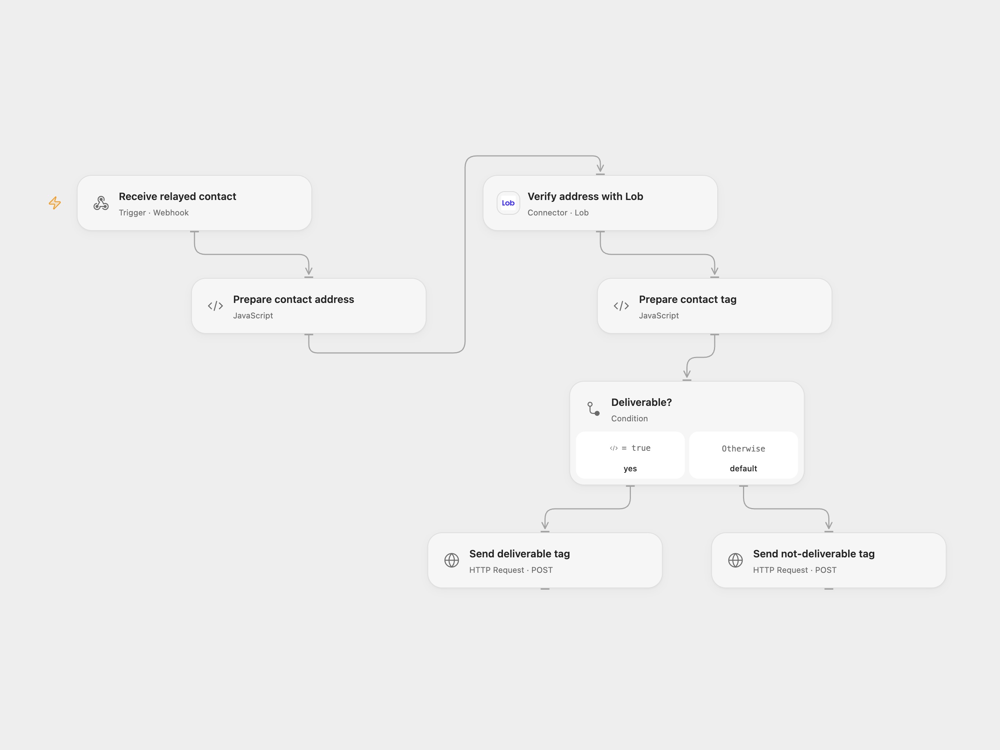

# Verify Groundhogg Contact Mailing Address

Verify a Groundhogg contact’s US mailing address and send a deliverability tag to its webhook listener.

<picture>
  <source media="(prefers-color-scheme: dark)" srcset="preview-dark.png">
  
</picture>

[Open Flow JSON](templates/verify-groundhogg-contact-mailing-address.openflow.json) · [n8n JSON](templates/verify-groundhogg-contact-mailing-address.n8n.json)

## Setup and use

Configure a Groundhogg funnel Webhook action to send the contact fields id, address, city, state and zip_code, with optional address2, to the supplied n8n webhook. Import the n8n workflow and set **Choose execution mode** to n8n for its native path or openflow to relay the complete received event to Open Flow. For n8n configure Lob HTTP Basic Auth using the API key as username and an empty password, and set both Groundhogg listener URLs. For Open Flow connect Lob, set both listener URLs, and set the Open Flow webhook URL in **Forward to Open Flow**. Activate n8n and use one mode. Groundhogg's Webhook action can send JSON or form data; n8n accepts either.

## Behavior

Lob verifies the US address. Exactly deliverable sends Mailing Address Deliverable; every other returned deliverability sends Mailing Address NOT Deliverable. The listener receives the original contact id and tag. Configure the listener to map those fields and apply the tag. Both webhook entrances acknowledge before the downstream work and do not authenticate the sender; restrict access and inspect execution history. Address and contact details can appear in execution history. If a listener request has an unknown outcome, inspect Groundhogg before retrying.

Inspiration &amp; credits

## Changes to the source

- Correct webhook body, ZIP and contact ID mappings, and add a full-event n8n relay for Open Flow. Use Lob's native address verification action in Open Flow.

Adapted from [Verify Groundhogg contact mailing address](https://github.com/Zie619/n8n-workflows/blob/ae8cf6dc5b873cbb4f74587aa9180ed3a9f70682/workflows/Http/0485_HTTP_Stickynote_Create_Webhook.json) in [Zie619/n8n-workflows](https://github.com/Zie619/n8n-workflows). The source export does not identify a separate template author or license.

The collection’s [MIT notice](https://github.com/Zie619/n8n-workflows/blob/94007c1445d9258a7da116646b79473e7c7c3282/LICENSE) is pinned at a later revision. This is the collection notice at that revision; it does not establish a separate original template author's license. Our changes are listed above; see [repository licensing](../../README.md#licensing).

> MIT License
>
> Copyright (c) 2025 Zie619
>
> Permission is hereby granted, free of charge, to any person obtaining a copy
> of this software and associated documentation files (the "Software"), to deal
> in the Software without restriction, including without limitation the rights
> to use, copy, modify, merge, publish, distribute, sublicense, and/or sell
> copies of the Software, and to permit persons to whom the Software is
> furnished to do so, subject to the following conditions:
>
> The above copyright notice and this permission notice shall be included in all
> copies or substantial portions of the Software.
>
> THE SOFTWARE IS PROVIDED "AS IS", WITHOUT WARRANTY OF ANY KIND, EXPRESS OR
> IMPLIED, INCLUDING BUT NOT LIMITED TO THE WARRANTIES OF MERCHANTABILITY,
> FITNESS FOR A PARTICULAR PURPOSE AND NONINFRINGEMENT. IN NO EVENT SHALL THE
> AUTHORS OR COPYRIGHT HOLDERS BE LIABLE FOR ANY CLAIM, DAMAGES OR OTHER
> LIABILITY, WHETHER IN AN ACTION OF CONTRACT, TORT OR OTHERWISE, ARISING FROM,
> OUT OF OR IN CONNECTION WITH THE SOFTWARE OR THE USE OR OTHER DEALINGS IN THE
> SOFTWARE.

