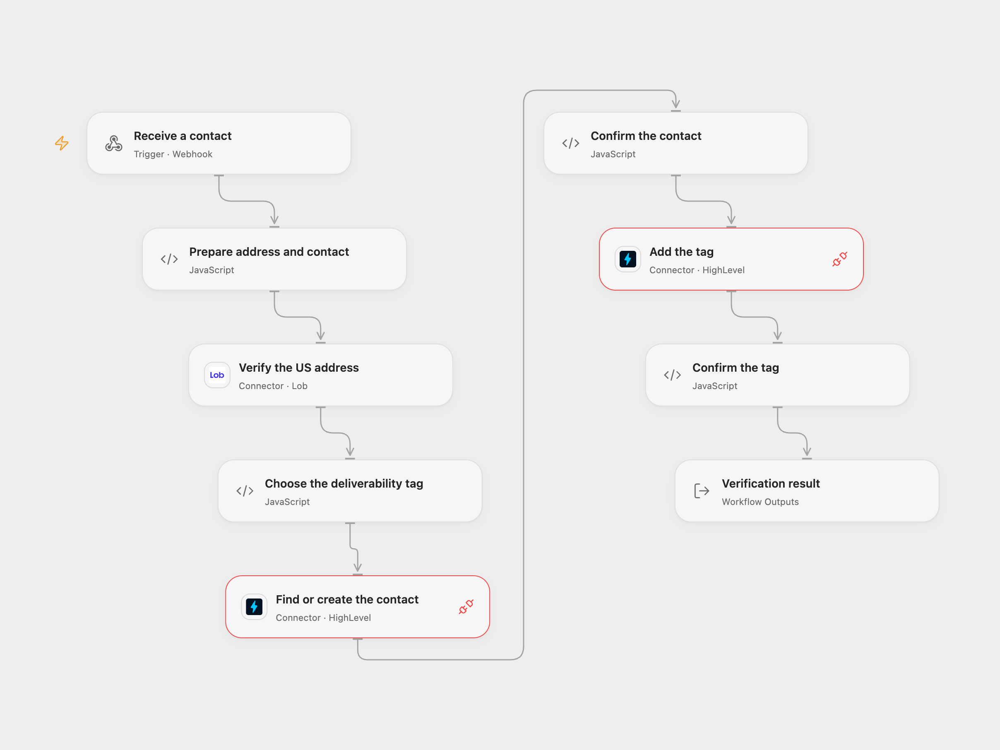

# Verify HighLevel Contact Mailing Address

Verify a US mailing address and add a deliverability tag to its HighLevel contact.

<picture>
  <source media="(prefers-color-scheme: dark)" srcset="preview-dark.png">
  
</picture>

[Open Flow JSON](templates/verify-highlevel-contact-mailing-address.openflow.json) · [n8n JSON](templates/verify-highlevel-contact-mailing-address.n8n.json)

## Setup

Connect Lob and HighLevel. Set your HighLevel location ID in **Prepare address and contact**. The HighLevel connection needs contact write permission for that location. POST a contact to the webhook with `address`, an email or phone, and either `zip_code` or both `city` and `state`. Use optional `address2` for a unit or secondary address line. Values should be strings so ZIP codes retain leading zeros.

In n8n, configure the location ID in **Prepare address and contact**, HTTP Basic Auth for Lob with the API key as username and an empty password, and Header Auth named `Authorization` with value `Bearer YOUR_HIGHLEVEL_TOKEN` on both HighLevel requests. Use a location-scoped private integration token with contact write permission. Both formats use an immediate webhook acknowledgement; check the execution for the outcome. Protect the webhook URL and allow only trusted senders.

## Behavior

Lob verifies the US address. Exactly `deliverable` adds **Mailing Address Deliverable**; the other documented deliverability results add **Mailing Address NOT Deliverable**. HighLevel matches or creates a contact by email or phone according to the location's duplicate settings, then adds the selected tag without replacing existing tags. If email and phone match different contacts, HighLevel applies its configured matching order. Review the result and the service's detailed address status.

The contact upsert and tag addition are separate writes. If the second fails, the contact may already have changed; an uncertain write may also have succeeded. Inspect HighLevel before retrying. No automatic retry or duplicate protection is added.

Inspiration &amp; credits

## Changes to the source

- Correct webhook body mapping and configure the location and credentials. Use current HighLevel upsert followed by its tag-add API, preserving existing tags instead of replacing them.
- Require a documented Lob status before writing and confirm each HighLevel response.

Adapted from [Verify HighLevel contact mailing address](https://github.com/Zie619/n8n-workflows/blob/ae8cf6dc5b873cbb4f74587aa9180ed3a9f70682/workflows/Http/0463_HTTP_Stickynote_Create_Webhook.json) in [Zie619/n8n-workflows](https://github.com/Zie619/n8n-workflows). The source export does not identify a separate template author or license.

The collection’s [MIT notice](https://github.com/Zie619/n8n-workflows/blob/94007c1445d9258a7da116646b79473e7c7c3282/LICENSE) is pinned at a later revision. This is the collection notice at that revision; it does not establish a separate original template author's license. Our changes are listed above; see [repository licensing](../../README.md#licensing).

> MIT License
>
> Copyright (c) 2025 Zie619
>
> Permission is hereby granted, free of charge, to any person obtaining a copy
> of this software and associated documentation files (the "Software"), to deal
> in the Software without restriction, including without limitation the rights
> to use, copy, modify, merge, publish, distribute, sublicense, and/or sell
> copies of the Software, and to permit persons to whom the Software is
> furnished to do so, subject to the following conditions:
>
> The above copyright notice and this permission notice shall be included in all
> copies or substantial portions of the Software.
>
> THE SOFTWARE IS PROVIDED "AS IS", WITHOUT WARRANTY OF ANY KIND, EXPRESS OR
> IMPLIED, INCLUDING BUT NOT LIMITED TO THE WARRANTIES OF MERCHANTABILITY,
> FITNESS FOR A PARTICULAR PURPOSE AND NONINFRINGEMENT. IN NO EVENT SHALL THE
> AUTHORS OR COPYRIGHT HOLDERS BE LIABLE FOR ANY CLAIM, DAMAGES OR OTHER
> LIABILITY, WHETHER IN AN ACTION OF CONTRACT, TORT OR OTHERWISE, ARISING FROM,
> OUT OF OR IN CONNECTION WITH THE SOFTWARE OR THE USE OR OTHER DEALINGS IN THE
> SOFTWARE.

