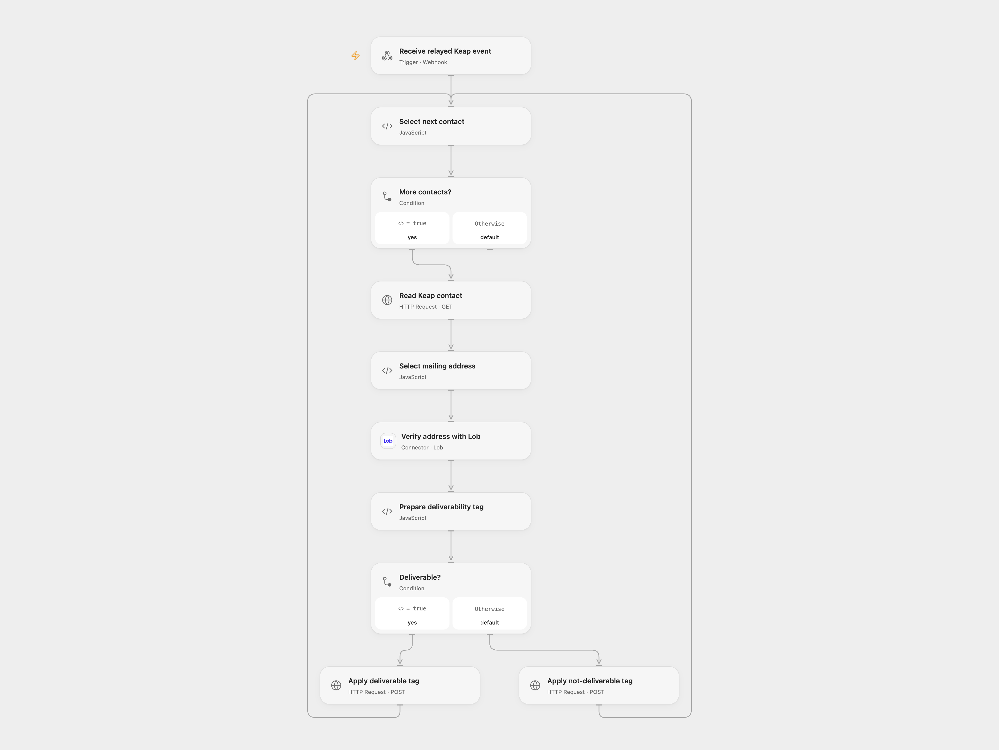

# Verify Keap Contact Mailing Address

Verify Keap contact mailing addresses and apply deliverability tags.

<picture>
  <source media="(prefers-color-scheme: dark)" srcset="preview-dark.png">
  
</picture>

[Open Flow JSON](templates/verify-keap-contact-mailing-address.openflow.json) · [n8n JSON](templates/verify-keap-contact-mailing-address.n8n.json)

## Setup and use

Subscribe a Keap contact REST Hook to the supplied n8n webhook. Configure n8n **Choose execution mode** as n8n to process there or openflow to relay the complete event to Open Flow. In n8n set a Keap bearer credential on **Read Keap contact**, a Keap connection on both tag nodes, Lob HTTP Basic Auth with API key as username and empty password, and numeric tag IDs in the tag nodes. For Open Flow bind secret Variable KEAP_ACCESS_TOKEN with contact read and tag write permissions to all three Keap HTTP nodes, connect Lob, enter the two numeric tag IDs in **Prepare deliverability tag**, and set **Forward to Open Flow** to its webhook URL. Use one mode.

## Behavior

Keap REST Hook events can contain multiple contact IDs. The workflow reads each contact, selects its BILLING address, otherwise SHIPPING, otherwise its first address, and asks Lob to verify it. Exactly deliverable applies the configured deliverable tag; other returned statuses apply the other tag. Configure Keap contacts with US mailing addresses. Both webhook entrances acknowledge before downstream work and do not authenticate the sender; restrict access and inspect execution history. Full contact data may appear in execution history. If a tag write is uncertain, inspect the contact before retrying; earlier contacts in the batch may already have been tagged.

Inspiration &amp; credits

## Changes to the source

- Accept the complete Keap REST Hook batch and retrieve each contact's address, instead of assuming the webhook directly contains address fields. Correct the ZIP and contact ID mappings and configure numeric tag IDs. Open Flow uses a user-supplied Keap bearer token and n8n relay.

Adapted from [Verify Keap contact mailing address](https://github.com/Zie619/n8n-workflows/blob/ae8cf6dc5b873cbb4f74587aa9180ed3a9f70682/workflows/Http/0493_HTTP_Keap_Create_Webhook.json) in [Zie619/n8n-workflows](https://github.com/Zie619/n8n-workflows). The source export does not identify a separate template author or license.

The collection’s [MIT notice](https://github.com/Zie619/n8n-workflows/blob/94007c1445d9258a7da116646b79473e7c7c3282/LICENSE) is pinned at a later revision. This is the collection notice at that revision; it does not establish a separate original template author's license. Our changes are listed above; see [repository licensing](../../README.md#licensing).

> MIT License
>
> Copyright (c) 2025 Zie619
>
> Permission is hereby granted, free of charge, to any person obtaining a copy
> of this software and associated documentation files (the "Software"), to deal
> in the Software without restriction, including without limitation the rights
> to use, copy, modify, merge, publish, distribute, sublicense, and/or sell
> copies of the Software, and to permit persons to whom the Software is
> furnished to do so, subject to the following conditions:
>
> The above copyright notice and this permission notice shall be included in all
> copies or substantial portions of the Software.
>
> THE SOFTWARE IS PROVIDED "AS IS", WITHOUT WARRANTY OF ANY KIND, EXPRESS OR
> IMPLIED, INCLUDING BUT NOT LIMITED TO THE WARRANTIES OF MERCHANTABILITY,
> FITNESS FOR A PARTICULAR PURPOSE AND NONINFRINGEMENT. IN NO EVENT SHALL THE
> AUTHORS OR COPYRIGHT HOLDERS BE LIABLE FOR ANY CLAIM, DAMAGES OR OTHER
> LIABILITY, WHETHER IN AN ACTION OF CONTRACT, TORT OR OTHERWISE, ARISING FROM,
> OUT OF OR IN CONNECTION WITH THE SOFTWARE OR THE USE OR OTHER DEALINGS IN THE
> SOFTWARE.

