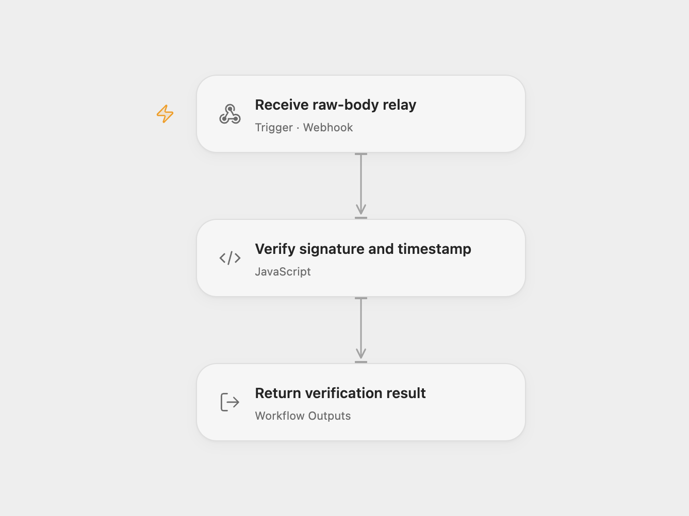

# Verify a Signed Webhook with Timestamp

Verify exact webhook bytes and a signed timestamp before accepting an event.

<!-- template-actions:start -->
 
<!-- template-actions:end -->

<picture>
  <source media="(prefers-color-scheme: dark)" srcset="preview-dark.png">
  
</picture>

## Setup

Apply body-size and rate limits at the ingress; the relay is subject to Open Flow input limits.

## Behavior

The sender signs the exact JSON bytes with HMAC-SHA256 and supplies X-Automation-Signature as sha256= followed by hexadecimal. The signed event_id must start evt_ and contain 8–64 letters, digits or hyphens. The integer sent_at must be at most 300 seconds old or 60 seconds in the future. Accepted requests receive 200; invalid or stale requests receive a generic 401. Both responses include no-store and nosniff headers. The time window does not deduplicate repeated events; add persistent event-ID deduplication where needed.

In n8n

Configure a shared HMAC secret in the n8n Crypto credential. For Open Flow mode, bind WEBHOOK_HMAC_SECRET to the same secret, deploy its webhook, and configure the Open Flow relay URL in n8n. Activate only one n8n webhook and protect the relay endpoint.

Inspiration &amp; credits

Adapted from [Signed Webhook HMAC Guard with Timestamp Window](https://github.com/enescingoz/awesome-n8n-templates/blob/827110332c21cbe000ab13f6d292d5adb1f1f8db/Other_Integrations_and_Use_Cases/Signed%20Webhook%20HMAC%20Guard%20with%20Timestamp%20Window.json) in [enescingoz/awesome-n8n-templates](https://github.com/enescingoz/awesome-n8n-templates).

Source collection notice: © 2024–2026 Enes Cingoz, [CC BY 4.0](https://github.com/enescingoz/awesome-n8n-templates/blob/827110332c21cbe000ab13f6d292d5adb1f1f8db/LICENSE). The source export does not identify a separate template author or license. See [repository licensing](../../README.md#licensing) for the scope of OOMOL contributions and third-party material.

