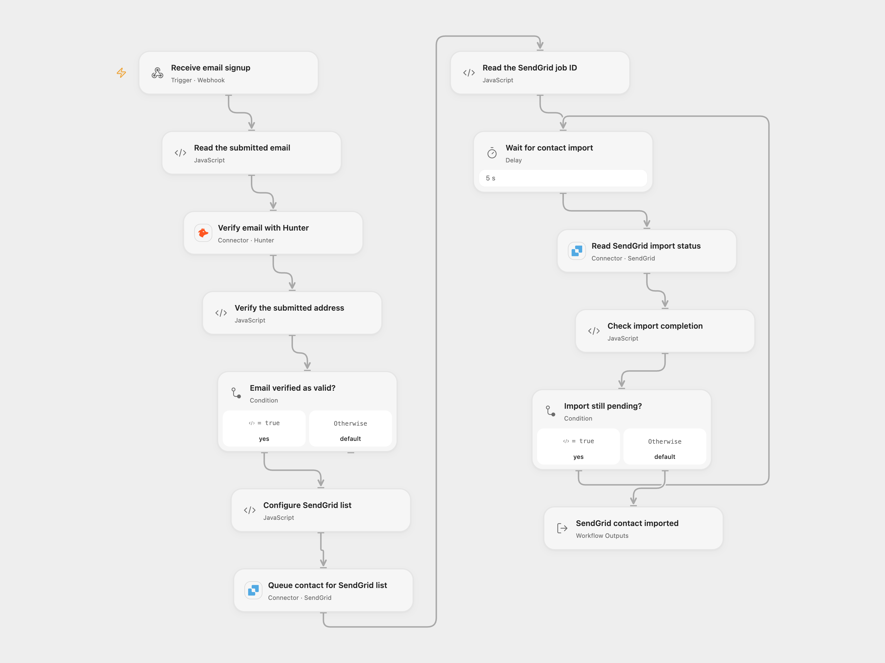

# Verify Signups Before Adding to SendGrid

Collect email signups, verify each address with Hunter, and add valid contacts to a SendGrid list.

<!-- template-actions:start -->
 
<!-- template-actions:end -->

<picture>
  <source media="(prefers-color-scheme: dark)" srcset="preview-dark.png">
  
</picture>

## Setup

1. Connect Hunter in **Verify email with Hunter**.
2. Choose a SendGrid Marketing Contacts list and enter its list ID in **Configure SendGrid list**. Bind the same SendGrid connection in **Queue contact for SendGrid list** and **Read SendGrid import status**.
3. Deploy the workflow and share its hosted signup form. Edit the title and description in **Receive email signup** if needed.

## Behavior

The form accepts one required email address. Hunter receives the submitted address. Only a matching verification with status `valid` proceeds to SendGrid. The workflow puts that same address in the configured list.

The form acknowledges receipt while verification and import run in the background. The workflow checks the accepted SendGrid job every five seconds, up to twelve times, and reports completion only after SendGrid finishes the import successfully. If a job fails or stays pending, inspect the recorded job ID in SendGrid before retrying the signup.

In n8n

Bind Hunter in **Verify email**. Enter the Marketing Contacts list ID in **Verify email and configure list**. Bind the same SendGrid credential in **Add contact to list** and **Read SendGrid import status**. Activate the workflow and share the production URL in **Submit form**. The form acknowledges receipt before the import finishes.

Inspiration &amp; credits

## Changes to the source

- Retain the submitted email across verification and SendGrid to prevent writing an unrelated or missing address.
- Check the SendGrid import job to completion and replace the source list ID with setup.
- [Rumjahn describes the original workflow](https://rumjahn.com/create-email-capture-forms-for-free-using-n8n-and-sendgrid-and-easily-grow-your-subscriber-list/).

Adapted from [Email form](https://github.com/Zie619/n8n-workflows/blob/ae8cf6dc5b873cbb4f74587aa9180ed3a9f70682/workflows/Hunter/0361_Hunter_Noop_Send_Triggered.json) in [Zie619/n8n-workflows](https://github.com/Zie619/n8n-workflows). Attribution: Rumjahn (original workflow); Zie619 / n8n-workflows (collection).

The collection’s [MIT notice](https://github.com/Zie619/n8n-workflows/blob/94007c1445d9258a7da116646b79473e7c7c3282/LICENSE) is pinned at a later revision. This is the collection notice at that revision; it does not establish a separate original template author's license. Our changes are listed above; see [repository licensing](../../README.md#licensing).

> MIT License
>
> Copyright (c) 2025 Zie619
>
> Permission is hereby granted, free of charge, to any person obtaining a copy
> of this software and associated documentation files (the "Software"), to deal
> in the Software without restriction, including without limitation the rights
> to use, copy, modify, merge, publish, distribute, sublicense, and/or sell
> copies of the Software, and to permit persons to whom the Software is
> furnished to do so, subject to the following conditions:
>
> The above copyright notice and this permission notice shall be included in all
> copies or substantial portions of the Software.
>
> THE SOFTWARE IS PROVIDED "AS IS", WITHOUT WARRANTY OF ANY KIND, EXPRESS OR
> IMPLIED, INCLUDING BUT NOT LIMITED TO THE WARRANTIES OF MERCHANTABILITY,
> FITNESS FOR A PARTICULAR PURPOSE AND NONINFRINGEMENT. IN NO EVENT SHALL THE
> AUTHORS OR COPYRIGHT HOLDERS BE LIABLE FOR ANY CLAIM, DAMAGES OR OTHER
> LIABILITY, WHETHER IN AN ACTION OF CONTRACT, TORT OR OTHERWISE, ARISING FROM,
> OUT OF OR IN CONNECTION WITH THE SOFTWARE OR THE USE OR OTHER DEALINGS IN THE
> SOFTWARE.

