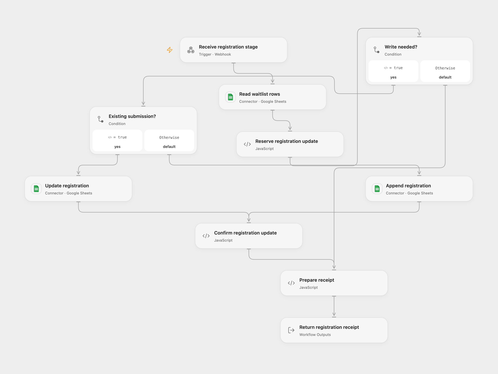

# Verify Waitlist Signups in Sheets

Collect waitlist registrations, verify email and save intended use in Google Sheets.

<!-- template-actions:start -->
 
<!-- template-actions:end -->

<picture>
  <source media="(prefers-color-scheme: dark)" srcset="preview-dark.png">
  
</picture>

## Setup

Create a spreadsheet with columns Submission ID, Firstname, Lastname, Email, Company, Verified, Intended Use in that order. Prevent overlapping sheet writes.

## Behavior

The code expires after 10 minutes and the form allows two attempts. Protect those records and SMTP access. This example is a waitlist workflow, not a general account authentication service.

For a pending Open Flow sheet write enter the key and confirmed or absent in **Reserve registration update**, replay the same stage, then clear the fields.

In n8n

Connect Google Sheets and SMTP in n8n and set the sender address. Configure a Data Table with item_key and status text columns for checkpoints. For Open Flow, set relay mode in **Prepare registration**, configure the webhook URL and spreadsheet IDs, connect Sheets and enable persistent State. Protect the webhook at the deployment boundary so only your trusted n8n workflow can send registration stages; a forged verified stage could mark a record verified. Direct mode runs in n8n; choose one mode. n8n collects the registration, generates and emails a verification code, verifies it before collecting intended use, and saves each stage to the same submission ID. The code is not stored in Sheets, but it can appear in n8n execution history and email. If an email, sheet write or relay result is uncertain, inspect the sent email, spreadsheet and pending Data Table row before replaying. In n8n inspect the pending submission and finish any remaining registration steps manually before marking it done; remove the pending row only if no external write occurred.

Inspiration &amp; credits

Use a stable submission ID, limit verification attempts and avoid storing the code in Sheets.

Adapted from [Waitlist email verification](https://github.com/Zie619/n8n-workflows/blob/ae8cf6dc5b873cbb4f74587aa9180ed3a9f70682/workflows/Form/0633_Form_GoogleSheets_Create_Triggered.json) in [Zie619/n8n-workflows](https://github.com/Zie619/n8n-workflows). The source export does not identify a separate template author or license.

The collection’s [MIT notice](https://github.com/Zie619/n8n-workflows/blob/94007c1445d9258a7da116646b79473e7c7c3282/LICENSE) is pinned at a later revision. This is the collection notice at that revision; it does not establish a separate original template author's license. Our changes are listed above; see [repository licensing](../../README.md#licensing).

> MIT License
>
> Copyright (c) 2025 Zie619
>
> Permission is hereby granted, free of charge, to any person obtaining a copy
> of this software and associated documentation files (the "Software"), to deal
> in the Software without restriction, including without limitation the rights
> to use, copy, modify, merge, publish, distribute, sublicense, and/or sell
> copies of the Software, and to permit persons to whom the Software is
> furnished to do so, subject to the following conditions:
>
> The above copyright notice and this permission notice shall be included in all
> copies or substantial portions of the Software.
>
> THE SOFTWARE IS PROVIDED "AS IS", WITHOUT WARRANTY OF ANY KIND, EXPRESS OR
> IMPLIED, INCLUDING BUT NOT LIMITED TO THE WARRANTIES OF MERCHANTABILITY,
> FITNESS FOR A PARTICULAR PURPOSE AND NONINFRINGEMENT. IN NO EVENT SHALL THE
> AUTHORS OR COPYRIGHT HOLDERS BE LIABLE FOR ANY CLAIM, DAMAGES OR OTHER
> LIABILITY, WHETHER IN AN ACTION OF CONTRACT, TORT OR OTHERWISE, ARISING FROM,
> OUT OF OR IN CONNECTION WITH THE SOFTWARE OR THE USE OR OTHER DEALINGS IN THE
> SOFTWARE.

