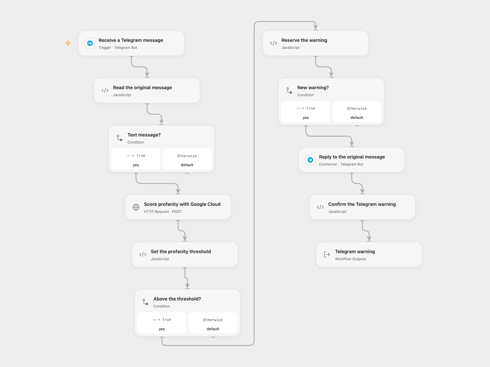

# Warn About Profanity in Telegram

Score English Telegram messages for profanity and reply to messages above your confidence threshold.

<!-- template-actions:start -->
 
<!-- template-actions:end -->

<picture>
  <source media="(prefers-color-scheme: dark)" srcset="preview-dark.png">
  
</picture>

## Setup

1. Connect the same Telegram bot in **Receive a Telegram message** and **Reply to the original message**. Give the bot permission to see new messages and send replies in the chosen chats. Limit the trigger to the chats you want to moderate. Use one active webhook per bot.
2. Enable the [Cloud Natural Language API](https://docs.cloud.google.com/natural-language/docs/setup) for a Google Cloud project with billing. Create an API key restricted to the Cloud Natural Language API. Bind it to the secret variable `GOOGLE_CLOUD_LANGUAGE_KEY` in **Score profanity with Google Cloud**.
3. Set the confidence threshold in **Set the profanity threshold**, then publish and enable the workflow.

## Behavior

The workflow sends new message text to Google Cloud Natural Language for English moderation. It uses the `Profanity` confidence and replies to the original message only when the score is strictly above the threshold. The default is 0.7. Non-text messages and scores at or below the threshold produce no reply. Scores from Google Cloud and the original Perspective API cannot be compared directly.

Missing or invalid scores stop processing. If a warning's delivery is uncertain, its reservation prevents a duplicate reply. Check the original chat to see whether the reply arrived.

In n8n

Use the same Telegram credential for **Receive a Telegram message** and **Reply to the original message** with a public HTTPS webhook. Select a Header Auth credential in **Score profanity with Google Cloud** with header name `x-goog-api-key` and the restricted Cloud Natural Language key. Set the threshold in **Set the profanity threshold**. Use a dedicated Data Table with text columns `warning_key`, `status`, and `message_id`. Select it in **New warning?**, **Reserve the warning**, and **Record the warning**. Use one production execution at a time. Check the chat before clearing a pending row.

Inspiration &amp; credits

Adapted from [Detect toxic language in Telegram messages](https://github.com/Zie619/n8n-workflows/blob/ae8cf6dc5b873cbb4f74587aa9180ed3a9f70682/workflows/Noop/0089_Noop_Telegram_Automate_Triggered.json) in [Zie619/n8n-workflows](https://github.com/Zie619/n8n-workflows). Attribution: Lorena (original workflow) / Zie619 (collection).

The collection’s [MIT notice](https://github.com/Zie619/n8n-workflows/blob/94007c1445d9258a7da116646b79473e7c7c3282/LICENSE) is pinned at a later revision. This is the collection notice at that revision; it does not establish a separate original template author's license. Our changes are listed above; see [repository licensing](../../README.md#licensing).

> MIT License
>
> Copyright (c) 2025 Zie619
>
> Permission is hereby granted, free of charge, to any person obtaining a copy
> of this software and associated documentation files (the "Software"), to deal
> in the Software without restriction, including without limitation the rights
> to use, copy, modify, merge, publish, distribute, sublicense, and/or sell
> copies of the Software, and to permit persons to whom the Software is
> furnished to do so, subject to the following conditions:
>
> The above copyright notice and this permission notice shall be included in all
> copies or substantial portions of the Software.
>
> THE SOFTWARE IS PROVIDED "AS IS", WITHOUT WARRANTY OF ANY KIND, EXPRESS OR
> IMPLIED, INCLUDING BUT NOT LIMITED TO THE WARRANTIES OF MERCHANTABILITY,
> FITNESS FOR A PARTICULAR PURPOSE AND NONINFRINGEMENT. IN NO EVENT SHALL THE
> AUTHORS OR COPYRIGHT HOLDERS BE LIABLE FOR ANY CLAIM, DAMAGES OR OTHER
> LIABILITY, WHETHER IN AN ACTION OF CONTRACT, TORT OR OTHERWISE, ARISING FROM,
> OUT OF OR IN CONNECTION WITH THE SOFTWARE OR THE USE OR OTHER DEALINGS IN THE
> SOFTWARE.

[Original n8n workflow by Lorena](https://n8n.io/workflows/1216-detect-toxic-language-in-telegram-messages/).

## Changes to the source

Replace [Perspective API](https://perspectiveapi.com/), which stops service on December 31, 2026, with Google Cloud Natural Language. Preserve the profanity-only threshold and reply target. The Telegram trigger validates the webhook secret, and delivery state guards against duplicate warnings.

