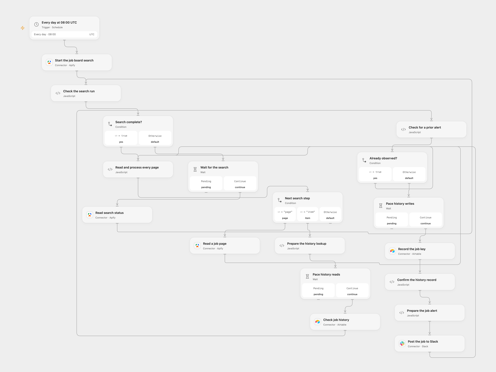

# Watch Competitor Hiring in Slack

Monitor company job boards and post newly observed positions to Slack.

<picture>
  <source media="(prefers-color-scheme: dark)" srcset="preview-dark.png">
  
</picture>

[Open Flow JSON](templates/watch-competitor-hiring-in-slack.openflow.json) · [n8n JSON](templates/watch-competitor-hiring-in-slack.n8n.json)

## Setup

Connect Apify, Airtable and Slack. Set the company board URLs or slugs in **Start the job board search** and select a Slack channel. Create an Airtable table with a text field named `Job key`; set the same base ID and table name in **Check job history** and **Record the job key**. In n8n, use Header Auth named `Authorization` with value `Bearer YOUR_APIFY_TOKEN` on each HTTP Request, connect Slack, and configure the company list and channel. Activate one format and avoid overlapping runs.

## Behavior

At 08:00 UTC, query the configured company boards through the Apify Actor, up to 1,000 positions per company, then notify Slack about previously unseen platform/company/job IDs. The first run sends all observed jobs. The Actor can return partial data if a board fails; check its SUMMARY record in Apify for board-level failures. The Actor supports Greenhouse, Lever, Ashby and SmartRecruiters. Open Flow starts on the minute boundary; n8n uses a fixed second within the scheduled minute.

Open Flow reads all dataset pages once before processing, then rereads and validates each page and checks and records each key in Airtable before posting. A later page or write failure can leave earlier alerts sent. History requests are spaced by at least 250 ms; other traffic to the base can still hit Airtable rate limits. Airtable history is retained until you remove it; n8n records the full batch before sending and stops when its existing history count plus incoming batch size exceeds 20,000, even if some keys are repeats. Open Flow suppresses repeated keys within the same dataset; n8n can send all rows sharing a newly seen key. These histories are separate. A failed or uncertain history or Slack write may have succeeded; inspect both before retrying. Earlier alerts can already have been sent and a recorded key can suppress a failed Slack alert.

Inspiration &amp; credits

## Changes to the source

- Use UTC in place of the source instance timezone, configure the Slack channel, and omit the n8n workflow footer. n8n uses standard HTTP requests to avoid automatic retries of an uncertain Actor start. Open Flow stores seen keys in Airtable; the source n8n node stores them in workflow state.

Adapted from [Watch competitor hiring across four ATS job boards](https://github.com/enescingoz/awesome-n8n-templates/blob/827110332c21cbe000ab13f6d292d5adb1f1f8db/Other_Integrations_and_Use_Cases/Watch%20competitor%20hiring%20across%20four%20ATS%20job%20boards.json) in [enescingoz/awesome-n8n-templates](https://github.com/enescingoz/awesome-n8n-templates).

Source collection notice: © 2024–2026 Enes Cingoz, [CC BY 4.0](https://github.com/enescingoz/awesome-n8n-templates/blob/827110332c21cbe000ab13f6d292d5adb1f1f8db/LICENSE). The source export does not identify a separate template author or license. See [repository licensing](../../README.md#licensing) for the scope of OOMOL contributions and third-party material.

