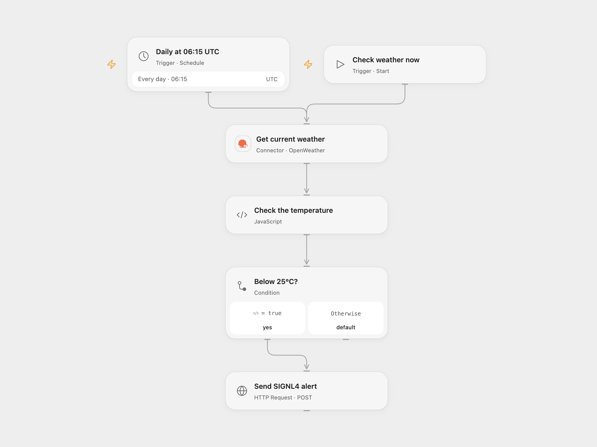

# Weather Temperature to SIGNL4 Alert

Send a SIGNL4 alert when a city’s current temperature is below 25°C.

<picture>
  <source media="(prefers-color-scheme: dark)" srcset="preview-dark.png">
  
</picture>

[Open Flow JSON](templates/weather-temperature-to-signl4-alert.openflow.json) · [n8n JSON](templates/weather-temperature-to-signl4-alert.n8n.json)

## Setup

Connect OpenWeather in **Get current weather** and set the city name. The starting city is Berlin and the request uses metric units. In SIGNL4, copy the team or integration webhook URL and store the complete URL as a secret Variable. Bind **Send SIGNL4 alert** URL to that Variable after importing. The URL contains the team secret; keep it private. In n8n connect OpenWeather and SIGNL4 credentials, and set the same city in **OpenWeatherMap**. Enable one format only.

## Behavior

Run manually or every day at 06:15 UTC. The source schedule used the n8n instance timezone; review the timezone before enabling. n8n Schedule Trigger uses a stable second within the minute, while Open Flow runs on the minute boundary. If the current temperature is strictly below 25°C, the workflow sends one alert containing the temperature and the returned latitude and longitude. At exactly 25°C or above it sends none. The alert retains the source title, external ID `weather-alert` and new status.

An invalid temperature, missing coordinates for an alert, weather request failure or failed alert request stops the run. A successful SIGNL4 response confirms event acceptance, not that a person was notified. An uncertain alert request may have succeeded; check SIGNL4 before retrying. Each triggering run can produce another alert. No automatic retry or resolution is configured. The HTTP request carries the secret in its URL, so restrict access to execution logs.

## Changes to the source

- Make UTC explicit and validate weather data before an alert.
- Use the OpenWeather Action and SIGNL4’s inbound webhook with a secret URL Variable in Open Flow; n8n retains its native nodes and credentials.

Source and license

Adapted from [Send weather alerts to your mobile phone with OpenWeatherMap and SIGNL4](https://github.com/Zie619/n8n-workflows/blob/ae8cf6dc5b873cbb4f74587aa9180ed3a9f70682/workflows/Manual/1216_Manual_Schedule_Automate_Scheduled.json) in [Zie619/n8n-workflows](https://github.com/Zie619/n8n-workflows). The matching [n8n community listing](https://n8n.io/workflows/966-send-weather-alerts-to-your-mobile-phone-with-openweathermap-and-signl4/) credits Ron. The original template does not state a separate license.

The collection’s [MIT notice](https://github.com/Zie619/n8n-workflows/blob/94007c1445d9258a7da116646b79473e7c7c3282/LICENSE) is pinned at a later revision. This is the collection notice at that revision; it does not establish a separate original template author's license. Our changes are listed above; see [repository licensing](../../README.md#licensing).

> MIT License
>
> Copyright (c) 2025 Zie619
>
> Permission is hereby granted, free of charge, to any person obtaining a copy
> of this software and associated documentation files (the "Software"), to deal
> in the Software without restriction, including without limitation the rights
> to use, copy, modify, merge, publish, distribute, sublicense, and/or sell
> copies of the Software, and to permit persons to whom the Software is
> furnished to do so, subject to the following conditions:
>
> The above copyright notice and this permission notice shall be included in all
> copies or substantial portions of the Software.
>
> THE SOFTWARE IS PROVIDED "AS IS", WITHOUT WARRANTY OF ANY KIND, EXPRESS OR
> IMPLIED, INCLUDING BUT NOT LIMITED TO THE WARRANTIES OF MERCHANTABILITY,
> FITNESS FOR A PARTICULAR PURPOSE AND NONINFRINGEMENT. IN NO EVENT SHALL THE
> AUTHORS OR COPYRIGHT HOLDERS BE LIABLE FOR ANY CLAIM, DAMAGES OR OTHER
> LIABILITY, WHETHER IN AN ACTION OF CONTRACT, TORT OR OTHERWISE, ARISING FROM,
> OUT OF OR IN CONNECTION WITH THE SOFTWARE OR THE USE OR OTHER DEALINGS IN THE
> SOFTWARE.

