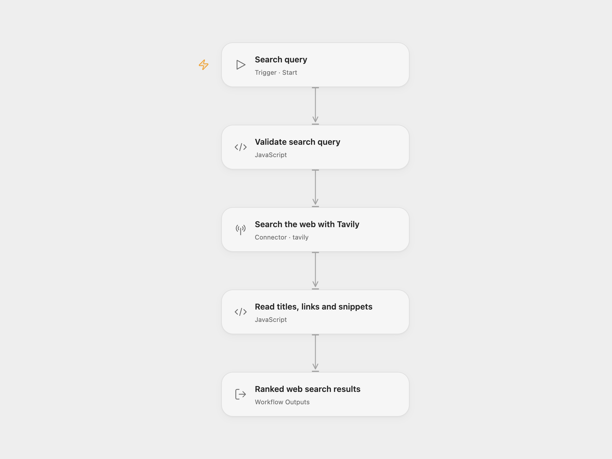

# Web Search Results

Search the web with Tavily and return up to five results with their titles, URLs and snippets.

<picture>
  <source media="(prefers-color-scheme: dark)" srcset="preview-dark.png">
  
</picture>

[Open Flow JSON](templates/web-search-results.openflow.json) · [n8n JSON](templates/web-search-results.n8n.json)

## Setup and use

Connect Tavily on **Search the web with Tavily**. Use Run and supply:

```json
{ "query": "latest AI agent frameworks" }
```

In n8n, edit **Search Query** and select an HTTP Header Auth credential on **Tavily Search** with name `Authorization` and value `Bearer <your Tavily API key>`. Execute the workflow manually.

Each run has one search step. It requests up to five results using Tavily’s `basic` search depth and `general` topic. Generated answers, raw page content, images and automatic parameter selection are disabled. Your query is sent to Tavily and uses your account’s API allowance. Results and order depend on Tavily; the workflow preserves that order.

Open Flow returns a `results` array containing `{title, url, snippet}`. n8n returns one item per result with the same fields. No matches is a successful empty list. Missing results or malformed entries stop the run; request failures are not converted to empty search results. There are no workflow-level retries or duplicate suppression. The provider manages its own request behavior. This template does not summarize results, call an LLM or crawl the linked pages.

<details>
<summary>Inspiration &amp; credits</summary>

## Changes to the source

- Replace Superhighway with Tavily in both formats. [The original service endpoint](https://superhighway.walls.sh/) now reports that Superhighway shut down on October 26, 2026. The replacement changes the search backend, ranking and snippets.
- Preserve the five-result limit and `{title, url, snippet}` output, mapping Tavily’s `content` field to `snippet`.
- Keep API keys in normal account credentials and build n8n’s JSON body as an object.
- Validate queries and result records, preserving empty searches and rejecting failed or malformed responses.

Adapted from [Live Web Research Agent with Superhighway](https://github.com/enescingoz/awesome-n8n-templates/blob/827110332c21cbe000ab13f6d292d5adb1f1f8db/AI_Research_RAG_and_Data_Analysis/Live%20Web%20Research%20Agent%20with%20Superhighway.json) in [enescingoz/awesome-n8n-templates](https://github.com/enescingoz/awesome-n8n-templates).

Source collection notice: © 2024–2026 Enes Cingoz, [CC BY 4.0](https://github.com/enescingoz/awesome-n8n-templates/blob/827110332c21cbe000ab13f6d292d5adb1f1f8db/LICENSE). The source export does not identify a separate template author or license. See [repository licensing](../../README.md#licensing) for the scope of OOMOL contributions and third-party material.

</details>
