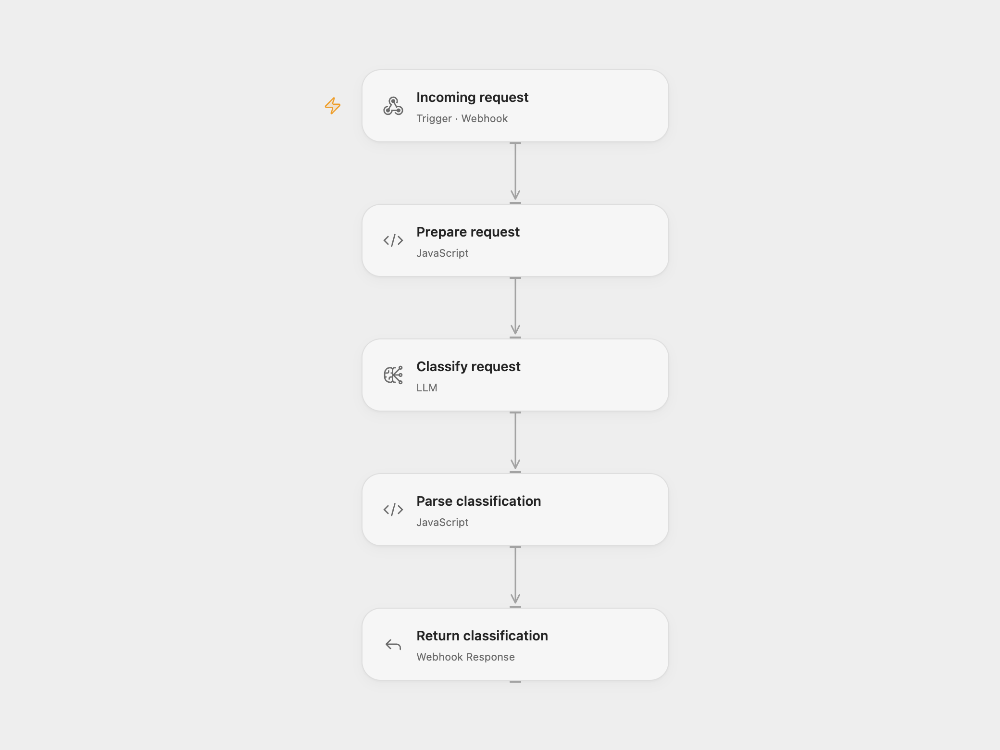

# Webhook Request Classifier

Classify an incoming request and return a route, priority, and one-sentence summary. Routes are support, sales, technical, and general. The workflow does not create tickets or contact a team.

<picture>
  <source media="(prefers-color-scheme: dark)" srcset="preview-dark.png">
  
</picture>

[Open Flow JSON](templates/webhook-request-classifier.openflow.json) · [n8n JSON](templates/webhook-request-classifier.n8n.json)

## Setup

For Open Flow, import the JSON and select a configured Claude Haiku 4.5 model in **Classify request**. For n8n, select an Anthropic credential in **Claude Classifier**.

Publish and enable the workflow. Send a JSON POST request with a `request` field to the webhook URL:

```json
{
  "request": {
    "subject": "Team plan pricing",
    "message": "Can you send a quote for 25 seats?"
  }
}
```

The `request` value can contain your own JSON fields or a text string. Both formats use the same wrapper. A successful response has `received: true`, a `route`, a `priority` of `high`, `medium`, or `low`, and a `summary`.

Malformed model output returns the fallback `general` / `medium` with summary `Unable to classify`. Unknown route and priority labels become `general` and `medium`. Model request failures still fail the workflow. Open Flow waits up to 60 seconds for classification; an HTTP timeout does not cancel the run. Review model accuracy for your request types before using the result to make routing decisions.

## Changes to the source

- Wait for classification and parsing before sending the HTTP response.
- Serialize request and response JSON safely, including quotes and multiline values.
- Accept the same explicit `request` wrapper in both formats.
- Parse complete or fenced JSON containing braces inside strings, retain the malformed-output fallback, and normalize unknown labels.
- Remove the source switch with no configured downstream actions.

<details>
<summary>Source and license</summary>

Adapted from [Claude Smart Webhook AI Router](https://github.com/enescingoz/awesome-n8n-templates/blob/827110332c21cbe000ab13f6d292d5adb1f1f8db/OpenAI_and_LLMs/Claude%20Smart%20Webhook%20AI%20Router.json) in [enescingoz/awesome-n8n-templates](https://github.com/enescingoz/awesome-n8n-templates).

Source collection notice: © 2024–2026 Enes Cingoz, [CC BY 4.0](https://github.com/enescingoz/awesome-n8n-templates/blob/827110332c21cbe000ab13f6d292d5adb1f1f8db/LICENSE). The source export does not identify a separate template author or license. This adaptation includes the changes listed above; see [repository licensing](../../README.md#licensing) for the scope of OOMOL contributions and third-party material.

</details>
