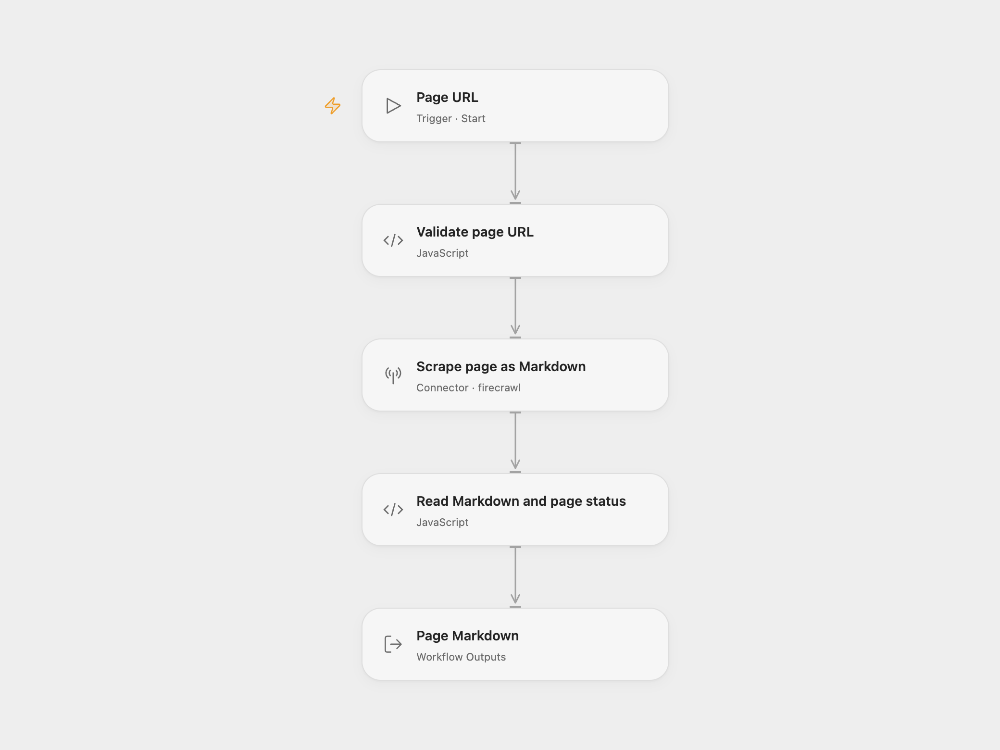

# Webpage Markdown Extractor

Fetch one page through Firecrawl and return its main content as Markdown.

<picture>
  <source media="(prefers-color-scheme: dark)" srcset="preview-dark.png">
  
</picture>

[Open Flow JSON](templates/webpage-markdown-extractor.openflow.json) · [n8n JSON](templates/webpage-markdown-extractor.n8n.json)

## Setup and use

Connect Firecrawl on **Scrape page as Markdown**. Use Run and supply one URL:

```json
{ "url": "https://example.com/page" }
```

In n8n, select an HTTP Header Auth credential on **FireCrawl**, with name `Authorization` and value `Bearer <your Firecrawl API key>`. Call the imported workflow through Execute Sub-workflow with the string field `url`. The workflow returns the Markdown as `response` and the target website’s reported HTTP status as `pageStatus`, or `null` when no valid status was supplied.

Each run has one scrape step. It requests main content in Markdown, with a 30-second Firecrawl timeout and `maxAge: 0` to request fresh content. Firecrawl manages rendering, target redirects and extraction. Extraction is subject to the website and your Firecrawl account’s limits and API allowance. The URL is sent to Firecrawl. This workflow does not crawl linked pages, generate a summary or write the extracted content to another service.

A successful Firecrawl request can contain a target error page such as HTTP 404. This template preserves that content and exposes `pageStatus` so callers can decide how to use it. Firecrawl request failures, unsuccessful service responses and missing or blank Markdown stop the run. There are no workflow-level retries configured; provider request retries remain service controlled.

<details>
<summary>Inspiration &amp; credits</summary>

## Changes to the source

- Declare the input as `url`, matching the source’s documented call shape instead of its undeclared `query.url` binding.
- Use the current Firecrawl v2 scrape API in both formats. [Firecrawl v1 shuts down on December 10, 2026](https://docs.firecrawl.dev/migrate-to-v2).
- Preserve the source v1 freshness setting explicitly with `maxAge: 0`; v2 otherwise defaults to a two-day cache allowance.
- Build the n8n JSON body as an object, remove the empty header entry and keep the API key in its credential.
- Reject unsuccessful or empty scrape results and include the reported page status alongside the Markdown.

Adapted from [Using External Workflows as Tools in n8n](https://github.com/enescingoz/awesome-n8n-templates/blob/827110332c21cbe000ab13f6d292d5adb1f1f8db/Other_Integrations_and_Use_Cases/Using%20External%20Workflows%20as%20Tools%20in%20n8n.json) in [enescingoz/awesome-n8n-templates](https://github.com/enescingoz/awesome-n8n-templates).

Source collection notice: © 2024–2026 Enes Cingoz, [CC BY 4.0](https://github.com/enescingoz/awesome-n8n-templates/blob/827110332c21cbe000ab13f6d292d5adb1f1f8db/LICENSE). The source export does not identify a separate template author or license. See [repository licensing](../../README.md#licensing) for the scope of OOMOL contributions and third-party material.

</details>
