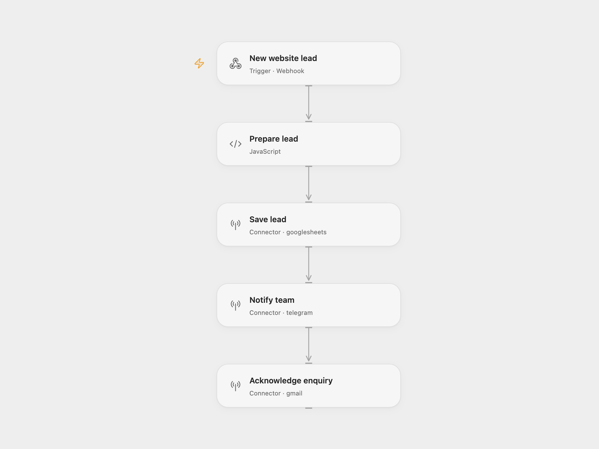

# Website Lead Capture

Capture a website enquiry, save it to Google Sheets, notify your team on Telegram, and send a courtesy email through Gmail. The messages retain the original Italian copy.

<picture>
  <source media="(prefers-color-scheme: dark)" srcset="preview-dark.png">
  
</picture>

[Open Flow JSON](templates/website-lead-capture.openflow.json) · [n8n JSON](templates/website-lead-capture.n8n.json)

## Setup

Create a sheet named `Lead` with these headers in columns A–F:

| Data | Nome | Email | Telefono | Messaggio | Stato |
| --- | --- | --- | --- | --- | --- |

For Open Flow, import the JSON and configure:

| Node | Configuration |
| --- | --- |
| Save lead | Connect Google Sheets; replace `YOUR_SPREADSHEET_ID`. The default range is `'Lead'!A:F`. |
| Notify team | Connect your Telegram bot; replace `@YOUR_TELEGRAM_CHANNEL` with your chat ID or channel username. |
| Acknowledge enquiry | Connect the Gmail account that will send acknowledgments. |
| Prepare lead | Set `timezone` for timestamps and `signature` for the email. The timezone starts at `UTC`. |

For n8n, import the JSON, connect the same three services, and configure the sheet, Telegram destination, and email signature in the corresponding nodes. Change the workflow timezone if needed; the exported template uses `UTC`.

Publish and enable the workflow when configured, then use the webhook URL shown by your platform. Send a POST request with a JSON body such as:

```json
{
  "name": "Ada",
  "email": "ada@example.com",
  "phone": "+39 000 000 0000",
  "message": "Please contact me about your service."
}
```

The aliases `nome`, `telefono`, and `messaggio` are also accepted and take precedence over their English counterparts.

The webhook acknowledges receipt immediately with `{"message":"Workflow was started"}`. Acknowledgment does not confirm that the sheet write or notifications have completed. A valid email address is required.

If your form sends extra fields, add them to the Open Flow webhook body schema before use.

<details>
<summary>Inspiration &amp; credits</summary>

## Improvements to the source

- Validate the email address before any sheet write or notification.
- Escape submitted text in Telegram Markdown and send the email as plain text, preserving paragraphs.
- Write literal cell values with `RAW` formatting so submitted text is not interpreted as a spreadsheet formula.
- Make the execution order explicit: save the row, send the Telegram alert, then send the email. A failure stops later steps.
- Bind notification and reply data to the prepared lead, preserving it even when the sheet returns only a write confirmation.
- Provide a column schema, clear setup placeholders, and an explicit UTC timezone.

Repeated requests create additional rows and messages. Telegram text must fit its 4,096-character message limit.

Adapted from [Website leads to Google Sheets with Telegram alert and auto-reply (Italian)](https://github.com/enescingoz/awesome-n8n-templates/blob/827110332c21cbe000ab13f6d292d5adb1f1f8db/Google_Drive_and_Google_Sheets/Website%20leads%20to%20Google%20Sheets%20with%20Telegram%20alert%20and%20auto-reply%20(Italian).json) in [enescingoz/awesome-n8n-templates](https://github.com/enescingoz/awesome-n8n-templates).

Source collection notice: © 2024–2026 Enes Cingoz, [CC BY 4.0](https://github.com/enescingoz/awesome-n8n-templates/blob/827110332c21cbe000ab13f6d292d5adb1f1f8db/LICENSE). The source export does not identify a separate template author or license. This adaptation includes the changes listed above; see [repository licensing](../../README.md#licensing) for the scope of OOMOL contributions and third-party material.

</details>
