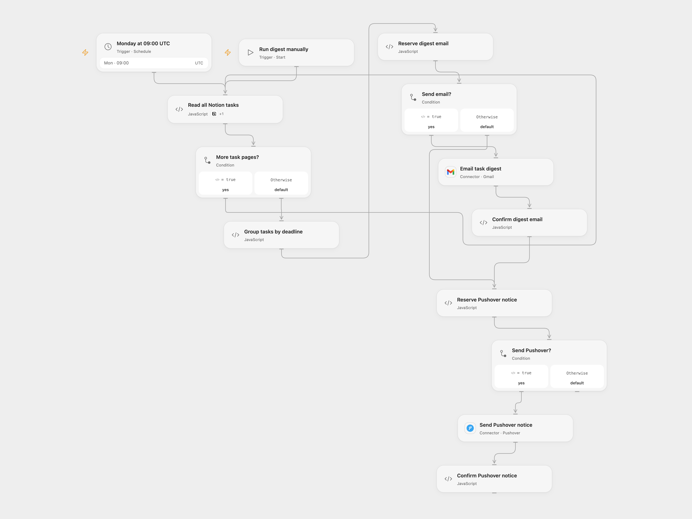

# Weekly Notion Task Deadline Digest

Email overdue and upcoming Notion tasks and send a Pushover notification each week.

<!-- template-actions:start -->
 
<!-- template-actions:end -->

<picture>
  <source media="(prefers-color-scheme: dark)" srcset="preview-dark.png">
  
</picture>

## Setup

Connect Notion, Gmail and Pushover. In **Read all Notion tasks**, configure the data source ID. The source needs a title property and properties named deadline (date), prio (select), status (status or select) and tags (multi-select). Set an HTTPS board URL and email recipient. Set the Pushover user key in **Send Pushover notice**, enable persistent State and prevent overlapping runs.

## Behavior

Every Monday at 09:00 UTC, or on manual run, the workflow reads all pages, ignores tasks without a deadline, sorts the rest and groups deadlines at or before now as overdue and later deadlines as upcoming. It emails the digest and sends the Pushover notice. Both empty groups are allowed. Date-only deadlines are compared at midnight UTC. Task data is included in email and execution history. In Open Flow, each Code node input and output must fit within 1 MiB, including the accumulated Notion pages and rendered digest.

Each action is checkpointed by UTC week. If email or notice delivery is unknown, inspect Gmail or Pushover before rerunning. In Open Flow enter its pending key in the corresponding reserve node and select confirmed if sent or absent if not; rerun and clear the fields.

In n8n

In n8n set the data source ID and board URL in **Configure digest**, set SMTP and Pushover credentials and the sender address in **Send Email**, select a Data Table with item_key and status text columns, and configure the recipient and Pushover user key using credentials or an expression. Choose one format. In n8n inspect the Data Table and services, finish any missing action manually and mark done, or remove the row only if neither action happened.

Inspiration &amp; credits

Read all pages, render both empty and populated groups, and checkpoint notifications.

Adapted from [Weekly update about Notion tasks](https://github.com/Zie619/n8n-workflows/blob/ae8cf6dc5b873cbb4f74587aa9180ed3a9f70682/workflows/Filter/0572_Filter_Schedule_Send_Scheduled.json) in [Zie619/n8n-workflows](https://github.com/Zie619/n8n-workflows). The source export does not identify a separate template author or license.

The collection’s [MIT notice](https://github.com/Zie619/n8n-workflows/blob/94007c1445d9258a7da116646b79473e7c7c3282/LICENSE) is pinned at a later revision. This is the collection notice at that revision; it does not establish a separate original template author's license. Our changes are listed above; see [repository licensing](../../README.md#licensing).

> MIT License
>
> Copyright (c) 2025 Zie619
>
> Permission is hereby granted, free of charge, to any person obtaining a copy
> of this software and associated documentation files (the "Software"), to deal
> in the Software without restriction, including without limitation the rights
> to use, copy, modify, merge, publish, distribute, sublicense, and/or sell
> copies of the Software, and to permit persons to whom the Software is
> furnished to do so, subject to the following conditions:
>
> The above copyright notice and this permission notice shall be included in all
> copies or substantial portions of the Software.
>
> THE SOFTWARE IS PROVIDED "AS IS", WITHOUT WARRANTY OF ANY KIND, EXPRESS OR
> IMPLIED, INCLUDING BUT NOT LIMITED TO THE WARRANTIES OF MERCHANTABILITY,
> FITNESS FOR A PARTICULAR PURPOSE AND NONINFRINGEMENT. IN NO EVENT SHALL THE
> AUTHORS OR COPYRIGHT HOLDERS BE LIABLE FOR ANY CLAIM, DAMAGES OR OTHER
> LIABILITY, WHETHER IN AN ACTION OF CONTRACT, TORT OR OTHERWISE, ARISING FROM,
> OUT OF OR IN CONNECTION WITH THE SOFTWARE OR THE USE OR OTHER DEALINGS IN THE
> SOFTWARE.

