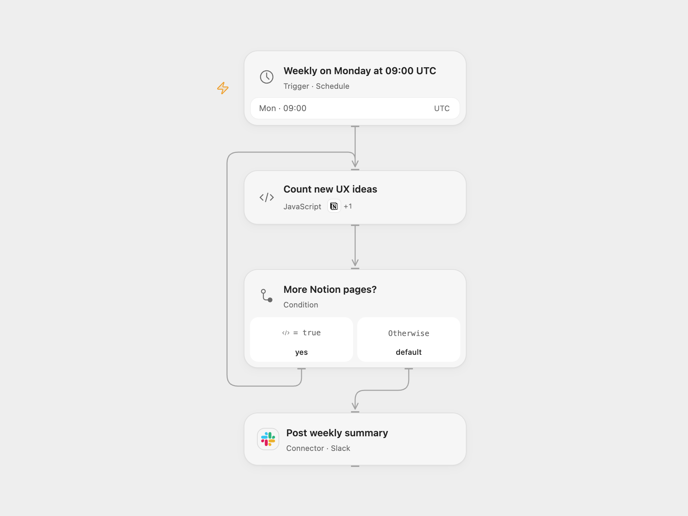

# Weekly Notion UX Ideas to Slack

Count new UX ideas in a Notion data source and post a weekly Slack summary.

<picture>
  <source media="(prefers-color-scheme: dark)" srcset="preview-dark.png">
  
</picture>

[Open Flow JSON](templates/weekly-notion-ux-ideas-to-slack.openflow.json) · [n8n JSON](templates/weekly-notion-ux-ideas-to-slack.n8n.json)

## Setup

Connect Notion with read access to the data source and Slack with permission to post to the destination channel. In **Count new UX ideas**, set the data source ID and the exact name of the multi-select property containing the option `UX`. Set the channel ID in **Post weekly summary**. In n8n, set those values in **Configure report**, select Notion credentials in **Query ideas**, and select Slack credentials and channel in **Post weekly summary**. Activate only one format.

## Behavior

Every Monday at 09:00 UTC, query all pages created in the preceding seven days and count distinct page IDs whose configured multi-select contains exactly `UX`. A summary is sent even when the count is zero. The query is paginated; a failed read stops before sending. Data source permissions, indexing, and workflow execution limits apply. The query is not a snapshot while pages change. If a Slack send fails or its result is unknown, inspect the channel before rerunning; a rerun can create a duplicate message.

Inspiration &amp; credits

## Changes to the source

- Replace the disabled private Notion source and personal mock records with required data source and property configuration.
- Use the current Notion data source API, explicitly schedule UTC, and send zero counts.

Adapted from [Weekly Notion UX ideas to Slack](https://github.com/Zie619/n8n-workflows/blob/ae8cf6dc5b873cbb4f74587aa9180ed3a9f70682/workflows/Code/0308_Code_Schedule_Automate_Scheduled.json) in [Zie619/n8n-workflows](https://github.com/Zie619/n8n-workflows). The source export does not identify a separate template author or license.

The collection’s [MIT notice](https://github.com/Zie619/n8n-workflows/blob/94007c1445d9258a7da116646b79473e7c7c3282/LICENSE) is pinned at a later revision. This is the collection notice at that revision; it does not establish a separate original template author's license. Our changes are listed above; see [repository licensing](../../README.md#licensing).

> MIT License
>
> Copyright (c) 2025 Zie619
>
> Permission is hereby granted, free of charge, to any person obtaining a copy
> of this software and associated documentation files (the "Software"), to deal
> in the Software without restriction, including without limitation the rights
> to use, copy, modify, merge, publish, distribute, sublicense, and/or sell
> copies of the Software, and to permit persons to whom the Software is
> furnished to do so, subject to the following conditions:
>
> The above copyright notice and this permission notice shall be included in all
> copies or substantial portions of the Software.
>
> THE SOFTWARE IS PROVIDED "AS IS", WITHOUT WARRANTY OF ANY KIND, EXPRESS OR
> IMPLIED, INCLUDING BUT NOT LIMITED TO THE WARRANTIES OF MERCHANTABILITY,
> FITNESS FOR A PARTICULAR PURPOSE AND NONINFRINGEMENT. IN NO EVENT SHALL THE
> AUTHORS OR COPYRIGHT HOLDERS BE LIABLE FOR ANY CLAIM, DAMAGES OR OTHER
> LIABILITY, WHETHER IN AN ACTION OF CONTRACT, TORT OR OTHERWISE, ARISING FROM,
> OUT OF OR IN CONNECTION WITH THE SOFTWARE OR THE USE OR OTHER DEALINGS IN THE
> SOFTWARE.

